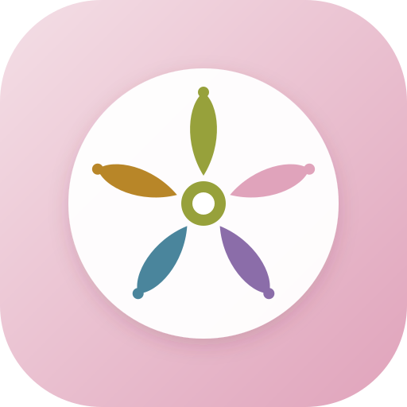

# Life Capital · Quản trị Năng lượng & Thời gian

Ứng dụng web cá nhân hoá giúp quản trị năng lượng, tối ưu hoá quỹ 168 giờ và cân bằng 5 loại vốn cuộc sống (Health, Relationship, Experience, Skill, Finance & Career).

---

## 1. Triết lý & Mô hình Cốt lõi

- **5 Loại Vốn Cuộc Sống (The 5 Life Capitals)**:
  1. 🌿 **Sức khỏe (Health)** `#97A13B` - Thể lực, giấc ngủ, rèn luyện, dinh dưỡng, tái tạo năng lượng thể chất.
  2. 🌸 **Quan hệ (Relationship)** `#E0A3BB` - Gia đình, bạn bè, người thương, kết nối xã hội sâu sắc.
  3. 🔮 **Trải nghiệm (Experience)** `#8b6da9` - Khám phá, du lịch, nghệ thuật, niềm vui sống, mở rộng góc nhìn.
  4. 🌊 **Kỹ năng (Skill)** `#4a859c` - Học hỏi, đọc sách, tích luỹ tri thức, rèn luyện chuyên môn.
  5. 🪙 **Tài chính / Công việc (Finance & Career)** `#b88628` - Sự nghiệp, tạo ra giá trị, quản lý tài sản.

- **Cơ chế Nạp ▲ (Recharge) vs Tiêu ▼ (Drain)**:
  - **Nạp (▲)**: Hoạt động bồi đắp, tích luỹ và phục hồi vốn sống.
  - **Tiêu (▼)**: Hoạt động tiêu hao, sử dụng năng lượng hoặc tạo áp lực (họp hành, deadline, làm việc căng thẳng).

- **Khung 168 Giờ (The 168-Hour Framework)**:
  - 1 tuần = 24h × 7 ngày = 168 giờ.
  - Mọi người đều có 168 giờ bình đẳng như nhau. Ứng dụng giúp bạn nhìn rõ số giờ đã phân bổ, số giờ còn trống cho sinh hoạt cá nhân và cảnh báo khi ghi chép vượt quá 168h.

- **Chỉ số Pin Năng Lượng (Daily Battery & Burnout Warning)**:
  - Cán cân mỗi ngày: Net = Tổng Nạp (▲) - Tổng Tiêu (▼).
  - Pin xanh khi nạp dương, pin đỏ khi tiêu hao nhiều hơn nạp.
  - Cảnh báo **⚡ Kiệt sức** tự động kích hoạt nếu ngày đó có từ 6h tiêu hao hoặc thâm hụt ≥ 4h mà không được nghỉ ngơi bù đắp (có thể tùy chỉnh ngưỡng trong Cài đặt).

- **Bánh xe cuộc đời (Wheel of Life Radar Chart)**:
  - Biểu đồ radar 5 trục SVG chuẩn công thái học thể hiện độ tròn trịa và cân bằng giữa các nguồn vốn mỗi tuần.
  - Tích hợp vòng đo 33% - 66% - 100% mục tiêu, tính toán tự động Điểm cân bằng bánh xe (Balance Score).

---

## 2. Bảng Màu & Hệ thống Thiết kế (Design System)

- **Màu chủ đạo (Primary)**: `#E0A3BB` (Mauve Rose)
- **4 Màu bổ trợ (Supporting)**:
  - `#F4DFE6` (Blush Soft) - Nền thanh tiến trình, hover state, card phụ
  - `#D6E6E7` (Mist Cyan) - Nhãn thời gian, trạng thái pin cân bằng
  - `#C5CC82` (Sage Olive) - Trạng thái nạp nhẹ, nhãn đạt chuẩn
  - `#97A13B` (Deep Olive Green) - Chỉ báo Nạp ▲, pin sạc dương
- **Nền web**: Pha thêm 5% màu trắng (`#fdfcfd` / `color-mix(in srgb, #faf7f8 95%, #ffffff 5%)`) mang lại cảm giác sáng sủa, thanh lịch và trong trẻo.
- **Hỗ trợ giao diện Sáng / Tối (Light & Dark Mode) chuẩn công thái học**:
  - Hỗ trợ chuyển đổi thủ công hoặc tự động theo hệ điều hành (`color-scheme: dark`).
  - Nền tối sâu trầm ấm `#151113`, thẻ `#1f191c`, chữ tương phản cao, chống lóa mắt vào ban đêm.

---

## 3. Các Tính năng Nổi bật & Tối ưu Hoàn thiện

1. ⚡ **Command Bar Ghi nhanh bằng ngôn ngữ tự nhiên**:
   - Nhập: *"Mai 18h đánh cầu lông 2 tiếng"* hoặc *"Hôm nay 20h đọc sách 1h"*.
   - Tự động nhận diện ngày, giờ bắt đầu, thời lượng, loại vốn và tác động Nạp/Tiêu theo thời gian thực; dòng xem trước luôn ghi rõ thứ và ngày (vd *Hôm qua · Thứ 5, 08/10*).
   - **Ngày:** *hôm nay, mai, ngày kia/mốt, hôm qua, tối qua, hôm kia*; ngày cụ thể *ngày 9 tháng 10 (năm 2026), 9 tháng 11, 09/10, 09-10, 09.10, 9/10/2026, ngày 15*; thứ *thứ 2 / t2 / thứ hai / chủ nhật* kèm *tuần này, tuần sau, tuần tới, tuần trước, tuần sau nữa* (đứng trước hoặc sau). Không nói tuần thì hiểu là lần tới gần nhất.
   - **Giờ:** *18h, 6h30, 20:00, 5h sáng, 2 giờ chiều, tối 8h, 8 giờ rưỡi, 12h đêm, 14-16h, 2-4h chiều*.
   - **Thời lượng:** *2 tiếng, 1.5h, 1h30, 1 tiếng 30 phút, một tiếng rưỡi, hai tiếng, 45 phút, mười lăm phút, nửa tiếng*.
   - "Mai" là tên người khi đi sau *gặp, cho, với…* hoặc viết hoa giữa câu (*Gọi điện cho Mai 20h*).
2. 📅 **3 Chế độ Xem Lịch Biểu**:
   - **Tuần chi tiết**: 7 thẻ ngày responsive kèm Pin năng lượng và nút thêm nhanh.
   - **Dòng thời gian 24h (Timeline)**: Trục thời gian dọc từ 06:00 đến 24:00, trực quan hoá các khối sự kiện. Tích hợp thuật toán **chia làn song song (Lane Splitting)** khi các sự kiện bị trùng khung giờ.
   - **Lưới 53 tuần**: Toàn cảnh cả năm có thanh cuộn và tự động định vị tuần hiện tại.
3. ⚙️ **Trung Tâm Cài Đặt & Dữ Liệu Tinh Gọn (Settings Modal)**:
   - Nút `⚙️` trên header tập trung toàn bộ cấu hình: Chuyển theme (Sáng/Tối/Theo máy), Sao lưu JSON/CSV, Khôi phục, Đặt thời lượng mặc định và Ngưỡng báo kiệt sức.
   - Thanh điều hướng chính gồm 4 tab: **Lịch biểu**, **Hộp việc**, **Tổng quan & 168h**, **Danh mục vốn**.
4. 🏆 **Bản Tin Tổng Kết Tuần Linh Hoạt (Weekly Review with Week Selector)**:
   - Cho phép chọn xem báo cáo tổng kết của **bất kỳ tuần nào** trong năm (từ W1 đến W52/53) qua bộ chuyển tuần `[ ◀ | ▶ ]` và menu thả xuống ngay trong popup.
   - Đánh giá Điểm sáng của tuần, Vốn cần cứu trợ, Bánh xe cuộc đời và gợi ý kế hoạch tuần mới.
5. 🛠️ **Popup Thêm / Sửa Hoạt Động Tinh Gọn**:
   - Giao diện form tinh gọn chỉ gồm các trường thông tin cần thiết, tự động đóng popup khi bấm Lưu.
   - Nhập bằng bàn phím: trong popup, mỗi lần nhấn Enter chuyển sang ô kế tiếp (Tên → Loại vốn → Tác động → Giờ bắt đầu → Thời lượng → Lặp lại → Đến hết ngày); Enter ở ô cuối cùng thì lưu. Khi đang gõ có dấu, một lần Enter vừa chốt chữ vừa chuyển ô. `Cmd/Ctrl + Enter` lưu ngay từ bất kỳ ô nào.
   - Thanh ghi nhanh: khi đang gõ có dấu, một lần Enter vừa chốt chữ vừa ghi hoạt động (Chrome và Safari).
   - Hỗ trợ tạo chuỗi lặp định kỳ (Hằng ngày, Ngày làm việc, Hằng tuần) kèm ngày kết thúc chuỗi, cả khi thêm mới lẫn khi sửa một hoạt động lẻ (hoạt động đó thành buổi đầu của chuỗi).
   - Xóa chuỗi có hai lựa chọn: **Xóa từ ngày này về sau** (giữ các buổi trước ngày đang mở) và **Xóa toàn bộ chuỗi**; hộp xác nhận ghi rõ số buổi bị xóa và được giữ.
6. 🎡 **Bánh Xe Cuộc Đời (Radar Chart) Chuẩn Hoá**:
   - Khung hình mở rộng chống cắt chữ trên mọi kích thước màn hình.
   - Người mới bắt đầu với mục tiêu tuần bằng 0 cho mọi loại vốn; bánh xe và bản tổng kết hiện nút **"Đặt mục tiêu"** dẫn tới tab Danh mục vốn, không chấm điểm hay đưa khuyến nghị dựa trên số giả định.
   - Tuần chưa có hoạt động nào: bản tổng kết hiện trạng thái trống kèm nút "Ghi hoạt động" thay vì đưa ra nhận định.
   - Tích hợp chỉ số Điểm cân bằng bánh xe (Balance Score) trực quan.
7. 🌐 **Động cơ Đa năm tự động (Multi-Year Engine)**:
   - Tự động nhận diện và tính toán 52/53 tuần theo chuẩn quốc tế **ISO 8601**.
   - Tự nhận năm ISO hiện tại mỗi khi mở app; có nút `[ ◀ | ▶ ]` chuyển năm linh hoạt.
8. 💾 **Bảo mật & Toàn vẹn Dữ liệu (Security & Data Integrity)**:
   - Bộ lọc `cleanState` khử mã độc và chống Prototype Pollution khi nhập sao lưu JSON.
   - Phòng chống CSV Injection tự động khi xuất dữ liệu bảng tính.
   - Tải tệp sao lưu `.json` và lịch trình `.csv` trực tiếp qua Native Blob Download.
   - Dữ liệu lưu trong `localStorage` của trình duyệt (khoảng 300 KB mỗi năm với 10 hoạt động/ngày). App xin trình duyệt giữ dữ liệu lâu dài (`navigator.storage.persist`), nhắc sao lưu khi quá 14 ngày chưa sao lưu, và hiện cảnh báo đỏ nếu không lưu được (bộ nhớ đầy hoặc bị chặn).
   - **Lưu ý Safari/iPhone:** Safari có thể tự xóa dữ liệu của trang web nếu bạn không mở trong 7 ngày. Hãy "Thêm vào Màn hình chính" và sao lưu `.json` định kỳ.
   - Mở nhiều tab cùng lúc an toàn: tab này lưu thì các tab khác tự nạp lại, không ghi đè dữ liệu của nhau.
   - **Gộp khi lưu (v0.1.1):** trước mỗi lần lưu, app kiểm tra xem tab hay cửa sổ khác có vừa ghi mà tab này chưa biết không (tab bị trình duyệt tạm dừng, trang mở lại từ bộ nhớ đệm, bản cũ của app còn mở). Nếu có thì gộp hai bên thay vì ghi đè. Bản cũ (không có cơ chế gộp) lưu đè thì app gộp lại ngay, hoặc ở lần mở sau nhờ bản sao lần ghi gần nhất (`lc2_mine`). Hộp việc được gộp theo từng việc.
   - **Bản tự lưu hằng ngày:** đầu mỗi ngày app giữ một bản (7 ngày gần nhất, trên máy đó). Cài đặt → Dữ liệu → *Bản tự lưu hằng ngày* → *Gộp lại* để thêm lại những hoạt động bị thiếu, không xóa gì.
9. 📱 **Chuẩn Progressive Web App (PWA)**:
   - Tích hợp `manifest.json` và `icon.svg` 5 cánh hoa độc quyền.
   - Cài đặt lên màn hình chính iPhone/Android, chạy toàn màn hình như Native App.
10. 📅 **Đẩy Một Chiều Sang Google Calendar (Google Calendar API v3)**:
   - Tích hợp chuẩn **Google Identity Services (GIS)** OAuth 2.0 cấp quyền trực tiếp phía Client (không cần máy chủ trung gian).
   - **Một chiều:** Life Capital → Google Calendar. Sửa hoặc xóa trực tiếp trên Google Calendar **không** cập nhật ngược về app, và có thể bị ghi đè ở lần đồng bộ sau.
   - Tự động đẩy khi **Thêm, Sửa, Xóa** hoạt động (kể cả chuỗi lặp định kỳ). Các thay đổi được xếp hàng và gửi lần lượt từng cái, nên không bị Google giới hạn tần suất khi tạo chuỗi dài.
   - **Không mất thay đổi:** quyền truy cập Google chỉ có hiệu lực 1 giờ. Khi hết hạn hoặc mất mạng, thay đổi được giữ ở trạng thái "chờ"; thanh tiêu đề hiện badge `⚠ GCal · Kết nối lại (N chờ)` hoặc `⏳ N chờ đồng bộ`. Bấm vào badge để kết nối lại, các thay đổi đang chờ sẽ được đẩy lên tự động.
   - Hoạt động chưa đặt giờ được tạo thành sự kiện cả ngày trên Google Calendar. Dữ liệu mẫu không bao giờ được đẩy lên.
   - Khi tắt *Tự động đồng bộ*: thêm và sửa không được gửi lên, nhưng lệnh **xóa** hoạt động đã có trên Google vẫn được ghi lại và hiện badge `⏳ N chờ đồng bộ (tự động đang tắt)`; bấm badge, bật lại tự động hoặc bấm *Đồng bộ tuần này* để gửi.
   - Tự động ánh xạ màu sắc Google Calendar (`colorId`) tương thích với 5 loại vốn sống (Xanh lá - Sức khỏe, Hồng - Quan hệ, Tím - Trải nghiệm, Xanh Cyan - Kỹ năng, Vàng - Tài chính).
   - Cung cấp nút đồng bộ hàng loạt `⟳ Đồng bộ tuần này` và công tắc bật/tắt tự động đồng bộ thời gian thực trong popup Cài đặt.
11. 🌱 **Khởi Đầu Trống & Dữ Liệu Mẫu Tùy Chọn**:
   - Lần đầu mở app, lịch trống kèm gợi ý cách ghi nhanh và nút **"Thử với dữ liệu mẫu"**: thêm khoảng 10 hoạt động ẩn danh vào tuần đang xem.
   - Banner "Đang dùng dữ liệu mẫu" có nút xóa toàn bộ dữ liệu mẫu bằng một chạm. Hoạt động mẫu nào bạn đã sửa sẽ được giữ lại như dữ liệu thật.
12. 🏷️ **Tùy Biến Từ Khóa Nhận Diện & Trí Nhớ AI Tự Học (Keyword Auto-tagging & Self-learning)**:
   - Cho phép người dùng tự do thêm/bớt từ khóa nhận diện cho từng loại vốn trong tab Danh mục vốn.
   - Loại vốn được đoán theo từ khóa khớp dài nhất (*học tiếng Anh* → Kỹ năng, không bị nhầm sang Quan hệ vì chữ *anh*).
   - Bộ nhớ `S.mem` ghi nhớ loại vốn bạn chọn trong popup cho từng tên hoạt động, để lần sau ghi nhanh cùng tên sẽ đoán đúng.

13. 📥 **Hộp Việc Chờ (v0.2.0)**:
   - Ghi những việc còn mơ hồ chưa có ngày giờ: ở tab **Hộp việc**, hoặc gõ dấu `+` ở đầu thanh ⚡ (vd *+ Chuẩn bị chuyến đi Đà Lạt*).
   - Chia mỗi việc thành các **việc nhỏ** có thứ tự và thời lượng (*Đặt vé xe 30p*, *Đặt homestay 1h30*; không ghi thì 1h). Đổi thứ tự bằng kéo hoặc nút ↑ ↓; bấm tên để sửa; tick khi xong.
   - **Máy tính:** ở Tuần chi tiết và Dòng thời gian 24h, hộp việc hiện thành cột bên phải. Kéo một việc nhỏ thả vào khung giờ (làm tròn 15 phút) hoặc vào một ngày (chọn giờ, gợi ý khung trống sớm nhất từ 08:00). Kéo dòng tên việc để **xếp cả việc**: các việc nhỏ chưa xếp được đặt liền nhau theo thứ tự, có bản xem trước chỗ trùng và việc không vừa trong ngày.
   - **iPhone:** bấm **Xếp lịch** trên việc nhỏ (hoặc **Xếp cả việc**), chọn ngày, giờ hoặc một khung trống gợi ý.
   - Việc nhỏ đã xếp là một hoạt động bình thường trên lịch (tính vào vốn, đồng bộ Google Calendar). Sửa giờ trên lịch thì nhãn "Đã xếp" trong hộp đổi theo; xóa hoạt động hoặc bấm **Đưa về hộp việc** trong popup thì việc nhỏ quay lại hộp.

---

## 4. Hướng dẫn Triển khai & Sử dụng

### Cách 1: Sử dụng Offline trên máy tính
Chỉ cần nhấp đúp vào tệp `index.html` để mở trực tiếp trên trình duyệt (Chrome, Safari, Edge, Brave).
> ⚠ Khi mở trực tiếp từ tệp (`file://`), **Google Calendar không hoạt động**, vì Google chỉ chấp nhận trang chạy qua HTTPS hoặc `localhost`. Muốn dùng Google Calendar trên máy, hãy chạy `python3 -m http.server 8765` trong thư mục dự án rồi mở `http://localhost:8765`.

### Cách 2: Đưa lên Hosting miễn phí (Vercel / Netlify / GitHub Pages)
- **Qua Netlify Drop (30 giây)**: Kéo cả thư mục `life-capital` thả vào [app.netlify.com/drop](https://app.netlify.com/drop).
- **Qua GitHub + Vercel**: Đẩy 3 tệp (`index.html`, `manifest.json`, `icon.svg`) lên kho GitHub rồi kết nối với Vercel để nhận đường link HTTPS miễn phí vĩnh viễn (vd: `https://lifecapital.vercel.app`).

### Cài đặt thành App trên iPhone:
1. Mở link trên **Safari**.
2. Nhấn nút **Chia sẻ** (biểu tượng hình vuông có mũi tên lên).
3. Chọn **Thêm vào Màn hình chính** (Add to Home Screen).

Nên cài theo cách này thay vì dùng tab Safari thường: Safari có thể xóa dữ liệu của trang web không được mở trong 7 ngày, còn app đã thêm vào Màn hình chính thì không bị.

### Cấu hình Google Calendar (tùy chọn)
1. Vào [Google Cloud Console](https://console.cloud.google.com/) → tạo project → **APIs & Services → Library → Google Calendar API → Enable**. Thiếu bước này, Google từ chối mọi sự kiện và app báo "Google Calendar API chưa được bật".
2. **OAuth consent screen**: chọn *External*, giữ chế độ **Testing**, thêm scope `https://www.googleapis.com/auth/calendar.events`.
3. Ở mục **Test users**, thêm email Google của **từng người** sẽ dùng tính năng này (tối đa 100 người). Người không có trong danh sách sẽ gặp lỗi `access_denied`.
4. **Credentials** → *Create OAuth client ID* → *Web application*. Ở **Authorized JavaScript origins**, thêm địa chỉ bạn deploy (vd `https://lifecapital.vercel.app`) và `http://localhost:8765` nếu chạy trên máy.
5. Trong app: `⚙️ Cài đặt` → dán **Client ID** → **Kết nối Google Calendar**. Trên màn hình của Google, nhớ **tick ô cho phép truy cập Google Calendar**; nếu bỏ tick, app sẽ báo và yêu cầu kết nối lại.

---

## 5. Toàn bộ Mã nguồn Hoàn chỉnh (`index.html`)

Dưới đây là mã nguồn độc lập đầy đủ (Full Standalone Source Code) của tệp `index.html`:

```html
<!DOCTYPE html>
<html lang="vi">
<head>
<meta charset="utf-8">
<meta name="viewport" content="width=device-width, initial-scale=1.0, viewport-fit=cover">
<title>Life Capital · Quản trị Năng lượng & Thời gian 2026</title>
<link rel="manifest" href="manifest.json">
<link rel="icon" type="image/svg+xml" href="icon.svg">
<link rel="apple-touch-icon" href="icon.svg">
<meta name="apple-mobile-web-app-capable" content="yes">
<meta name="apple-mobile-web-app-status-bar-style" content="default">
<meta name="apple-mobile-web-app-title" content="Life Capital">
<meta name="theme-color" content="#E0A3BB">
<style>
/* ==========================================================================
   BẢNG MÀU CHỦ ĐẠO & BỔ TRỢ:
   - Màu chủ đạo: #E0A3BB (Mauve Rose)
   - Màu bổ trợ:
     * #F4DFE6 (Blush Soft)
     * #D6E6E7 (Mist Cyan)
     * #C5CC82 (Sage Light Olive)
     * #97A13B (Deep Olive Green)
   - Nền web pha thêm 5% màu trắng để sáng và thông thoáng hơn
   ========================================================================== */
:root {
  color-scheme: light;
  --ac: #E0A3BB;               /* Màu chủ đạo: Mauve Rose */
  --ac-hover: #d28faa;
  --ac-soft: rgba(224, 163, 187, 0.22);
  --ac-dark: #642841;          /* Chữ tương phản cao */

  /* Màu bổ trợ */
  --c-blush: #F4DFE6;          /* Bổ trợ 1: Hồng phấn nhạt */
  --c-cyan: #D6E6E7;           /* Bổ trợ 2: Xanh ngọc mây nhạt */
  --c-sage: #C5CC82;           /* Bổ trợ 3: Xanh xám oliu sáng */
  --c-olive: #97A13B;          /* Bổ trợ 4: Xanh oliu đậm */

  /* Nền web pha thêm 5% màu trắng */
  --bg: #fdfcfd;
  --bg-color-mixed: color-mix(in srgb, #faf7f8 95%, #ffffff 5%);
  --card: #ffffff;
  --card-subtle: #fcf8fa;
  --tx: #251d21;
  --tx-sec: #594d53;
  --mu: #796b71;
  --bd: #ebdde2;
  --bd-focus: #E0A3BB;
  --bar: #F4DFE6;              /* Thanh tiến trình / track nền */

  --ok: #97A13B;               /* Nạp năng lượng ▲ (Olive đậm) */
  --ok-soft: rgba(197, 204, 130, 0.28);
  --bad: #c24d5b;              /* Rút năng lượng ▼ */
  --bad-soft: rgba(224, 163, 187, 0.25);
  --wa: #b87b1e;
  --wa-soft: rgba(184, 123, 30, 0.15);
  --hd: #642841;               /* Header bảng */

  --shadow-sm: 0 1px 3px rgba(100, 40, 65, 0.04);
  --shadow-md: 0 4px 14px rgba(100, 40, 65, 0.07);
  --shadow-lg: 0 12px 32px rgba(100, 40, 65, 0.14);

  --on-ac: #421629; --ac-text: #8a3f5f; --ok-text: #6c732a; --wa-text: #906525;            /* Chữ trên nền hồng phấn --ac: luôn tối để rõ nét */
  --on-olive: #1f2608;         /* Chữ trên nền xanh oliu đậm --c-olive */
  --on-cyan: #1a4245;          /* Chữ trên nền xanh mây --c-cyan */
  --on-blush: #642841;         /* Chữ trên nền blush --c-blush */

  --radius-sm: 6px;
  --radius-md: 10px;
  --radius-lg: 16px;
  --radius-full: 9999px;
  box-sizing: border-box;
}

@media (prefers-color-scheme: dark) {
  :root:not([data-theme="light"]) {
    color-scheme: dark;
    --bg: #151113;
    --bg-color-mixed: #151113;
    --card: #1f191c;
    --card-subtle: #292125;
    --tx: #f8eff3;
    --tx-sec: #b9abb2;
    --mu: #94858d;
    --ac: #E0A3BB;
    --ac-hover: #ebbcd0;
    --ac-soft: rgba(224, 163, 187, 0.2);
    --ac-dark: #642841;

    --c-blush: #34262c;
    --c-cyan: #1d2f31;
    --c-sage: #383e22;
    --c-olive: #C5CC82;

    --bd: #3d2f36;
    --bd-focus: #E0A3BB;
    --bar: #2b2226;
    --ok: #C5CC82;
    --ok-soft: rgba(197, 204, 130, 0.2);
    --bad: #ea6b77;
    --bad-soft: rgba(234, 107, 119, 0.2);
    --wa: #e5a13c;
    --wa-soft: rgba(229, 161, 60, 0.2);
    --hd: #381624;
    --shadow-sm: 0 1px 3px rgba(0,0,0,0.3);
    --shadow-md: 0 4px 14px rgba(0,0,0,0.4);
    --shadow-lg: 0 12px 32px rgba(0,0,0,0.6);

    --on-ac: #381220; --ac-text: #E0A3BB; --ok-text: #C5CC82; --wa-text: #e5a13c;          /* Chữ trên nền hồng phấn --ac: luôn tối để rõ nét */
    --on-olive: #242c09;       /* Chữ trên nền xanh oliu sáng #C5CC82 */
    --on-cyan: #a3e8ee;        /* Chữ sáng trên nền cyan tối */
    --on-blush: #fcebf2;       /* Chữ sáng trên nền blush tối */
  }
}

:root[data-theme="dark"] {
  color-scheme: dark;
  --bg: #151113;
  --bg-color-mixed: #151113;
  --card: #1f191c;
  --card-subtle: #292125;
  --tx: #f8eff3;
  --tx-sec: #b9abb2;
  --mu: #94858d;
  --ac: #E0A3BB;
  --ac-hover: #ebbcd0;
  --ac-soft: rgba(224, 163, 187, 0.2);
  --ac-dark: #642841;

  --c-blush: #34262c;
  --c-cyan: #1d2f31;
  --c-sage: #383e22;
  --c-olive: #C5CC82;

  --bd: #3d2f36;
  --bd-focus: #E0A3BB;
  --bar: #2b2226;
  --ok: #C5CC82;
  --ok-soft: rgba(197, 204, 130, 0.2);
  --bad: #ea6b77;
  --bad-soft: rgba(234, 107, 119, 0.2);
  --wa: #e5a13c;
  --wa-soft: rgba(229, 161, 60, 0.2);
  --hd: #381624;
  --shadow-sm: 0 1px 3px rgba(0,0,0,0.3);
  --shadow-md: 0 4px 14px rgba(0,0,0,0.4);
  --shadow-lg: 0 12px 32px rgba(0,0,0,0.6);

  --on-ac: #381220; --ac-text: #E0A3BB; --ok-text: #C5CC82; --wa-text: #e5a13c;          /* Chữ trên nền hồng phấn --ac: luôn tối để rõ nét */
  --on-olive: #242c09;       /* Chữ trên nền xanh oliu sáng #C5CC82 */
  --on-cyan: #a3e8ee;        /* Chữ sáng trên nền cyan tối */
  --on-blush: #fcebf2;       /* Chữ sáng trên nền blush tối */
}

*, *::before, *::after { box-sizing: border-box; }
button, input, select, textarea { font-family: inherit; }
b, strong { font-weight: 600; }
html {
  scroll-behavior: smooth;
  -webkit-text-size-adjust: 100%;
}
body {
  margin: 0;
  background: var(--bg-color-mixed, var(--bg));
  color: var(--tx);
  font: 14px/1.5 ui-rounded, "SF Pro Rounded", "Helvetica Neue", Helvetica, "Segoe UI", Arial, sans-serif;
  font-variant-numeric: tabular-nums;
  padding-bottom: calc(40px + env(safe-area-inset-bottom, 0px));
  min-height: 100vh;
}

/* App Shell */
.app-container {
  max-width: 1240px;
  margin: 0 auto;
  padding: 16px 14px;
}

/* Header */
.app-header {
  display: flex;
  justify-content: space-between;
  align-items: center;
  flex-wrap: wrap;
  gap: 12px;
  margin-bottom: 12px;
  padding-bottom: 12px;
  border-bottom: 1px solid var(--bd);
}
.brand-area {
  display: flex;
  align-items: baseline;
  gap: 10px;
}
.brand-title {
  font: 600 20px/1.2 var(--font-ui); letter-spacing: -0.2px;
  margin: 0;
  color: var(--tx);
  letter-spacing: -0.5px;
}
.brand-badge {
  font-size: 11px;
  font-weight: 600;
  text-transform: uppercase;
  letter-spacing: 0.5px;
  background: var(--ac-soft);
  color: var(--ac-text);
  padding: 3px 8px;
  border-radius: var(--radius-full);
}
.header-actions {
  display: flex;
  align-items: center;
  gap: 8px;
  flex-wrap: wrap;
}

/* Command Bar (Tính năng 4: Natural Language Quick Input) */
.quick-capture-box {
  background: var(--card);
  border: 1.5px solid var(--ac);
  border-radius: var(--radius-lg);
  padding: 10px 14px;
  margin-bottom: 16px;
  box-shadow: 0 2px 10px var(--ac-soft);
  display: flex;
  flex-direction: column;
  gap: 8px;
}
.quick-capture-row {
  display: flex;
  gap: 8px;
  align-items: center;
}
.quick-capture-input {
  flex: 1;
  border: none;
  background: transparent;
  font-size: 14px;
  color: var(--tx);
  outline: none;
  padding: 4px 0;
}
.quick-capture-input::placeholder {
  color: var(--mu);
}
.quick-preview-bar {
  display: flex;
  align-items: center;
  gap: 6px;
  flex-wrap: wrap;
  font-size: 12px;
  padding-top: 6px;
  border-top: 1px dashed var(--bd);
}

/* Primary Tabs Nav */
nav.main-nav {
  display: flex;
  gap: 8px;
  overflow-x: auto;
  padding: 4px 2px 12px 2px;
  position: sticky;
  top: 0;
  background: var(--bg-color-mixed, var(--bg));
  z-index: 20;
  backdrop-filter: blur(8px);
  -webkit-overflow-scrolling: touch;
}
nav.main-nav::-webkit-scrollbar { display: none; }
nav.main-nav button {
  border: 1px solid var(--bd);
  background: var(--card);
  color: var(--tx-sec);
  padding: 8px 16px;
  border-radius: var(--radius-full);
  cursor: pointer;
  font-size: 13.5px;
  font-weight: 500;
  white-space: nowrap;
  display: inline-flex;
  align-items: center;
  gap: 6px;
  transition: all 0.15s ease;
  box-shadow: var(--shadow-sm);
}
nav.main-nav button:hover {
  background: var(--c-blush);
  color: var(--tx);
  border-color: var(--ac);
}
nav.main-nav button.active {
  background: var(--ac);
  color: var(--on-ac);
  border-color: var(--ac);
  font-weight: 600;
  box-shadow: 0 2px 8px var(--ac-soft);
}

/* Card & Buttons */
.card {
  background: var(--card);
  border: 1px solid var(--bd);
  border-radius: var(--radius-lg);
  padding: 18px;
  margin-bottom: 16px;
  box-shadow: var(--shadow-sm);
}
.card-header {
  display: flex;
  justify-content: space-between;
  align-items: center;
  margin-bottom: 14px;
  flex-wrap: wrap;
  gap: 8px;
}
.card-title {
  margin: 0;
  font: 600 16px/1.3 var(--font-ui);
  display: flex;
  align-items: center;
  gap: 8px;
}
.card-sub {
  color: var(--mu);
  font-size: 13px;
  margin-top: 3px;
}
.row {
  display: flex;
  gap: 10px;
  align-items: center;
  flex-wrap: wrap;
}
.btn {
  font: inherit;
  font-size: 13px;
  font-weight: 500;
  padding: 8px 14px;
  border-radius: var(--radius-md);
  border: 1px solid var(--bd);
  background: var(--card);
  color: var(--tx);
  cursor: pointer;
  display: inline-flex;
  align-items: center;
  justify-content: center;
  gap: 6px;
  transition: all 0.15s ease;
  user-select: none;
}
.btn:hover {
  background: var(--c-blush);
  border-color: var(--ac);
}
.btn.btn-primary {
  background: var(--ac);
  color: var(--on-ac);
  border-color: var(--ac);
  font-weight: 600;
}
.btn.btn-primary:hover {
  background: var(--ac-hover);
  box-shadow: 0 2px 8px var(--ac-soft);
}
.btn.btn-accent-olive {
  background: var(--c-olive);
  color: var(--on-olive);
  border-color: var(--c-olive);
}
.btn.btn-sm {
  padding: 5px 10px;
  font-size: 12px;
  border-radius: var(--radius-sm);
}
.btn.btn-ghost {
  border-color: transparent;
  background: transparent;
  box-shadow: none;
}
.btn.btn-ghost:hover {
  background: var(--c-blush);
}
.btn.btn-danger {
  color: var(--bad);
  border-color: var(--bad-soft);
}
.btn.btn-danger:hover {
  background: var(--bad-soft);
}

input, select, textarea {
  font: inherit;
  font-size: 13.5px;
  padding: 8px 12px;
  border: 1px solid var(--bd);
  border-radius: var(--radius-md);
  background: var(--bg);
  color: var(--tx);
  outline: none;
  transition: border-color 0.15s ease, box-shadow 0.15s ease;
}
input:focus, select:focus, textarea:focus {
  border-color: var(--bd-focus);
  box-shadow: 0 0 0 3px var(--ac-soft);
}
input[type="number"] { width: 80px; }
input[type="time"] { min-width: 105px; }

/* Status Badges */
.pill {
  display: inline-flex;
  align-items: center;
  gap: 4px;
  padding: 2px 8px;
  border-radius: var(--radius-full);
  font-size: 12px;
  font-weight: 500;
}
.pill.pill-ok { background: var(--ok-soft); color: var(--ok-text); }
.pill.pill-bad { background: var(--bad-soft); color: var(--bad); }
.pill.pill-cyan { background: var(--c-cyan); color: var(--on-cyan); }
.pill.pill-blush { background: var(--c-blush); color: var(--on-blush); }
.pill.pill-neutral { background: var(--bar); color: var(--tx-sec); }

.dot {
  display: inline-block;
  width: 9px;
  height: 9px;
  border-radius: 50%;
  flex-shrink: 0;
}

/* View Switcher */
.segmented-control {
  display: inline-flex;
  background: var(--bar);
  padding: 3px;
  border-radius: var(--radius-md);
  gap: 2px;
}
.segmented-control button {
  border: none;
  background: transparent;
  color: var(--tx-sec);
  padding: 6px 12px;
  font-size: 12.5px;
  font-weight: 500;
  border-radius: calc(var(--radius-md) - 2px);
  cursor: pointer;
  transition: all 0.15s ease;
}
.segmented-control button.active {
  background: var(--card);
  color: var(--tx);
  font-weight: 600;
  box-shadow: var(--shadow-sm);
}

/* Pin năng lượng (Daily Battery Widget) */
.battery-badge {
  display: inline-flex;
  align-items: center;
  gap: 5px;
  padding: 2px 7px;
  border-radius: var(--radius-full);
  font-size: 11.5px;
  font-weight: 600;
}
.battery-badge.positive {
  background: var(--ok-soft);
  color: var(--ok-text);
}
.battery-badge.negative {
  background: var(--bad-soft);
  color: var(--bad);
}
.battery-badge.balanced {
  background: var(--c-cyan);
  color: var(--on-cyan);
}
.battery-badge.idle {
  background: var(--bar);
  color: var(--mu);
}
.battery-icon {
  width: 18px;
  height: 10px;
  border: 1.5px solid currentColor;
  border-radius: 2.5px;
  position: relative;
  display: inline-flex;
  align-items: center;
  padding: 1px;
}
.battery-icon::after {
  content: "";
  position: absolute;
  right: -3.5px;
  top: 2px;
  bottom: 2px;
  width: 2px;
  background: currentColor;
  border-radius: 0 1px 1px 0;
}
.battery-fill {
  height: 100%;
  background: currentColor;
  border-radius: 1px;
  transition: width 0.3s;
}

/* Calendar Week Cards (Tuần chi tiết) */
.week-cards-grid {
  display: grid;
  grid-template-columns: repeat(7, minmax(0, 1fr));
  gap: 10px;
}
/* Số cột theo bề rộng thật của lưới (hẹp lại khi mở cột Hộp việc), không theo bề rộng màn hình */
.wk-wrap { container-type: inline-size; min-width: 0; }
@container (max-width: 1039px) { .week-cards-grid { grid-template-columns: repeat(4, minmax(0, 1fr)); } }
@container (max-width: 599px) { .week-cards-grid { grid-template-columns: repeat(2, minmax(0, 1fr)); } }
@media (max-width: 640px) { .week-cards-grid { grid-template-columns: minmax(0, 1fr) !important; } } /* điện thoại: một cột */
@supports not (container-type: inline-size) {
  @media (max-width: 992px) { .week-cards-grid { grid-template-columns: repeat(4, 1fr); } }
  @media (max-width: 640px) { .week-cards-grid { grid-template-columns: 1fr; } }
}

.day-card {
  background: var(--card);
  border: 1px solid var(--bd);
  border-radius: var(--radius-md);
  display: flex;
  flex-direction: column;
  min-height: 200px;
  overflow: hidden;
  transition: border-color 0.15s, box-shadow 0.15s;
}
.day-card:hover {
  border-color: var(--ac);
  box-shadow: var(--shadow-sm);
}
.day-card.today {
  border: 2px solid var(--ac);
  background: color-mix(in srgb, var(--ac) 5%, var(--card));
}
.day-card-header {
  padding: 8px 10px;
  background: var(--card-subtle);
  border-bottom: 1px solid var(--bd);
  display: flex;
  justify-content: space-between;
  align-items: center;
}
.day-card.today .day-card-header {
  background: var(--ac);
  color: var(--on-ac);
}
.day-card.today .day-card-header .day-name,
.day-card.today .day-card-header .day-date {
  color: var(--on-ac);
}
.day-name {
  font-weight: 600;
  font-size: 13px;
  color: var(--tx);
}
.day-date {
  font-size: 12px;
  color: var(--mu);
}
.day-battery-row {
  padding: 5px 10px;
  background: color-mix(in srgb, var(--bar) 50%, var(--card));
  display: flex;
  justify-content: space-between;
  align-items: center;
  border-bottom: 1px solid var(--bd);
}
.day-events-list {
  padding: 8px;
  display: flex;
  flex-direction: column;
  gap: 6px;
  flex: 1;
}
.day-card-add-btn {
  margin: 6px 8px 8px 8px;
  padding: 6px;
  border: 1px dashed var(--bd);
  background: transparent;
  color: var(--mu);
  border-radius: var(--radius-sm);
  cursor: pointer;
  font-size: 12px;
  display: flex;
  align-items: center;
  justify-content: center;
  gap: 4px;
  transition: all 0.15s ease;
}
.day-card-add-btn:hover {
  border-color: var(--ac);
  color: var(--ac-dark);
  background: var(--ac-soft);
}

/* Event Item */
.event-item {
  border-radius: var(--radius-sm);
  padding: 5px 8px;
  font-size: 12px;
  cursor: pointer;
  transition: transform 0.1s ease, box-shadow 0.1s ease;
  border-left: 3.5px solid transparent;
  background: var(--card-subtle);
  display: flex;
  flex-direction: column;
  gap: 2px;
  text-align: left;
}
.event-item:hover {
  transform: translateY(-1px);
  box-shadow: var(--shadow-sm);
}
.event-item-top {
  display: flex;
  justify-content: space-between;
  align-items: center;
  gap: 4px;
}
.event-title {
  font-weight: 600;
  color: var(--tx);
  overflow: hidden;
  text-overflow: ellipsis;
  white-space: nowrap;
}
.event-meta {
  font-size: 11px;
  color: var(--mu);
  display: flex;
  justify-content: space-between;
  align-items: center;
}
.event-mode-up { color: var(--ok-text); font-weight: 600; }
.event-mode-down { color: var(--bad); font-weight: 600; }

/* Dòng thời gian 24h */
.timeline-container {
  display: flex;
  flex-direction: column;
  background: var(--card);
  border: 1px solid var(--bd);
  border-radius: var(--radius-lg);
  overflow: hidden;
}
.timeline-days-nav {
  display: flex;
  gap: 6px;
  padding: 10px;
  background: var(--card-subtle);
  border-bottom: 1px solid var(--bd);
  overflow-x: auto;
}
.timeline-grid {
  position: relative;
  height: 864px; /* 18h từ 06:00 đến 24:00, mỗi giờ 48px */
  overflow-y: auto;
  background: repeating-linear-gradient(
    to bottom,
    transparent 0px,
    transparent 47px,
    var(--bd) 48px
  );
}
.timeline-hour-mark {
  position: absolute;
  left: 10px;
  font-size: 11px;
  color: var(--mu);
  transform: translateY(-50%);
  user-select: none;
}
.timeline-hour-mark:first-child { transform: translateY(2px); } /* 06:00 nằm sát mép trên: không đẩy lên để khỏi bị cắt */
.timeline-content-area {
  position: absolute;
  left: 60px;
  right: 14px;
  top: 0;
  bottom: 0;
}
.timeline-event-block {
  position: absolute;
  left: 0;
  right: 0;
  border-radius: var(--radius-sm);
  padding: 4px 8px;
  font-size: 12px;
  color: #fff;
  overflow: hidden;
  box-shadow: 0 1px 4px rgba(0,0,0,0.12);
  cursor: pointer;
  transition: transform 0.1s ease;
}
.timeline-event-block:hover {
  transform: scale(1.01);
  z-index: 5;
}

/* ==========================================================================
   CSS CHO LƯỚI 53 TUẦN (SỬA LỖI HIỂN THỊ)
   ========================================================================== */
.table-wrapper {
  overflow: auto;
  border: 1px solid var(--bd);
  border-radius: var(--radius-md);
  background: var(--card);
  max-height: 72vh;
  box-shadow: var(--shadow-sm);
  position: relative;
  -webkit-overflow-scrolling: touch;
}
table.calendar-table {
  border-collapse: collapse;
  width: 100%;
  min-width: 940px;
}
table.calendar-table th {
  background: var(--hd);
  color: #ffffff;
  padding: 10px 8px;
  position: sticky;
  top: 0;
  font-weight: 600;
  font-size: 13px;
  z-index: 10;
  text-align: center;
  border-bottom: 2px solid var(--bd);
  box-shadow: 0 1px 2px rgba(0,0,0,0.1);
}
table.calendar-table td {
  padding: 6px;
  border-top: 1px solid var(--bd);
  vertical-align: top;
  text-align: center;
  font-size: 12.5px;
}
td.cal-day-cell {
  cursor: pointer;
  min-width: 110px;
  height: 74px;
  transition: background 0.15s ease;
  position: relative;
}
td.cal-day-cell:hover {
  background: var(--c-blush);
}
td.cal-day-cell.is-today {
  background: color-mix(in srgb, var(--ac) 15%, var(--card));
  outline: 2px solid var(--ac);
  outline-offset: -2px;
}
td.cal-day-cell small {
  color: var(--mu);
  display: block;
  font-size: 11px;
  font-weight: 500;
  margin-bottom: 4px;
}
tr.current-week td {
  background: color-mix(in srgb, var(--ac) 8%, var(--card));
}
tr.current-week td:first-child, tr.current-week td:nth-child(2) {
  font-weight: 600;
  color: var(--ac-text);
}
tr.past-week td {
  opacity: 0.85;
}

/* Bánh xe cuộc đời Radar Chart */
.radar-box {
  display: flex;
  justify-content: center;
  align-items: center;
  padding: 10px;
}
.radar-svg {
  width: 100%;
  max-width: 380px;
  height: auto;
  overflow: visible;
}

/* 168h Bar */
.progress-168-bar {
  display: flex;
  height: 24px;
  border-radius: var(--radius-full);
  overflow: hidden;
  background: var(--bar);
  box-shadow: inset 0 1px 2px rgba(0,0,0,0.1);
  margin: 14px 0 10px;
}
.progress-168-seg {
  height: 100%;
  transition: width 0.3s ease;
}
.progress-168-seg:hover { filter: brightness(1.1); }

/* Bảng tóm tắt */
table.sum-table {
  width: 100%;
  border-collapse: collapse;
}
table.sum-table th {
  padding: 10px 8px;
  font-weight: 600;
  font-size: 13px;
  color: var(--tx-sec);
  border-bottom: 2px solid var(--bd);
  text-align: center;
}
table.sum-table th:first-child { text-align: left; }
table.sum-table td {
  padding: 10px 8px;
  border-bottom: 1px solid var(--bd);
  text-align: center;
  font-size: 13px;
}
table.sum-table td:first-child { text-align: left; }
table.sum-table tr:hover td { background: var(--card-subtle); }

/* Sparkline columns */
.sparkline-wrapper {
  display: inline-flex;
  align-items: flex-end;
  gap: 3px;
  height: 28px;
  vertical-align: middle;
  padding: 0 4px;
}
.sparkline-bar {
  width: 7px;
  border-radius: 2px 2px 0 0;
  transition: height 0.2s ease, opacity 0.2s ease;
  cursor: pointer;
}
.sparkline-bar:hover {
  transform: scaleY(1.1);
  opacity: 1 !important;
}

/* Modal Bottom Sheet */
.modal-overlay {
  position: fixed;
  inset: 0;
  background: rgba(15, 10, 13, 0.65);
  backdrop-filter: blur(4px);
  -webkit-backdrop-filter: blur(4px);
  z-index: 999;
  display: flex;
  align-items: flex-end;
  justify-content: center;
  opacity: 0;
  pointer-events: none;
  transition: opacity 0.2s ease;
}
.modal-overlay.open {
  opacity: 1;
  pointer-events: auto;
}
.modal-sheet {
  background: var(--card);
  width: 100%;
  max-width: 680px;
  max-height: 85vh;
  border-radius: 20px 20px 0 0;
  box-shadow: var(--shadow-lg);
  display: flex;
  flex-direction: column;
  overflow: hidden;
  transform: translateY(100%);
  transition: transform 0.25s cubic-bezier(0.16, 1, 0.3, 1);
  border-top: 4px solid var(--ac);
  padding-bottom: env(safe-area-inset-bottom, 0px);
}
@media (min-width: 768px) {
  .modal-overlay {
    align-items: center;
    padding: 20px;
  }
  .modal-sheet {
    border-radius: var(--radius-lg);
    border: 1px solid var(--bd);
    border-top: 4px solid var(--ac);
    transform: scale(0.95) translateY(10px);
    max-height: 80vh;
  }
  .modal-overlay.open .modal-sheet {
    transform: scale(1) translateY(0);
  }
}
.modal-overlay.open .modal-sheet {
  transform: translateY(0);
}
.modal-header {
  padding: 14px 18px;
  border-bottom: 1px solid var(--bd);
  display: flex;
  justify-content: space-between;
  align-items: center;
  background: var(--card);
}
.modal-title {
  font: 600 16px var(--font-ui);
  margin: 0;
  display: flex;
  align-items: center;
  gap: 8px;
}
.modal-body {
  padding: 18px;
  overflow-y: auto;
  display: flex;
  flex-direction: column;
  gap: 16px;
}

/* Event Editor Form */
.form-group {
  display: flex;
  flex-direction: column;
  gap: 6px;
}
.form-label {
  font-size: 12px;
  font-weight: 600;
  color: var(--tx-sec);
  text-transform: uppercase;
  letter-spacing: 0.5px;
}
.form-row {
  display: grid;
  grid-template-columns: 1fr 1fr;
  gap: 10px;
}
@media (max-width: 500px) {
  .form-row { grid-template-columns: 1fr; }
}

/* Toast */
.toast-container {
  position: fixed;
  bottom: 24px;
  right: 24px;
  z-index: 10000;
  display: flex;
  flex-direction: column;
  gap: 8px;
  pointer-events: none;
}
.toast {
  padding: 10px 16px;
  border-radius: var(--radius-md);
  background: var(--card);
  color: var(--tx);
  border: 1px solid var(--bd);
  box-shadow: var(--shadow-md);
  font-size: 13.5px;
  font-weight: 500;
  display: flex;
  align-items: center;
  gap: 8px;
  pointer-events: auto;
  animation: toastIn 0.25s cubic-bezier(0.16, 1, 0.3, 1);
}
@keyframes toastIn {
  from { opacity: 0; transform: translateY(12px) scale(0.96); }
  to { opacity: 1; transform: translateY(0) scale(1); }
}
.toast.toast-ok { border-left: 4px solid var(--c-olive); }
.toast span { flex: 1; min-width: 0; }
.toast .toast-act { margin-left: 6px; padding: 3px 10px; white-space: nowrap; flex-shrink: 0; }
.toast.toast-bad { border-left: 4px solid var(--bad); }

/* Banner Thông báo tổng kết tuần */
.review-prompt-banner {
  background: linear-gradient(135deg, var(--c-blush), var(--card));
  border: 1.5px solid var(--ac);
  border-radius: var(--radius-md);
  padding: 12px 16px;
  margin-bottom: 14px;
  display: flex;
  justify-content: space-between;
  align-items: center;
  flex-wrap: wrap;
  gap: 10px;
}
[hidden] { display: none !important; }
.save-alert { background: var(--bad-soft); border-color: var(--bad); color: var(--tx); }
:focus-visible { outline: 2px solid var(--ac); outline-offset: 2px; }
.chg { font-weight: 600; background: var(--ac-soft); border-radius: 4px; padding: 0 3px; box-shadow: 0 0 0 1px var(--ac); }
/* Hộp việc chờ (v0.2.0) */
.cal-with-inbox { display: grid; grid-template-columns: minmax(0, 1fr) 320px; gap: 14px; align-items: start; }
.inbox-aside { position: sticky; top: 12px; max-height: calc(100vh - 24px); overflow-y: auto; background: var(--card); border: 1px solid var(--bd); border-radius: var(--radius-lg); padding: 12px; }
@media (max-width: 1023px) { .cal-with-inbox { grid-template-columns: minmax(0, 1fr); } .inbox-aside { display: none; } }
.hv-box { display: flex; flex-direction: column; gap: 8px; }
.hv-panel-head { display: flex; justify-content: space-between; align-items: center; font-size: 14px; }
.hv-hint { font-size: 11.5px; color: var(--mu); }
.hv-add, .hv-add-sub { width: 100%; }
.hv-add-sub { margin: 6px 0 2px; font-size: 13px; }
.hv-empty { font-size: 13px; color: var(--mu); padding: 14px 6px; text-align: center; }
.hv-task { border: 1px solid var(--bd); border-left: 4px solid var(--ac); border-radius: var(--radius-md); padding: 8px 10px; background: var(--card); display: flex; flex-direction: column; gap: 4px; }
.hv-head { display: flex; align-items: center; gap: 6px; min-width: 0; }
.hv-head[draggable="true"] { cursor: grab; }
.hv-handle { color: var(--mu); font-size: 12px; letter-spacing: -2px; cursor: grab; user-select: none; padding: 0 2px; }
.hv-toggle { border: 0; background: transparent; color: var(--tx-sec); cursor: pointer; font-size: 13px; padding: 2px 4px; }
.hv-name { border: 0; background: transparent; color: var(--tx); font: inherit; text-align: left; cursor: text; padding: 2px 0; min-width: 0; overflow-wrap: anywhere; }
.hv-title { font-weight: 600; font-size: 14px; flex: 1; }
.hv-meta { display: flex; flex-wrap: wrap; align-items: center; gap: 6px; font-size: 12px; color: var(--mu); }
.hv-mini { font: inherit; font-size: 11.5px; font-weight: 600; border: 1px solid var(--bd); border-radius: var(--radius-full); padding: 2px 8px; background: var(--card-subtle); color: var(--tx); cursor: pointer; max-width: 140px; }
.hv-mini.up { color: var(--ok-text); } .hv-mini.down { color: var(--bad); }
.hv-acts { display: inline-flex; gap: 2px; margin-left: auto; align-items: center; }
.hv-acts .btn-sm { padding: 3px 7px; }
.hv-subs { list-style: none; margin: 4px 0 0; padding: 0; display: flex; flex-direction: column; gap: 2px; }
.hv-sub { display: flex; flex-wrap: wrap; align-items: center; gap: 6px; padding: 4px 6px; border-radius: var(--radius-sm); font-size: 13px; }
.hv-sub:hover { background: var(--card-subtle); }
.hv-sub[draggable="true"] { cursor: grab; }
.hv-sub .hv-name { flex: 1 1 120px; }
.hv-sub.sched .hv-name { color: var(--mu); }
.hv-sub.done .hv-name { text-decoration: line-through; color: var(--mu); }
.hv-sub.editing input:not([type="number"]) { flex: 1 1 140px; min-width: 0; }
.hv-dur { font-size: 11.5px; font-weight: 600; color: var(--tx-sec); background: var(--card-subtle); border: 1px solid var(--bd); border-radius: var(--radius-full); padding: 0 7px; }
.hv-when { font: inherit; font-size: 11.5px; border: 0; background: var(--ok-soft); color: var(--ok-text); border-radius: var(--radius-full); padding: 1px 8px; cursor: pointer; }
.hv-sched { font-weight: 600; }
.hv-done-toggle { align-self: flex-start; }
.hv-over { outline: 2px dashed var(--ac); outline-offset: 2px; background: color-mix(in srgb, var(--ac) 8%, var(--card)); }
.hv-ghost { position: absolute; left: 0; right: 0; border: 2px dashed var(--ac-text); background: color-mix(in srgb, var(--ac) 22%, transparent); border-radius: var(--radius-sm); font-size: 12px; font-weight: 600; color: var(--tx); padding: 2px 8px; pointer-events: none; z-index: 5; }
body.hv-dragging .day-card { border-style: dashed; }
.hv-slot.on { border-color: var(--ac); background: var(--ac-soft); font-weight: 600; }
.hv-plan { display: flex; flex-direction: column; gap: 4px; padding: 8px 10px; border: 1px solid var(--bd); border-radius: var(--radius-sm); background: var(--card-subtle); }
.hv-plan-row { display: flex; gap: 10px; font-size: 13px; align-items: baseline; flex-wrap: wrap; }
.hv-plan-row b { font-variant-numeric: tabular-nums; min-width: 92px; }
.hv-plan-row.over { color: var(--mu); text-decoration: line-through; }
.ev-linked { display: inline-block; width: 6px; height: 6px; border-radius: 50%; background: var(--ac); margin-right: 5px; vertical-align: middle; }
/* Cột bên lịch hẹp: bỏ nút lên/xuống (đổi thứ tự bằng kéo, hoặc ở tab Hộp việc), gom mỗi việc nhỏ về một dòng */
.hv-box.panel .hv-mv { display: none; }
.hv-box.panel .hv-sub { flex-wrap: nowrap; }
.hv-box.panel .hv-sub .hv-name { flex: 1 1 auto; min-width: 48px; overflow: hidden; text-overflow: ellipsis; white-space: nowrap; }
.hv-box.panel .hv-sub .hv-when { white-space: nowrap; }
.hv-box.panel .hv-sub.sched .hv-dur { display: none; }
.hv-box.panel .hv-sub .hv-acts { margin-left: 0; }
@media (hover: none), (pointer: coarse) {
  .hv-box .btn-sm, .hv-toggle, .hv-mini, .hv-when, .hv-name { min-height: 44px; }
  .hv-acts .btn-sm { min-width: 44px; }
  .hv-sub input[type="checkbox"], .hv-head input[type="checkbox"] { width: 22px; height: 22px; }
  .hv-add, .hv-add-sub { min-height: 44px; font-size: 16px; }
}
/* ===== Giao diện kính mờ (v0.3.0): giữ bảng màu, đổi chất liệu và bố cục ===== */
:root {
  --glass: rgba(255, 255, 255, 0.56);
  --glass-hi: rgba(255, 255, 255, 0.76);
  --glass-bd: rgba(255, 255, 255, 0.72);
  --glass-shadow: 0 10px 30px rgba(100, 40, 65, 0.10), inset 0 1px 0 rgba(255, 255, 255, 0.6);
  --blur: blur(18px) saturate(160%);
  --r-xl: 22px;
  --blob-1: rgba(224, 163, 187, 0.55);
  --blob-2: rgba(197, 204, 130, 0.50);
  --blob-3: rgba(214, 230, 231, 0.90);
  --blob-4: rgba(244, 223, 230, 0.95);
  --blob-5: rgba(151, 161, 59, 0.20);
}
@media (prefers-color-scheme: dark) {
  :root:not([data-theme="light"]) {
    --glass: rgba(31, 25, 28, 0.58); --glass-hi: rgba(40, 32, 36, 0.80); --glass-bd: rgba(255, 255, 255, 0.09);
    --glass-shadow: 0 10px 30px rgba(0, 0, 0, 0.45), inset 0 1px 0 rgba(255, 255, 255, 0.05);
    --blob-1: rgba(224, 163, 187, 0.24); --blob-2: rgba(151, 161, 59, 0.22); --blob-3: rgba(74, 133, 156, 0.22); --blob-4: rgba(100, 40, 65, 0.40); --blob-5: rgba(197, 204, 130, 0.10);
  }
}
:root[data-theme="dark"] {
  --glass: rgba(31, 25, 28, 0.58); --glass-hi: rgba(40, 32, 36, 0.80); --glass-bd: rgba(255, 255, 255, 0.09);
  --glass-shadow: 0 10px 30px rgba(0, 0, 0, 0.45), inset 0 1px 0 rgba(255, 255, 255, 0.05);
  --blob-1: rgba(224, 163, 187, 0.24); --blob-2: rgba(151, 161, 59, 0.22); --blob-3: rgba(74, 133, 156, 0.22); --blob-4: rgba(100, 40, 65, 0.40); --blob-5: rgba(197, 204, 130, 0.10);
}
@supports not ((backdrop-filter: blur(1px)) or (-webkit-backdrop-filter: blur(1px))) {
  :root { --glass: rgba(255, 255, 255, 0.90); --glass-hi: rgba(255, 255, 255, 0.96); }
}
body { background: var(--bg); padding-bottom: 0; }
body::before {
  content: ""; position: fixed; inset: -8%; z-index: -1; pointer-events: none; filter: blur(24px);
  background:
    radial-gradient(38% 42% at 10% 12%, var(--blob-1), transparent 70%),
    radial-gradient(34% 40% at 88% 6%, var(--blob-2), transparent 70%),
    radial-gradient(44% 50% at 84% 88%, var(--blob-3), transparent 70%),
    radial-gradient(40% 46% at 16% 92%, var(--blob-4), transparent 70%),
    radial-gradient(30% 34% at 52% 46%, var(--blob-5), transparent 70%),
    var(--bg);
}

/* Bố cục: thanh bên trái + cột nội dung */
.app-shell { display: grid; grid-template-columns: 240px minmax(0, 1fr); gap: 18px; max-width: 1480px; margin: 0 auto; padding: 16px; align-items: start; }
.app-container { max-width: none; margin: 0; padding: 0; min-width: 0; }
.sidebar { position: sticky; top: 16px; height: calc(100vh - 32px); display: flex; flex-direction: column; gap: 14px; padding: 16px 12px; }
.sidebar .brand-area { display: flex; align-items: center; gap: 10px; padding: 2px 6px 14px; border-bottom: 1px solid var(--glass-bd); }
.brand-logo { width: 38px; height: 38px; border-radius: 12px; background: var(--glass-hi); padding: 5px; box-shadow: var(--glass-shadow); }
.brand-title { font-size: 20px; }
nav.main-nav { flex-direction: column; position: static; background: transparent; backdrop-filter: none; -webkit-backdrop-filter: none; padding: 0; gap: 4px; overflow: visible; }
nav.main-nav button { justify-content: flex-start; width: 100%; border: 0; background: transparent; box-shadow: none; border-radius: 12px; padding: 10px 12px; font-size: 14px; color: var(--tx-sec); }
nav.main-nav button:hover { background: var(--glass-hi); color: var(--tx); border: 0; }
nav.main-nav button.active { background: var(--glass-hi); color: var(--tx); border: 0; font-weight: 600; box-shadow: inset 3px 0 0 var(--ac), var(--glass-shadow); }
.nav-count { margin-left: auto; font-size: 11px; font-weight: 600; background: var(--ac); color: var(--on-ac); border-radius: 99px; padding: 0 7px; line-height: 18px; }
.lb-short { display: none; }
.sidebar-settings { margin-top: auto; width: 100%; justify-content: flex-start; border-radius: 12px; }
.app-header { padding: 14px 20px; border-bottom: 0; margin-bottom: 14px; align-items: center; }
.page-head { display: flex; flex-direction: column; gap: 2px; min-width: 0; }
.page-title-row { display: flex; align-items: center; gap: 10px; flex-wrap: wrap; }
.page-title { margin: 0; font: 600 22px/1.2 var(--font-ui); letter-spacing: -0.3px; color: var(--tx); }
.page-sub { margin: 0; color: var(--tx-sec); font-size: 13px; }
.year-row { display: inline-flex; align-items: center; gap: 2px; }
/* Header theo tab: chỉ hiện nút có tác dụng ở tab đang mở */
body[data-tab="hv"] .year-row, body[data-tab="set"] .year-row,
body[data-tab="hv"] #reviewBtn, body[data-tab="set"] #reviewBtn,
body[data-tab="su"] #addBtn, body[data-tab="set"] #addBtn { display: none; }
/* Hộp thoại xác nhận */
.modal-overlay.ask-overlay { z-index: 1500; align-items: center; padding: 20px; }
.ask-overlay .ask-sheet { max-width: 380px; border-radius: var(--radius-lg); padding: 18px 18px 16px; transform: scale(0.96); max-height: calc(100dvh - 40px); overflow-y: auto; overscroll-behavior: contain; }
.ask-overlay.open .ask-sheet { transform: none; }
.ask-title { margin: 0; font-size: 16px; font-weight: 600; }
.ask-msg { margin: 6px 0 0; font-size: 13.5px; line-height: 1.5; color: var(--tx-sec); }
.ask-acts { display: flex; flex-wrap: wrap; justify-content: flex-end; gap: 8px; margin-top: 16px; }
@media (max-width: 480px) { .ask-acts .btn { flex: 1 1 auto; min-height: 44px; } }
.app-header #settingsBtn { display: none; }

/* Chất liệu kính */
.card, .quick-capture-box, .app-header, .sidebar, .day-card, .timeline-container, .stat-tile, .inbox-aside, .table-wrapper, .review-prompt-banner {
  background: var(--glass);
  -webkit-backdrop-filter: var(--blur);
  backdrop-filter: var(--blur);
  border: 1px solid var(--glass-bd);
  box-shadow: var(--glass-shadow);
}
.card, .quick-capture-box, .app-header, .sidebar, .timeline-container, .inbox-aside, .table-wrapper, .review-prompt-banner { border-radius: var(--r-xl); }
.quick-capture-box { box-shadow: var(--glass-shadow), 0 0 0 1.5px color-mix(in srgb, var(--ac) 65%, transparent); }
.day-card { border-radius: 18px; }
.day-card:hover { border-color: color-mix(in srgb, var(--ac) 70%, transparent); }
.day-card-header { background: transparent; border-bottom: 1px solid var(--glass-bd); }
.day-card.today { background: color-mix(in srgb, var(--ac) 16%, var(--glass-hi)); border: 1.5px solid var(--ac); }
.day-card.today .day-card-header { background: color-mix(in srgb, var(--ac) 75%, transparent); }
.day-card-add-btn { background: transparent; }
.timeline-days-nav, .timeline-container > div[style*="background:var(--card)"] { background: transparent !important; }
.modal-sheet { background: var(--glass-hi); -webkit-backdrop-filter: blur(24px) saturate(160%); backdrop-filter: blur(24px) saturate(160%); border: 1px solid var(--glass-bd); }
.btn { border-radius: 12px; }
.segmented-control { background: var(--glass); border: 1px solid var(--glass-bd); border-radius: 12px; }
.segmented-control button { border-radius: 9px; }
.segmented-control button.active { background: var(--ac); color: var(--on-ac); box-shadow: 0 2px 8px var(--ac-soft); }
.hv-task { background: var(--glass-hi); border-color: var(--glass-bd); border-radius: 14px; }

/* Hàng số liệu tuần */
.stat-row { display: grid; grid-template-columns: repeat(4, minmax(0, 1fr)); gap: 12px; margin-bottom: 14px; }
.stat-tile { background: var(--glass-hi); border-radius: 16px; padding: 10px 14px; display: flex; flex-direction: column; align-items: center; gap: 2px; }
.stat-tile span { font-size: 11px; font-weight: 600; letter-spacing: 0.06em; text-transform: uppercase; color: var(--tx-sec); }
.stat-tile b { font: 600 20px/1.2 var(--font-ui); font-variant-numeric: tabular-nums; color: var(--tx); }
.stat-tile.up b { color: var(--ok-text); }
.stat-tile.down b { color: var(--bad); }

/* Hoạt động dạng viên, tô theo màu loại vốn */
.event-item { --cap: var(--ac); border-left: 0; border-radius: 10px; padding: 6px 9px; background: color-mix(in srgb, var(--cap) 30%, var(--glass-hi)); box-shadow: inset 0 0 0 1px color-mix(in srgb, var(--cap) 40%, transparent); }
.event-meta { color: var(--tx-sec); gap: 6px; min-width: 0; }
.event-meta > span { white-space: nowrap; }
.event-meta > span:last-child { overflow: hidden; text-overflow: ellipsis; min-width: 0; }
.timeline-event-block { border-radius: 10px; }

@media (max-width: 899px) {
  .app-shell { display: block; padding: 12px 12px calc(92px + env(safe-area-inset-bottom, 0px)); }
  .sidebar { position: fixed; left: 10px; right: 10px; top: auto; bottom: calc(10px + env(safe-area-inset-bottom, 0px)); height: auto; z-index: 60; padding: 6px; border-radius: 20px; flex-direction: row; gap: 0; background: var(--glass-hi); }
  .sidebar .brand-area, .sidebar-settings { display: none; }
  nav.main-nav { flex-direction: row; width: 100%; justify-content: space-around; }
  nav.main-nav button { flex: 1; flex-direction: column; gap: 2px; font-size: 14px; font-weight: 500; white-space: nowrap; padding: 6px 2px; justify-content: center; min-height: 52px; position: relative; }
  nav.main-nav button.active { box-shadow: inset 0 -3px 0 var(--ac), var(--glass-shadow); }
  .lb-full { display: none; }
  .lb-short { display: inline; }
  .nav-count { position: absolute; top: 3px; right: 18%; margin: 0; }
  .app-header { padding: 12px 14px; }
  .app-header #settingsBtn { display: inline-flex; }
  .page-title { font-size: 21px; }
  .stat-row { grid-template-columns: repeat(2, minmax(0, 1fr)); gap: 8px; }
  .toast-container { bottom: calc(146px + env(safe-area-inset-bottom, 0px)) !important; }
  /* Ô ghi nhanh nổi ngay trên thanh tab; bàn phím mở thì nằm sát trên bàn phím và ẩn thanh tab */
  .app-shell { padding-bottom: calc(150px + env(safe-area-inset-bottom, 0px)); }
  .quick-capture-box { position: fixed; left: 10px; right: 10px; bottom: calc(82px + env(safe-area-inset-bottom, 0px)); z-index: 59; margin: 0; padding: 6px 6px 6px 14px; }
  .quick-capture-input { font-size: 16px; }
  .quick-capture-box:focus-within { bottom: calc(max(var(--kb, 0px), env(safe-area-inset-bottom, 0px)) + 8px); }
  body:has(.quick-capture-box:focus-within) .sidebar { display: none; }
}
@media (max-width: 359px) { nav.main-nav button { font-size: 13px; } }
.header-actions .btn.btn-sm { font-size: 13px; padding: 6px 12px; }
/* Chế độ Ngày: vuốt ngang để đổi ngày */
.timeline-container { touch-action: pan-y; }
@keyframes tlSlideL { from { opacity: 0.35; transform: translateX(28px); } to { opacity: 1; transform: none; } }
@keyframes tlSlideR { from { opacity: 0.35; transform: translateX(-28px); } to { opacity: 1; transform: none; } }
.timeline-container.slide-l .timeline-grid { animation: tlSlideL 0.22s ease-out; }
.timeline-container.slide-r .timeline-grid { animation: tlSlideR 0.22s ease-out; }
/* Mục thu gọn được (Cài đặt, Tổng quan) */
details.set-sec > summary, details.fold > summary { list-style: none; cursor: pointer; display: flex; align-items: center; gap: 8px; user-select: none; }
details.set-sec > summary::-webkit-details-marker, details.fold > summary::-webkit-details-marker { display: none; }
details.set-sec > summary::after, details.fold > summary::after { content: ""; flex: none; width: 7px; height: 7px; margin: 0 4px 3px 2px; border-right: 1.5px solid var(--mu); border-bottom: 1.5px solid var(--mu); transform: rotate(45deg); transition: transform 0.15s; }
details.set-sec[open] > summary::after, details.fold[open] > summary::after { transform: rotate(-135deg); margin-bottom: -3px; }
details.set-sec > summary { margin: 0; min-height: 32px; }
details.set-sec[open] > summary { margin-bottom: 8px; }
.set-sum { margin-left: auto; font-size: 12px; font-weight: 500; letter-spacing: 0; text-transform: none; color: var(--tx-sec); text-align: right; }
details.fold > summary .card-title { margin: 0; }
details.fold > summary .set-sum { font-size: 12.5px; }
details.fold[open] > summary .set-sum { display: none; }
/* ===== Giọt nước: kính trong veo có vệt sáng, nút kính loang màu, không mảng màu đặc ===== */
:root {
  --glass: rgba(255, 255, 255, 0.30);
  --glass-hi: rgba(255, 255, 255, 0.46);
  --glass-bd: rgba(255, 255, 255, 0.62);
  --sheen: linear-gradient(135deg, rgba(255, 255, 255, 0.58) 0%, rgba(255, 255, 255, 0.16) 42%, rgba(255, 255, 255, 0.05) 100%);
  --glass-shadow: 0 8px 32px rgba(100, 40, 65, 0.08), inset 0 1px 1px rgba(255, 255, 255, 0.75), inset 0 -1px 1px rgba(255, 255, 255, 0.18);
  --blur: blur(calc(8px + var(--bg-blur, 8px) * 0.6)) saturate(170%);
  --pill-sheen: rgba(255, 255, 255, 0.62);
  --pill-mix: 50%;
  --veil: rgba(255, 255, 255, 0.18);
  --font-ui: ui-rounded, "SF Pro Rounded", "Helvetica Neue", Helvetica, "Segoe UI", Arial, sans-serif;
  --field: rgba(255, 255, 255, 0.42);
  --overlay: rgba(60, 30, 45, 0.14);
  --card: rgba(255, 255, 255, 0.40);
  --card-subtle: rgba(255, 255, 255, 0.26);
  --bar: rgba(255, 255, 255, 0.34);
  --btn-mix: 88%; --today-mix: 60%;
  --btn-ink: var(--on-ac); --olive-ink: var(--on-olive);
}
@media (prefers-color-scheme: dark) {
  :root:not([data-theme="light"]) {
    --glass: rgba(28, 22, 25, 0.36); --glass-hi: rgba(34, 27, 31, 0.55); --glass-bd: rgba(255, 255, 255, 0.10);
    --sheen: linear-gradient(135deg, rgba(255, 255, 255, 0.10) 0%, rgba(255, 255, 255, 0.03) 45%, rgba(255, 255, 255, 0) 100%);
    --glass-shadow: 0 10px 32px rgba(0, 0, 0, 0.40), inset 0 1px 1px rgba(255, 255, 255, 0.08);
    --pill-sheen: rgba(255, 255, 255, 0.07); --pill-mix: 42%; --veil: rgba(16, 11, 14, 0.45); --field: rgba(0, 0, 0, 0.22); --overlay: rgba(0, 0, 0, 0.35);
    --card: rgba(36, 29, 33, 0.45); --card-subtle: rgba(255, 255, 255, 0.05); --bar: rgba(255, 255, 255, 0.07);
    --btn-mix: 46%; --today-mix: 40%; --btn-ink: var(--tx); --olive-ink: var(--tx);
  }
}
:root[data-theme="dark"] {
  --glass: rgba(28, 22, 25, 0.36); --glass-hi: rgba(34, 27, 31, 0.55); --glass-bd: rgba(255, 255, 255, 0.10);
  --sheen: linear-gradient(135deg, rgba(255, 255, 255, 0.10) 0%, rgba(255, 255, 255, 0.03) 45%, rgba(255, 255, 255, 0) 100%);
  --glass-shadow: 0 10px 32px rgba(0, 0, 0, 0.40), inset 0 1px 1px rgba(255, 255, 255, 0.08);
  --pill-sheen: rgba(255, 255, 255, 0.07); --pill-mix: 42%; --veil: rgba(16, 11, 14, 0.45); --field: rgba(0, 0, 0, 0.22); --overlay: rgba(0, 0, 0, 0.35);
    --card: rgba(36, 29, 33, 0.45); --card-subtle: rgba(255, 255, 255, 0.05); --bar: rgba(255, 255, 255, 0.07);
    --btn-mix: 46%; --today-mix: 40%; --btn-ink: var(--tx); --olive-ink: var(--tx);
}
@supports not ((backdrop-filter: blur(1px)) or (-webkit-backdrop-filter: blur(1px))) {
  :root { --glass: rgba(255, 255, 255, 0.86); --glass-hi: rgba(255, 255, 255, 0.94); }
}

/* Ảnh nền riêng: phủ một lớp mờ cho dịu, các tấm kính làm mờ thêm lần nữa */
body::before { filter: blur(var(--bg-blur, 8px)); }
body.has-bg::before { background: linear-gradient(var(--veil), var(--veil)), var(--bg-img) center / cover no-repeat, var(--bg); }

.card, .quick-capture-box, .app-header, .sidebar, .day-card, .timeline-container, .stat-tile, .inbox-aside, .table-wrapper, .review-prompt-banner, .modal-sheet, .toast, .hv-task {
  background: var(--sheen), var(--glass);
  -webkit-backdrop-filter: var(--blur);
  backdrop-filter: var(--blur);
  border: 1px solid var(--glass-bd);
  box-shadow: var(--glass-shadow);
}
.stat-tile, .hv-task, .toast { background: var(--sheen), var(--glass-hi); }
.modal-sheet { background: var(--sheen), var(--glass-hi); -webkit-backdrop-filter: blur(30px) saturate(170%); backdrop-filter: blur(30px) saturate(170%); }
.modal-overlay { background: var(--overlay); -webkit-backdrop-filter: blur(6px); backdrop-filter: blur(6px); }
.modal-header { background: transparent; border-bottom-color: var(--glass-bd); }
.day-card.today { background: linear-gradient(135deg, var(--pill-sheen), color-mix(in srgb, var(--ac) 20%, transparent)), var(--glass); }
.day-card.today .day-card-header { background: linear-gradient(135deg, var(--pill-sheen), color-mix(in srgb, var(--ac) var(--today-mix), transparent)); }
.day-card.today .day-card-header, .day-card.today .day-card-header .day-name, .day-card.today .day-card-header .day-date { color: var(--btn-ink); }
.cal-with-inbox.collapsed { grid-template-columns: minmax(0, 1fr) 52px; }
.inbox-rail { position: sticky; top: 12px; display: flex; flex-direction: column; align-items: center; gap: 8px; padding: 12px 0; border-radius: 16px; border: 1px solid var(--glass-bd); background: var(--sheen), var(--glass); -webkit-backdrop-filter: var(--blur); backdrop-filter: var(--blur); box-shadow: var(--glass-shadow); color: var(--tx-sec); cursor: pointer; font: inherit; font-size: 12px; }
.inbox-rail:hover { color: var(--tx); border-color: color-mix(in srgb, var(--ac) 60%, transparent); }
.inbox-rail .nav-count { margin: 0; }
.rail-lb { writing-mode: vertical-rl; letter-spacing: 0.04em; }
@media (max-width: 1023px) { .cal-with-inbox.collapsed { grid-template-columns: minmax(0, 1fr); } .inbox-rail { display: none; } }
@media (max-width: 899px) { .sidebar { background: var(--sheen), var(--glass-hi); } }

/* Nút: kính trong, loang từ trắng sang màu của nút */
.btn {
  background: linear-gradient(135deg, var(--pill-sheen), rgba(255, 255, 255, 0.14));
  border: 1px solid var(--glass-bd);
  color: var(--tx);
  -webkit-backdrop-filter: blur(12px) saturate(160%);
  backdrop-filter: blur(12px) saturate(160%);
  box-shadow: 0 2px 10px rgba(100, 40, 65, 0.06), inset 0 1px 1px rgba(255, 255, 255, 0.6);
}
.btn:hover { background: linear-gradient(135deg, var(--pill-sheen), color-mix(in srgb, var(--ac) 22%, transparent)); border-color: var(--glass-bd); }
.btn.btn-primary { background: linear-gradient(135deg, var(--pill-sheen) 0%, color-mix(in srgb, var(--ac) var(--btn-mix), transparent) 100%); color: var(--btn-ink); border-color: color-mix(in srgb, var(--ac) 55%, transparent); }
.btn.btn-accent-olive { background: linear-gradient(135deg, var(--pill-sheen) 0%, color-mix(in srgb, var(--c-olive) var(--btn-mix), transparent) 100%); color: var(--olive-ink); border-color: color-mix(in srgb, var(--c-olive) 55%, transparent); }
.btn.btn-primary:hover, .btn.btn-accent-olive:hover { filter: saturate(1.15) brightness(1.03); box-shadow: 0 4px 14px rgba(100, 40, 65, 0.12), inset 0 1px 1px rgba(255, 255, 255, 0.6); }
.btn.btn-ghost { background: transparent; border-color: transparent; box-shadow: none; -webkit-backdrop-filter: none; backdrop-filter: none; }
.btn.btn-ghost:hover { background: linear-gradient(135deg, var(--pill-sheen), rgba(255, 255, 255, 0.10)); border-color: var(--glass-bd); }
.segmented-control { background: var(--sheen), var(--glass); }
.segmented-control button.active, .set-seg button.on { background: linear-gradient(135deg, var(--pill-sheen) 0%, color-mix(in srgb, var(--ac) var(--btn-mix), transparent) 100%); color: var(--btn-ink); box-shadow: 0 2px 8px var(--ac-soft), inset 0 1px 1px rgba(255, 255, 255, 0.5); }
nav.main-nav button.active { background: var(--sheen), var(--glass-hi); }
.nav-count { background: linear-gradient(135deg, var(--pill-sheen), color-mix(in srgb, var(--ac) var(--btn-mix), transparent)); color: var(--btn-ink); }

/* Ô nhập */
input, select, textarea { background: var(--field); border-color: var(--glass-bd); -webkit-backdrop-filter: blur(8px); backdrop-filter: blur(8px); }
input:focus, select:focus, textarea:focus { border-color: var(--ac); box-shadow: 0 0 0 3px var(--ac-soft); }
.quick-capture-input { background: transparent; -webkit-backdrop-filter: none; backdrop-filter: none; }

/* Hoạt động và nhãn loại vốn: kính loang màu, chữ theo màu chữ giao diện */
.event-item { background: linear-gradient(135deg, var(--pill-sheen), color-mix(in srgb, var(--cap) var(--pill-mix), transparent)); box-shadow: inset 0 0 0 1px color-mix(in srgb, var(--cap) 35%, transparent), inset 0 1px 1px rgba(255, 255, 255, 0.45); }
.timeline-event-block { border: 1px solid color-mix(in srgb, var(--cap, #888888) 40%, transparent); -webkit-backdrop-filter: blur(8px); backdrop-filter: blur(8px); box-shadow: 0 2px 10px rgba(100, 40, 65, 0.08), inset 0 1px 1px rgba(255, 255, 255, 0.4); }
table.calendar-table th { background: var(--sheen), var(--glass-hi); color: var(--tx); -webkit-backdrop-filter: var(--blur); backdrop-filter: var(--blur); }
.save-alert { background: linear-gradient(135deg, var(--pill-sheen), color-mix(in srgb, var(--bad) 35%, transparent)), var(--glass); }
.bg-range { width: 180px; accent-color: var(--ac); }
.bg-range:disabled { opacity: 0.45; }
body.bg-peek .modal-sheet, body.bg-peek .modal-sheet * { transition: none !important; }
html.bg-peek, html.bg-peek * { scrollbar-color: transparent transparent; }
@supports not (scrollbar-color: auto) {
  html.bg-peek ::-webkit-scrollbar, html.bg-peek::-webkit-scrollbar { width: 0; height: 0; background: transparent; }
}
body.bg-peek .modal-overlay { background: transparent; -webkit-backdrop-filter: none; backdrop-filter: none; }
body.bg-peek .modal-sheet { background: transparent; border-color: transparent; box-shadow: none; -webkit-backdrop-filter: none; backdrop-filter: none; }
body.bg-peek .modal-sheet .modal-header, body.bg-peek .modal-body > *:not(.set-bg), body.bg-peek .set-bg > *:not(.bg-blur-row) { visibility: hidden; }
body.bg-peek .bg-blur-row { visibility: visible; background: var(--sheen), var(--glass-hi); border: 1px solid var(--glass-bd); border-radius: 14px; padding: 8px 12px; box-shadow: var(--glass-shadow); }
@media (prefers-reduced-motion: reduce) { *, *::before, *::after { animation: none !important; transition: none !important; scroll-behavior: auto !important; } }
.chg { font-weight: 600; background: color-mix(in srgb, var(--ac) 22%, transparent); border-radius: 4px; padding: 0 3px; box-shadow: 0 0 0 1px color-mix(in srgb, var(--ac) 45%, transparent); }
.set-sec { padding: 14px 0; border-bottom: 1px solid var(--bd); }
.set-sec:first-child { padding-top: 0; }
.set-sec:last-child { border-bottom: none; padding-bottom: 0; }
.set-h { margin: 0 0 6px; font-size: 11.5px; font-weight: 600; letter-spacing: 0.06em; text-transform: uppercase; color: var(--mu); }
.set-danger .set-h { color: var(--bad); }
.set-row { display: flex; align-items: center; justify-content: space-between; gap: 16px; padding: 6px 0; }
.set-lbl { display: flex; flex-direction: column; gap: 2px; font-size: 13.5px; color: var(--tx); }
.set-lbl small { font-size: 12px; font-weight: 400; color: var(--mu); }
.set-note { margin: 0 0 10px; font-size: 12.5px; color: var(--mu); }
.set-actions { display: flex; gap: 8px; flex-wrap: wrap; margin-bottom: 6px; }
.set-inline { display: flex; gap: 8px; align-items: center; flex-wrap: wrap; justify-content: flex-end; }
.set-row select { min-width: 0; width: auto; }
.set-seg { display: inline-flex; border: 1px solid var(--glass-bd); border-radius: var(--radius-full); overflow: hidden; }
.set-seg button { border: 0; background: transparent; color: var(--tx); padding: 6px 12px; font: inherit; font-size: 13px; cursor: pointer; white-space: nowrap; }
.set-seg { flex: none; }
@media (max-width: 480px) { .set-row:has(> .set-seg) { flex-wrap: wrap; gap: 8px; } .set-row:has(> .set-seg) .set-lbl { flex: 1 1 100%; } }
.set-seg button.on { background: linear-gradient(135deg, var(--pill-sheen) 0%, color-mix(in srgb, var(--ac) var(--btn-mix), transparent) 100%); color: var(--btn-ink); font-weight: 600; }

/* Phím tắt */
.sidebar-keys { width: 100%; justify-content: flex-start; border-radius: 12px; margin-top: auto; }
.sidebar-keys + .sidebar-settings { margin-top: 6px; }
@media (hover: none), (pointer: coarse), (max-width: 899px) { .sidebar-keys { display: none; } .sidebar-keys + .sidebar-settings { margin-top: auto; } }
.keys { display: grid; grid-template-columns: auto 1fr; gap: 8px 14px; margin: 10px 0 0; font-size: 13.5px; color: var(--tx); }
.keys kbd { font: 600 12px var(--font-ui); min-width: 26px; text-align: center; padding: 3px 7px; border-radius: 7px; border: 1px solid var(--glass-bd); background: var(--sheen), var(--glass-hi); box-shadow: var(--glass-shadow); justify-self: start; }
.ask-msg.ask-html { color: var(--tx); }

/* Lưới năm trên điện thoại: bản đồ nhiệt, vuốt ngang theo quý */
.yr-mobile { display: none; }
@media (max-width: 640px) {
  .yr-mobile { display: block; }
  .yr-desk { display: none; }
}
.yr-tabs { display: flex; gap: 6px; margin-bottom: 10px; }
.yr-tabs button { flex: 1; }
.yr-quarters { display: flex; gap: 12px; overflow-x: auto; scroll-snap-type: x mandatory; scrollbar-width: none; -webkit-overflow-scrolling: touch; }
.yr-quarters::-webkit-scrollbar { display: none; }
.yr-q { flex: 0 0 100%; scroll-snap-align: start; padding: 12px; }
.yr-q h3 { margin: 0 0 8px; font-size: 14px; font-weight: 600; }
.yr-row { display: grid; grid-template-columns: 38px repeat(7, minmax(0, 1fr)) 44px; gap: 4px; align-items: center; margin-bottom: 4px; }
.yr-row.hd { font-size: 10.5px; font-weight: 600; color: var(--mu); text-align: center; margin-bottom: 6px; }
.yr-wk { font-size: 11.5px; font-weight: 600; color: var(--tx-sec); }
.yr-row.cur .yr-wk { color: var(--ac-text); }
.yr-day { aspect-ratio: 1; border: 1px solid var(--glass-bd); border-radius: 8px; background: var(--card-subtle); color: var(--tx); font: 500 11px var(--font-ui); padding: 0; cursor: pointer; }
.yr-day.today { outline: 2px solid var(--ac); outline-offset: 1px; font-weight: 600; }
.yr-day.out { opacity: 0.35; }
.yr-net { font-size: 11px; font-weight: 600; text-align: right; font-variant-numeric: tabular-nums; }
.yr-net.up { color: var(--ok-text); } .yr-net.down { color: var(--bad); }
.yr-legend { font-size: 11.5px; color: var(--mu); margin-top: 8px; line-height: 1.5; }

/* Hướng dẫn lần đầu */
.onb { position: fixed; left: 0; right: 0; margin: 0 auto; bottom: 24px; width: min(380px, calc(100vw - 32px)); z-index: 900; padding: 16px 18px 14px; border-radius: var(--radius-lg); background: var(--sheen), var(--glass-hi); -webkit-backdrop-filter: var(--blur); backdrop-filter: var(--blur); border: 1px solid var(--glass-bd); box-shadow: var(--glass-shadow), 0 18px 48px rgba(0, 0, 0, 0.18); animation: toastIn 0.25s cubic-bezier(0.16, 1, 0.3, 1); }
.onb[hidden] { display: none; }
.onb-step { font-size: 11.5px; font-weight: 600; letter-spacing: 0.06em; text-transform: uppercase; color: var(--mu); }
.onb h3 { margin: 4px 0 4px; font-size: 16px; font-weight: 600; }
.onb p { margin: 0; font-size: 13.5px; line-height: 1.5; color: var(--tx-sec); }
.onb-acts { display: flex; justify-content: flex-end; gap: 8px; margin-top: 14px; flex-wrap: wrap; }
@keyframes onbPulse { 0%, 100% { box-shadow: 0 0 0 3px var(--ac), 0 0 0 7px color-mix(in srgb, var(--ac) 22%, transparent); } 50% { box-shadow: 0 0 0 3px var(--ac), 0 0 0 12px color-mix(in srgb, var(--ac) 8%, transparent); } }
.onb-target { animation: onbPulse 1.6s ease-in-out infinite; }
@media (max-width: 899px) { .onb { bottom: calc(144px + env(safe-area-inset-bottom, 0px)); } }

/* Giảm hiệu ứng: bỏ kính mờ và chuyển động, kính đục hơn để chữ vẫn rõ */
:root.lite *, :root.lite *::before, :root.lite *::after { -webkit-backdrop-filter: none !important; backdrop-filter: none !important; animation-duration: 0.01ms !important; animation-iteration-count: 1 !important; transition-duration: 0.01ms !important; scroll-behavior: auto !important; }
:root.lite:not([data-theme="dark"]) { --glass: rgba(255, 252, 253, 0.90); --glass-hi: rgba(255, 252, 253, 0.95); --card: rgba(255, 252, 253, 0.92); --overlay: rgba(60, 30, 45, 0.30); }
@media (prefers-color-scheme: dark) {
  :root.lite:not([data-theme="light"]) { --glass: rgba(30, 24, 27, 0.94); --glass-hi: rgba(38, 30, 34, 0.96); --card: rgba(36, 29, 33, 0.94); --overlay: rgba(0, 0, 0, 0.55); }
}
:root.lite[data-theme="dark"] { --glass: rgba(30, 24, 27, 0.94); --glass-hi: rgba(38, 30, 34, 0.96); --card: rgba(36, 29, 33, 0.94); --overlay: rgba(0, 0, 0, 0.55); }
</style>
<script>
  try {
    const t = localStorage.getItem("lc_theme");
    if (t) document.documentElement.setAttribute("data-theme", t);
    const l = localStorage.getItem("lc_lite") || "auto", mq = q => window.matchMedia && matchMedia(q).matches;
    if (l === "on" || (l === "auto" && (mq("(prefers-reduced-motion: reduce)") || mq("(prefers-reduced-transparency: reduce)")))) document.documentElement.classList.add("lite");
  } catch(e) {}
</script>
<script src="https://accounts.google.com/gsi/client" async defer></script>
</head>
<body>

<div class="app-shell">
<aside class="sidebar" aria-label="Điều hướng">
  <div class="brand-area">
    
    <h1 class="brand-title">Life Capital</h1>
  </div>
  <!-- Navigation Tabs -->
  <nav class="main-nav" id="nav"></nav>
  <button type="button" class="btn btn-sm btn-ghost sidebar-keys" onclick="showShortcuts()" title="Phím tắt (?)">Phím tắt</button>
  <button type="button" class="btn btn-sm sidebar-settings" onclick="openSettingsModal()">Cài đặt</button>
</aside>

<div class="app-container">
  <!-- Header -->
  <header class="app-header">
    <div class="page-head">
      <div class="page-title-row">
        <h2 class="page-title" id="pageTitle">Lịch biểu</h2>
        <span class="year-row">
          <button class="btn btn-sm btn-ghost" onclick="changeYear(-1)" title="Xem năm trước" aria-label="Năm trước" style="padding:2px 6px; font-size:11px;">◀</button>
          <span class="brand-badge" id="brandYearBadge">2026</span>
          <button class="btn btn-sm btn-ghost" onclick="changeYear(1)" title="Xem năm sau" aria-label="Năm sau" style="padding:2px 6px; font-size:11px;">▶</button>
        </span>
      </div>
      <p class="page-sub" id="pageSub"></p>
    </div>
    <div class="header-actions">
      <button type="button" class="btn btn-sm" id="syncBadge" hidden></button>
      <button class="btn btn-sm btn-accent-olive" id="reviewBtn" onclick="openWeeklyReviewModal(sel)" title="Tổng kết tuần">Tổng kết</button>
      <button class="btn btn-sm btn-primary" id="addBtn" onclick="headerAdd()">Thêm</button>
      <button class="btn btn-sm" id="settingsBtn" onclick="openSettingsModal()" title="Cài đặt">Cài đặt</button>
    </div>
  </header>

  <!-- Tính năng 4: Natural Language Quick Command Bar -->
  <div class="quick-capture-box">
    <div class="quick-capture-row">
      <input id="nlpInput" class="quick-capture-input"
             placeholder="Ghi nhanh, vd: Mai 18h cầu lông 2 tiếng"
             oninput="handleNLPInput(this.value)"
             onkeydown="handleNLPKeydown(event)">
      <button class="btn btn-sm btn-primary" onclick="executeNLP()">Ghi</button>
    </div>
    <div class="quick-preview-bar" id="nlpPreview" style="display:none;"></div>
  </div>

  <div class="review-prompt-banner save-alert" id="saveAlert" role="alert" hidden></div>

  <!-- Main View Area -->
  <main id="v"></main>
</div>
</div>

<!-- Modal Editor Sheet -->
<div class="modal-overlay" id="modalOverlay" onclick="handleBackdropClick(event)">
  <div class="modal-sheet" id="modalSheet" role="dialog" aria-modal="true" aria-labelledby="sheetTitle">
    <div class="modal-header">
      <h3 class="modal-title" id="sheetTitle">Chi tiết ngày</h3>
      <button class="btn btn-sm btn-ghost" onclick="closeEditor()" title="Đóng (ESC)">✕</button>
    </div>
    <div class="modal-body" id="sheetBody"></div>
  </div>
</div>

<!-- Modal Tổng kết tuần -->
<div class="modal-overlay" id="reviewModalOverlay" onclick="handleReviewBackdropClick(event)">
  <div class="modal-sheet" id="reviewModalSheet" style="max-width:720px;" role="dialog" aria-modal="true" aria-labelledby="reviewSheetTitle">
    <div class="modal-header">
      <h3 class="modal-title" id="reviewSheetTitle">Tổng kết tuần</h3>
      <button class="btn btn-sm btn-ghost" onclick="closeReviewModal()" title="Đóng (ESC)">✕</button>
    </div>
    <div class="modal-body" id="reviewSheetBody"></div>
  </div>
</div>

<!-- Modal Cài đặt hệ thống & Dữ liệu -->
<div class="modal-overlay" id="settingsModalOverlay" onclick="handleSettingsBackdropClick(event)">
  <div class="modal-sheet" id="settingsModalSheet" style="max-width:640px;" role="dialog" aria-modal="true" aria-labelledby="settingsSheetTitle">
    <div class="modal-header">
      <h3 class="modal-title" id="settingsSheetTitle">Cài đặt</h3>
      <button type="button" class="btn btn-sm btn-ghost" onclick="closeSettingsModal()" title="Đóng (ESC)" aria-label="Đóng">✕</button>
    </div>
    <div class="modal-body" id="settingsSheetBody"></div>
  </div>
</div>

<!-- Modal Xếp lịch (Hộp việc) -->
<div class="modal-overlay" id="schedOverlay" onclick="if (event.target.id === 'schedOverlay') closeSched()">
  <div class="modal-sheet" style="max-width:520px;" role="dialog" aria-modal="true" aria-labelledby="schedTitle">
    <div class="modal-header">
      <h3 class="modal-title" id="schedTitle">Xếp lịch</h3>
      <button type="button" class="btn btn-sm btn-ghost" onclick="closeSched()" title="Đóng (ESC)" aria-label="Đóng">✕</button>
    </div>
    <div class="modal-body" id="schedBody" onkeydown="if (event.key === 'Enter' && event.target.tagName !== 'BUTTON') { event.preventDefault(); confirmSched(); }"></div>
  </div>
</div>

<!-- Hộp thoại xác nhận (thay confirm() của trình duyệt) -->
<div class="modal-overlay ask-overlay" id="askOverlay" onclick="if (event.target.id === 'askOverlay') askDone(null)">
  <div class="modal-sheet ask-sheet" role="alertdialog" aria-modal="true" aria-labelledby="askTitle" aria-describedby="askMsg">
    <h3 class="ask-title" id="askTitle"></h3>
    <p class="ask-msg" id="askMsg"></p>
    <div class="ask-acts" id="askActs" onclick="const b = event.target.closest('[data-a]'); if (b) askDone(b.dataset.a);"></div>
  </div>
</div>

<!-- Hướng dẫn lần đầu -->
<div class="onb" id="onb" role="dialog" aria-labelledby="onbTitle" aria-describedby="onbText" hidden>
  <div class="onb-step" id="onbStep"></div>
  <h3 id="onbTitle"></h3>
  <p id="onbText"></p>
  <div class="onb-acts" id="onbActs"></div>
</div>

<!-- Toast Container -->
<div class="toast-container" id="toastContainer" aria-live="polite"></div>

<script>
/* ==========================================================================
   1. DỮ LIỆU CỐT LÕI (5 LOẠI VỐN VỚI BẢNG MÀU YÊU CẦU)
   ========================================================================== */
// [khóa, tên, màu, mục tiêu nạp/tuần, từ khóa]. Mục tiêu mặc định = 0: người dùng tự đặt, app không phán xét theo số giả định.
const DCAP = [
  ["sk", "Sức khỏe", "#97A13B", 0, ["gym", "bơi", "chạy bộ", "cầu lông", "đá bóng", "spa", "ngủ", "thể thao", "fitness", "yoga", "đi bộ", "sức khỏe", "massage", "nạp năng lượng"]],
  ["qh", "Quan hệ", "#E0A3BB", 0, ["dinner", "sinh nhật", "cưới", "gia đình", "bạn", "date", "chị", "em", "anh", "bố", "mẹ", "thăm", "ăn tối", "gặp mặt", "trò chuyện", "hẹn hò", "liên hoan"]],
  ["tn", "Trải nghiệm", "#8b6da9", 0, ["xem", "du lịch", "trip", "phim", "workshop", "thử", "concert", "cafe", "cà phê", "chill", "ăn uống", "dạo phố", "triển lãm", "bảo tàng", "khám phá"]],
  ["kn", "Kỹ năng", "#4a859c", 0, ["học", "đọc", "course", "study", "khóa", "sách", "tiếng anh", "code", "nghiên cứu", "luyện", "đàn", "viết", "podcast", "kỹ năng", "vẽ", "ngoại ngữ"]],
  ["tc", "Tài chính / công việc", "#b88628", 0, ["họp", "làm việc", "work", "meeting", "deep", "dự án", "khách", "bán", "deal", "deadline", "báo cáo", "ot", "tăng ca", "công ty", "văn phòng", "khách hàng", "tài chính", "tiền"]]
];
const DN_VI = ["Thứ 2", "Thứ 3", "Thứ 4", "Thứ 5", "Thứ 6", "Thứ 7", "Chủ Nhật"];
const DN_SHORT = ["T2", "T3", "T4", "T5", "T6", "T7", "CN"];
const PALETTE = ["#E0A3BB", "#97A13B", "#4a859c", "#8b6da9", "#b88628", "#c24d5b", "#642841"];

const ad = (d, n) => new Date(d.getFullYear(), d.getMonth(), d.getDate() + n);
const ky = d => d.getFullYear() + "-" + String(d.getMonth() + 1).padStart(2, "0") + "-" + String(d.getDate()).padStart(2, "0");
function getWeek1Monday(year) {
  const jan4 = new Date(year, 0, 4);
  const day = jan4.getDay();
  const diff = day === 0 ? -6 : 1 - day;
  return new Date(year, 0, 4 + diff);
}

function getWeeksOfYear(year) {
  const w0 = getWeek1Monday(year);
  const wNext0 = getWeek1Monday(year + 1);
  const count = Math.round((wNext0 - w0) / (7 * 864e5));
  return {
    w0,
    count,
    weeks: [...Array(count)].map((_, i) => ad(w0, i * 7))
  };
}

const isoYear = d => new Date(d.getFullYear(), d.getMonth(), d.getDate() + 3 - ((d.getDay() + 6) % 7)).getFullYear();
let activeYear = isoYear(new Date());
let yearData = getWeeksOfYear(activeYear);
let W0 = yearData.w0;
let W = yearData.weeks;

function changeYear(delta) {
  activeYear += delta;
  yearData = getWeeksOfYear(activeYear);
  W0 = yearData.w0;
  W = yearData.weeks;
  CW = wkNow();
  sel = CW >= 0 ? CW : 0;
  draw(true);
  showToast(`Đã chuyển sang năm ${activeYear}`, "ok");
}

// Dữ liệu mẫu ẩn danh, đặt theo tuần đang xem: [thứ (0 = T2), giờ, tiêu đề, vốn, Nạp/Tiêu, số giờ]
const DEMO = [
  [0, "06:30", "Chạy bộ", "sk", "u", 1],
  [0, "09:00", "Làm việc dự án", "tc", "d", 8],
  [1, "09:00", "Họp nhóm", "tc", "d", 2],
  [1, "21:00", "Đọc sách", "kn", "u", 1],
  [2, "18:30", "Gym", "sk", "u", 1.5],
  [3, "09:00", "Làm việc dự án", "tc", "d", 8],
  [3, "19:00", "Ăn tối cùng gia đình", "qh", "u", 1.5],
  [4, "20:00", "Học tiếng Anh", "kn", "u", 1],
  [5, "08:00", "Đánh cầu lông", "sk", "u", 2],
  [5, "19:30", "Xem phim", "tn", "u", 2.5],
  [6, "10:00", "Cà phê với bạn bè", "qh", "u", 2]
];

function defState() {
  return {
    ev: {},
    caps: DCAP.map(c => ({ k: c[0], n: c[1], c: c[2], tg: c[3], kw: [...c[4]] })),
    bl: {},
    mem: {},
    gdel: [],
    tasks: [],
    pm: "0",
    cfg: { defDuration: 2, burnoutHours: 6 }
  };
}

const hasDemo = () => Object.values(S.ev).some(l => l.some(e => e.demo)) || S.tasks.some(t => t.demo);

function loadDemo() {
  const w = W[sel >= 0 ? sel : 0];
  DEMO.forEach(([d, s, t, c, m, h]) => {
    if (!S.caps.some(x => x.k === c)) return; // vốn mặc định đã bị xóa
    const k = ky(ad(w, d));
    const L = S.ev[k] = S.ev[k] || [];
    L.push({ t, c, m, h, s, demo: 1 });
    sortL(L);
  });
  if (!S.tasks.some(t => t.demo)) {
    const title = "Chuẩn bị chuyến đi Đà Lạt";
    S.tasks.unshift({ id: nid("t"), t: title, c: S.caps.some(c => c.k === "tn") ? "tn" : guess(title), m: "u", demo: 1,
      subs: [["Chốt ngày đi với cả nhà", 0.5], ["Đặt vé xe", 0.5], ["Đặt homestay", 1]].map(([t, h]) => ({ id: nid("s"), t, h })) });
  }
  save();
  draw();
  showToast("Đã thêm dữ liệu mẫu", "ok");
}

function clearDemo() {
  Object.keys(S.ev).forEach(k => {
    S.ev[k] = S.ev[k].filter(e => !e.demo);
    if (!S.ev[k].length) delete S.ev[k];
  });
  S.tasks = S.tasks.filter(t => !t.demo);
  save();
  draw();
  showToast("Đã xóa dữ liệu mẫu", "ok");
}

const SAFE_K = /^(?!__proto__$)[\w-]{1,24}$/;
// gid: id sự kiện Google (base32hex; instance của chuỗi lặp có thêm "_20261008T…Z")
const GID = /^[\w-]{5,1024}$/;
const GCAL_CID = /^[\w.-]{5,200}\.apps\.googleusercontent\.com$/;
let S, rawSaved = null;
try { rawSaved = localStorage.getItem("lc2"); } catch (e) {}
try {
  S = rawSaved ? cleanState(JSON.parse(rawSaved)) : null;
} catch (e) {
  console.error("Không đọc được dữ liệu đã lưu:", e);
  S = null;
}
if (!S) {
  // Dữ liệu có nhưng không đọc được: giữ lại bản gốc để có thể cứu, rồi mới dùng dữ liệu mặc định
  if (rawSaved) { try { localStorage.setItem("lc2_unreadable", rawSaved); } catch (e) {} }
  S = defState();
}

if (!S.caps) S.caps = DCAP.map(c => ({ k: c[0], n: c[1], c: c[2], tg: (S.tg || {})[c[0]] ?? c[3], kw: [...c[4]] }));
S.caps.forEach(c => {
  if (!c.kw || !Array.isArray(c.kw) || !c.kw.length) {
    const def = DCAP.find(d => d[0] === c.k);
    if (def && def[4]) c.kw = [...def[4]];
  }
});
if (!S.cfg) S.cfg = { defDuration: 2, burnoutHours: 6 };
S.bl = S.bl || {};
S.mem = S.mem || {};
S.gdel = S.gdel || [];
S.tasks = S.tasks || [];
// Bản cũ ghi cả phỏng đoán của thanh ghi nhanh vào bộ nhớ (vd "học tiếng anh" → Quan hệ): xóa một lần
if (S.memV !== 2) { S.mem = {}; S.memV = 2; }

const cmp = (a, b) => (a.s || "99:99").localeCompare(b.s || "99:99");
const sortL = l => l.sort(cmp);
Object.values(S.ev).forEach(sortL);

const CM = k => S.caps.find(c => c.k === k) || { n: "(đã xóa)", c: "#888888", tg: 0 };
const BL = k => S.bl[k] = S.bl[k] || { u: 0, d: 0 };
const esc = s => String(s == null ? "" : s).replace(/[&<>"'`]/g, c => ({ "&": "&amp;", "<": "&lt;", ">": "&gt;", '"': "&quot;", "'": "&#39;", "`": "&#96;" }[c]));
const $ = i => document.getElementById(i);

// Nền + chữ cho khối màu vốn, đảm bảo contrast ≥ 4.5:1 (WCAG AA) với mọi màu người dùng chọn
const DARK_INK = "#140c10";
const lumHex = hex => {
  const c = [1, 3, 5].map(i => parseInt(hex.slice(i, i + 2), 16) / 255).map(v => v <= 0.03928 ? v / 12.92 : ((v + 0.055) / 1.055) ** 2.4);
  return 0.2126 * c[0] + 0.7152 * c[1] + 0.0722 * c[2];
};
// Nhãn và khối theo loại vốn: kính loang từ trắng sang màu loại vốn, chữ dùng màu chữ của giao diện để luôn đọc rõ
function capInk(hex) {
  if (!/^#[0-9a-f]{6}$/i.test(hex || "")) hex = "#888888";
  return `--cap:${hex}; background: linear-gradient(135deg, var(--pill-sheen) 0%, color-mix(in srgb, ${hex} var(--pill-mix), transparent) 100%); color: var(--tx); border-color: color-mix(in srgb, ${hex} 40%, transparent);`;
}
const r1 = n => (Math.round((n || 0) * 10) / 10).toString();
const pad = n => String(n).padStart(2, "0");
const tt = (s, h) => {
  if (!s) return "";
  const [a, b] = s.split(":").map(Number);
  const m = Math.min(1439, a * 60 + b + Math.round((h || 0) * 60));
  return pad(m / 60 | 0) + ":" + pad(m % 60);
};

let CH = new Set(), PV = {}, dirty = false, TABDIR = 0, saveFailed = false;
const save = () => {
  dirty = true;
  try {
    absorb(readDisk()); // nơi khác vừa ghi mà tab này chưa biết: gộp trước, không ghi đè
    S.sv = SV;
    const out = JSON.stringify(S);
    try { localStorage.setItem("lc2", out); }
    catch (q) { freeSpace(); localStorage.setItem("lc2", out); } // đầy bộ nhớ: bỏ bản phụ rồi thử lại
    lastRaw = out;
    try { localStorage.setItem("lc2_mine", out); } catch (e) {}
    if (saveFailed) { saveFailed = false; renderSaveAlert(); }
  } catch (e) {
    // Giữ cảnh báo cố định (không chỉ toast): đóng tab lúc này là mất các thay đổi chưa lưu
    if (!saveFailed) { saveFailed = true; renderSaveAlert(); }
  }
  if (oldWriterSeen === 1) {
    oldWriterSeen = 2;
    showToast("Một tab cũ vừa ghi đè dữ liệu. Đã gộp lại, không mất gì. Hãy tải lại các tab khác.", "bad");
  }
};

/* ---- Lưu an toàn khi có nhiều nơi cùng ghi (v0.1.1) ----
   lastRaw là chuỗi tab này đọc hoặc ghi gần nhất. Lúc lưu, nếu lc2 trên máy khác lastRaw thì một tab
   hay cửa sổ khác đã ghi mà tab này không nhận được (tab bị trình duyệt tạm dừng, trang khôi phục từ
   bộ nhớ đệm, bản cũ của app không biết lắng nghe…): gộp hai bên thay vì ghi đè.
   Dữ liệu do bản này ghi có sv = 2. Bên ghi không có sv (bản cũ) thì chỉ cộng thêm, không xóa gì. */
const SV = 2;
let lastRaw = rawSaved, oldWriterSeen = 0;
function readDisk() { try { return localStorage.getItem("lc2"); } catch (e) { return null; } }
const evKey = e => [e.t, e.s, e.h, e.c, e.m, e.r || "", e.demo ? 1 : 0, e.tk || ""].join("|");
const sameJ = (a, b) => JSON.stringify(a) === JSON.stringify(b);
// trust = bên kia là bản mới và có gốc chung: việc nó xóa là thật. Không trust: hợp hai bên, không xóa gì.
function mergeStates(base, mine, theirs, trust) {
  const ev = {};
  const days = new Set([...Object.keys(mine.ev), ...Object.keys(theirs.ev), ...(base ? Object.keys(base.ev) : [])]);
  days.forEach(k => {
    const B = (base && base.ev[k]) || [], M = mine.ev[k] || [], T = theirs.ev[k] || [], L = [];
    new Set([...M, ...T].map(evKey)).forEach(g => {
      const m = M.filter(e => evKey(e) === g), t = T.filter(e => evKey(e) === g);
      const cb = B.filter(e => evKey(e) === g).length;
      const pool = m.concat(t.slice(m.length));
      const n = Math.min(pool.length, trust ? Math.max(0, m.length + t.length - cb) : pool.length);
      for (let i = 0; i < n; i++) {
        const e = pool[i], twin = i < m.length ? t[i] : null;
        if (twin && twin.gid && !e.gid) e.gid = twin.gid; // giữ liên kết Google, tránh tạo bản trùng
        L.push(e);
      }
    });
    if (L.length) ev[k] = sortL(L);
  });
  const used = new Set(Object.values(ev).flat().map(e => e.c));
  const cap = st => new Map(((st && st.caps) || []).map(c => [c.k, c]));
  const cB = cap(base), cM = cap(mine), cT = cap(theirs), caps = [];
  [...new Set([...theirs.caps.map(c => c.k), ...mine.caps.map(c => c.k)])].forEach(k => {
    const b = cB.get(k), m = cM.get(k), t = cT.get(k);
    let c;
    if (m && t) c = trust && b && sameJ(m, b) ? t : m;
    else c = trust && b && !used.has(k) ? null : (m || t); // một bên đã xóa loại vốn không còn hoạt động nào
    if (c) caps.push(c);
  });
  const pick = f => (trust && base && sameJ(mine[f], base[f])) ? theirs[f] : mine[f];
  // Hộp việc: theo id; một bên sửa thì lấy bên đó, một bên xóa (trust) thì xóa, không trust thì giữ
  const tB = new Map(((base && base.tasks) || []).map(t => [t.id, t])), tM = new Map((mine.tasks || []).map(t => [t.id, t])), tT = new Map((theirs.tasks || []).map(t => [t.id, t]));
  const tasks = [];
  [...new Set([...(mine.tasks || []).map(t => t.id), ...(theirs.tasks || []).map(t => t.id)])].forEach(id => {
    const b = tB.get(id), m = tM.get(id), t = tT.get(id);
    let x;
    if (m && t) x = trust && b && sameJ(m, b) ? t : m;
    else x = trust && b ? null : (m || t);
    if (x) tasks.push(x);
  });
  return {
    ...theirs, ...mine, ev, caps: caps.length ? caps : mine.caps,
    bl: pick("bl"), mem: pick("mem"), cfg: pick("cfg"), pm: pick("pm"), memV: pick("memV"),
    lb: Math.max(+mine.lb || 0, +theirs.lb || 0),
    gdel: [...new Set([...(mine.gdel || []), ...(theirs.gdel || [])])].slice(-500),
    tasks,
    sv: SV
  };
}
// Gộp dữ liệu vừa đọc từ máy (raw) vào S. Trả về true nếu S đã thay đổi.
function absorb(raw) {
  if (raw == null || raw === lastRaw) return false;
  let parsed = null, theirs = null, base = null;
  try { parsed = JSON.parse(raw); theirs = cleanState(parsed); } catch (e) {}
  if (!theirs) return false;
  Object.values(theirs.ev).forEach(sortL);
  try { base = lastRaw ? cleanState(JSON.parse(lastRaw)) : null; } catch (e) {}
  const fresh = parsed.sv === SV;
  S = mergeStates(base, S, theirs, fresh && !!base);
  lastRaw = raw;
  if (!fresh && !oldWriterSeen) oldWriterSeen = 1;
  return true;
}
// Bản tự lưu đầu mỗi ngày, giữ 7 ngày gần nhất
const SNAP = "lc2_bk_";
function snapKeys() { try { return Object.keys(localStorage).filter(k => k.startsWith(SNAP)).sort(); } catch (e) { return []; } }
function snapshotDaily() {
  try {
    const key = SNAP + ky(new Date()), raw = localStorage.getItem("lc2");
    if (!raw || localStorage.getItem(key)) return;
    localStorage.setItem(key, raw);
    snapKeys().slice(0, -7).forEach(k => localStorage.removeItem(k));
  } catch (e) {}
}
function freeSpace() {
  try { localStorage.removeItem("lc2_mine"); snapKeys().slice(0, -1).forEach(k => localStorage.removeItem(k)); } catch (e) {}
}
// Gộp một bản tự lưu vào dữ liệu hiện tại: chỉ cộng thêm những gì còn thiếu, không xóa gì
function restoreSnapshot(key) {
  let d = null;
  try { d = cleanState(JSON.parse(localStorage.getItem(key))); } catch (e) {}
  if (!d) { showToast("Không đọc được bản tự lưu", "bad"); return; }
  Object.values(d.ev).forEach(sortL);
  const before = Object.values(S.ev).flat().length;
  S = mergeStates(null, S, d, false);
  save();
  draw();
  renderSettingsModal();
  const n = Object.values(S.ev).flat().length - before;
  showToast(n ? `Đã khôi phục ${n} hoạt động` : "Không thiếu hoạt động nào", "ok");
}
// Đọc lại dữ liệu khi quay lại tab (trình duyệt có thể đã tạm dừng tab và bỏ lỡ thay đổi từ tab khác)
function pullDisk() {
  if (!absorb(readDisk())) return;
  if (oldWriterSeen === 1) save(); // bản cũ vừa ghi đè: ghi lại bản đã gộp ngay
  hvEdit = null;
  if (ed) { closeEditor(); showToast("Đã cập nhật từ tab khác", "bad"); }
  if (sch) { closeSched(); showToast("Đã cập nhật từ tab khác", "bad"); }
  if ($("settingsModalOverlay").classList.contains("open")) renderSettingsModal();
  draw();
}
// Khởi động: bản cũ của app đã lưu đè lúc không có tab bản mới nào mở → gộp lại với lần ghi gần nhất của bản này
try {
  const mineRaw = localStorage.getItem("lc2_mine");
  if (rawSaved && mineRaw && mineRaw !== rawSaved && JSON.parse(rawSaved).sv !== SV) {
    const mine = cleanState(JSON.parse(mineRaw));
    if (mine) {
      Object.values(mine.ev).forEach(sortL);
      S = mergeStates(null, mine, S, false);
      oldWriterSeen = 1;
      save();
    }
  }
} catch (e) {}
snapshotDaily();

function renderSaveAlert() {
  const el = $("saveAlert");
  if (!el) return;
  el.hidden = !saveFailed;
  el.innerHTML = saveFailed ? `
    <div>
      <b>Không lưu được dữ liệu</b>
      <div style="font-size:12px; margin-top:2px;">Bộ nhớ có thể đã đầy. Hãy sao lưu ngay để không mất thay đổi.</div>
    </div>
    <button type="button" class="btn btn-sm btn-danger" onclick="exportData('json')">Sao lưu</button>` : "";
}

/* ==========================================================================
   2. TÍNH TOÁN TUẦN & LOGIC PIN NĂNG LƯỢNG
   ========================================================================== */
let T0, tk;
const wkNow = () => {
  const n = new Date();
  T0 = new Date(n.getFullYear(), n.getMonth(), n.getDate());
  tk = ky(T0);
  const i = Math.floor(Math.round((T0 - W0) / 864e5) / 7);
  return i >= 0 && i < W.length ? i : -1;
};
let CW = wkNow(), lt = tk, sel = CW;
let cur = "ca"; // Tabs: "ca" (Lịch tuần), "su" (Tổng quan), "set" (Cài đặt vốn), "bak" (Sao lưu)
let calSubView = "focus"; // "focus" (Tuần chi tiết), "timeline" (Dòng thời gian 24h), "year" (Lưới 53 tuần)
let suMore = false; // Tổng quan: bảng "Giờ theo loại vốn" đang mở
let timelineDayIdx = (new Date().getDay() + 6) % 7; // 0 = T2 .. 6 = CN; mặc định là hôm nay
let N = 4;
let ed = null, ei = null;

const evs = i => [0, 1, 2, 3, 4, 5, 6].flatMap(j => S.ev[ky(ad(W[i], j))] || []);
function wk(i, c) {
  const b = BL(c);
  let u = b.u, d = b.d;
  evs(i).forEach(e => {
    if (e.c === c) {
      if (e.m === "u") u += e.h;
      else d += e.h;
    }
  });
  return { u, d };
}
const al = i => S.caps.reduce((a, c) => {
  const w = wk(i, c.k);
  return a + w.u + w.d;
}, 0);

// Tính toán Pin năng lượng trong ngày
function getDayBattery(dateStr) {
  const events = S.ev[dateStr] || [];
  let u = 0, d = 0;
  events.forEach(e => {
    if (e.m === "u") u += e.h;
    else d += e.h;
  });
  const net = u - d;
  const burnoutH = (S && S.cfg && S.cfg.burnoutHours) ? S.cfg.burnoutHours : 6;
  const isBurnout = d >= burnoutH || (d - u >= 4);
  let fillPercent = 50;
  let statusClass = "idle";
  let label = "0h";

  if (events.length === 0) {
    fillPercent = 0;
    statusClass = "idle";
    label = "Chưa ghi";
  } else if (net > 0) {
    fillPercent = Math.min(100, 50 + net * 12);
    statusClass = "positive";
    label = `+${r1(net)}h`;
  } else if (net < 0) {
    fillPercent = Math.max(10, 50 + net * 10);
    statusClass = "negative";
    label = `${r1(net)}h`;
  } else {
    fillPercent = 50;
    statusClass = "balanced";
    label = "Cân bằng";
  }

  return { u, d, net, fillPercent, statusClass, label, isBurnout };
}

// Phân loại vốn theo từ khóa: cụm khớp nhiều từ / dài nhất thắng ("tiếng anh" thắng "anh"),
// không phụ thuộc thứ tự các loại vốn.
function guess(t) {
  const normTitle = (t || "").normalize("NFC").trim().toLowerCase();
  const m = S.mem && Object.prototype.hasOwnProperty.call(S.mem, normTitle) ? S.mem[normTitle] : null;
  if (m && S.caps.some(c => c.k === m.c)) return m.c;

  const w = " " + normTitle.split(/[^\p{L}\p{N}]+/u).join(" ") + " ";
  let best = null, bestScore = 0;
  for (const c of S.caps) {
    const def = DCAP.find(d => d[0] === c.k);
    const kws = (c.kw && c.kw.length) ? c.kw : (def ? def[4] : []);
    for (const k of kws) {
      const kk = String(k || "").normalize("NFC").toLowerCase().trim();
      if (!kk || !w.includes(" " + kk + " ")) continue;
      const score = kk.split(/\s+/).length * 100 + kk.length;
      if (score > bestScore) { best = c.k; bestScore = score; }
    }
  }
  return best || (S.caps[0] ? S.caps[0].k : "sk");
}

/* ==========================================================================
   3. TOAST NOTIFICATIONS
   ========================================================================== */
function showToast(msg, type = "ok", act) {
  const c = $("toastContainer");
  if (!c) return null;
  const t = document.createElement("div");
  t.className = `toast toast-${type}`;
  t.innerHTML = `${type === "ok" ? "✓" : "⚠"} <span>${esc(msg)}</span>`;
  if (act) {
    const b = document.createElement("button");
    b.type = "button";
    b.className = "btn btn-sm toast-act";
    b.textContent = act.label;
    b.onclick = act.fn;
    t.appendChild(b);
  }
  c.appendChild(t);
  t.hide = () => {
    if (!t.isConnected) return;
    t.style.opacity = "0";
    t.style.transform = "translateY(10px)";
    t.style.transition = "all 0.2s ease";
    setTimeout(() => t.remove(), 200);
  };
  setTimeout(t.hide, act ? UNDO_MS : 2600);
  return t;
}

// Hộp thoại xác nhận dạng kính. Trả về "ok", "alt" hoặc null (hủy).
// Hành động nguy hiểm đặt sẵn con trỏ ở Hủy để Enter không xóa nhầm.
let askState = null;
function ask({ title, msg = "", html = "", ok = "Đồng ý", alt = "", cancel = "Hủy", danger = false }) {
  if (askState) askDone(null);
  return new Promise(res => {
    askState = { res, back: document.activeElement };
    $("askTitle").textContent = title;
    if (html) $("askMsg").innerHTML = html; else $("askMsg").textContent = msg; // html: chỉ nội dung tĩnh của app
    $("askMsg").classList.toggle("ask-html", !!html);
    $("askMsg").hidden = !msg && !html;
    $("askActs").innerHTML = (cancel ? `<button type="button" class="btn btn-sm btn-ghost" data-a="">${esc(cancel)}</button>` : "")
      + (alt ? `<button type="button" class="btn btn-sm" data-a="alt">${esc(alt)}</button>` : "")
      + `<button type="button" class="btn btn-sm ${danger ? "btn-danger" : "btn-primary"}" data-a="ok">${esc(ok)}</button>`;
    $("askOverlay").classList.add("open");
    // Chờ phím Enter vừa mở hộp thoại kết thúc rồi mới đặt con trỏ, tránh tự bấm luôn
    setTimeout(() => { if (askState) { const b = $("askActs").querySelector(danger ? '[data-a=""]' : '[data-a="ok"]'); if (b) b.focus(); } }, 30);
  });
}
function askDone(a) {
  if (!askState) return;
  const { res, back } = askState;
  askState = null;
  $("askOverlay").classList.remove("open");
  if (back && back.focus && document.contains(back)) back.focus();
  res(a || null);
}

/* Hoàn tác khi xóa: trong UNDO_MS, lệnh xóa trên Google Calendar được giữ lại (đã ghi vào S.gdel
   nên đóng trang giữa chừng vẫn xóa đúng ở lần mở sau). Hoàn tác thì trả lại dữ liệu và bỏ lệnh xóa. */
const UNDO_MS = 6000;
let undoCur = null;
const undoHold = new Set();
function offerUndo(msg, restore, evs) {
  undoCommit();
  const gids = (evs || []).map(x => x[1].gid).filter(g => g && S.gdel.includes(g));
  gids.forEach(g => undoHold.add(g));
  const u = { restore, gids };
  u.toast = showToast(msg, "ok", { label: "Hoàn tác", fn: undoRun });
  u.timer = setTimeout(undoCommit, UNDO_MS);
  undoCur = u;
}
function undoCommit() {
  const u = undoCur;
  if (!u) return;
  undoCur = null;
  clearTimeout(u.timer);
  u.gids.forEach(g => undoHold.delete(g));
  if (u.gids.length) gcalFlush();
}
function undoRun() {
  const u = undoCur;
  if (!u) return;
  undoCur = null;
  clearTimeout(u.timer);
  u.gids.forEach(g => undoHold.delete(g));
  S.gdel = S.gdel.filter(g => !u.gids.includes(g));
  u.restore();
  save(); gcalFlush(); draw();
  if (u.toast) u.toast.hide();
  showToast("Đã hoàn tác", "ok");
}
window.addEventListener("pagehide", undoCommit);
// Chiều cao bàn phím ảo (iPhone không thu nhỏ trang khi bàn phím mở): ô ghi nhanh dùng để nằm sát trên bàn phím
if (window.visualViewport) {
  const vv = window.visualViewport;
  const kb = () => document.documentElement.style.setProperty("--kb", Math.max(0, Math.round(window.innerHeight - vv.height - vv.offsetTop)) + "px");
  vv.addEventListener("resize", kb);
  vv.addEventListener("scroll", kb);
}
// Gỡ các hoạt động thỏa điều kiện khỏi lịch (kèm lệnh xóa trên Google); trả về [[ngày, hoạt động]] để hoàn tác
function pullEvents(pred) {
  const out = [];
  Object.keys(S.ev).forEach(k => {
    S.ev[k] = S.ev[k].filter(e => {
      if (!pred(e, k)) return true;
      queueDelete(e.gid);
      out.push([k, e]);
      return false;
    });
    if (!S.ev[k].length) delete S.ev[k];
  });
  return out;
}
function putEvents(list) {
  list.forEach(([k, e]) => { (S.ev[k] = S.ev[k] || []).push(e); });
  new Set(list.map(x => x[0])).forEach(k => sortL(S.ev[k]));
}

/* ==========================================================================
   4. TÍNH NĂNG 4: NATURAL LANGUAGE QUICK PARSER (GHI NHANH)
   ========================================================================== */
let parsedNLP = null;

const toMin = s => { const [a, b] = s.split(":").map(Number); return a * 60 + b; };
const WB = p => new RegExp("(?<![\\p{L}\\p{N}])(?:" + p + ")(?![\\p{L}\\p{N}])", "iu");

// Kiểm tra giờ/thời lượng/trùng giờ — dùng chung cho modal, ghi nhanh và chuỗi lặp
function chkEvent(date, s, h, skip) {
  if (!(h > 0 && h <= 24)) return { err: "Thời lượng từ 0 đến 24 giờ" };
  if (!s) return {};
  const mn = toMin(s);
  if (mn + h * 60 > 1440) return { err: "Hoạt động vượt quá nửa đêm. Hãy tách thành hai hoạt động." };
  const hit = (S.ev[date] || []).find((y, i) => i !== skip && y.s && toMin(y.s) < mn + h * 60 && mn < toMin(y.s) + y.h * 60);
  return { hit };
}

// Regex có ranh giới từ Unicode: « = không đứng sau chữ/số, » = không đứng trước chữ/số
const NLP_RX = (src, flags = "iu") => new RegExp(src.replace(/«/g, "(?<![\\p{L}\\p{N}])").replace(/»/g, "(?![\\p{L}\\p{N}])"), flags);

// Số đếm bằng chữ đứng trước đơn vị thời lượng: "hai tiếng", "mười lăm phút", "ba mươi phút"
const VI_DIGIT = { "một": 1, "mốt": 1, "hai": 2, "ba": 3, "bốn": 4, "tư": 4, "năm": 5, "lăm": 5, "sáu": 6, "bảy": 7, "bẩy": 7, "tám": 8, "chín": 9 };
function viNum(s) {
  const t = s.toLowerCase().trim().split(/\s+/);
  let n, i;
  if (t[0] === "mười") { n = 10; i = 1; }
  else if (t[1] === "mươi") { n = (VI_DIGIT[t[0]] || 0) * 10; i = 2; }
  else { n = VI_DIGIT[t[0]] || 0; i = 1; }
  if (n >= 10 && t[i] && VI_DIGIT[t[i]] != null) n += VI_DIGIT[t[i]];
  return n;
}
const NUM_WORDS_RX = NLP_RX("«(?:một|hai|ba|bốn|tư|năm|sáu|bảy|bẩy|tám|chín|mười)(?:\\s+(?:mươi|mốt|một|hai|ba|bốn|tư|lăm|năm|sáu|bảy|bẩy|tám|chín))*(?=\\s*(?:tiếng|giờ|phút|ph|p)»)", "giu");
const normalizeViNumbers = s => s.replace(NUM_WORDS_RX, m => String(viNum(m)));

// "Hôm qua · Thứ 4, 07/10" — luôn hiện thứ và ngày cụ thể; thêm năm khi khác năm nay
function describeDate(d) {
  const today = new Date(); today.setHours(0, 0, 0, 0);
  const diff = Math.round((d - today) / 864e5);
  const rel = { "-2": "Hôm kia", "-1": "Hôm qua", "0": "Hôm nay", "1": "Ngày mai", "2": "Ngày kia" }[diff];
  const dm = pad(d.getDate()) + "/" + pad(d.getMonth() + 1) + (d.getFullYear() !== today.getFullYear() ? "/" + d.getFullYear() : "");
  return (rel ? rel + " · " : "") + DN_VI[(d.getDay() + 6) % 7] + ", " + dm;
}

const NLP_PERIOD = "sáng|trưa|chiều|tối|đêm";
// Từ đứng ngay trước "Mai" cho thấy đó là tên người, không phải "ngày mai"
const NAME_BEFORE_MAI = /^(gặp|với|cùng|cho|bạn|chị|em|anh|thăm|nhà|đón|gọi|nhắn|của|và|chú|cô|bác|dì|cậu|mợ|ông|bà|tên|bé|con)$/i;
const WD_RX = "(?:(?:thứ|thu)\\s*([2-7])|t([2-7])|thứ\\s+(hai|ba|tư|bốn|năm|sáu|bảy)|(chủ\\s*nhật|cn))";
const WK_RX = "tuần\\s*(này|sau\\s*nữa|sau|tới|trước|rồi|qua)";
const wdIndex = (n1, n2, word) => n1 ? +n1 - 2 : n2 ? +n2 - 2 : word ? { hai: 0, ba: 1, tư: 2, bốn: 2, năm: 3, sáu: 4, bảy: 5 }[word.toLowerCase()] : 6;
const weekShift = q => !q ? null : /này/i.test(q) ? 0 : /nữa/i.test(q) ? 2 : /sau|tới/i.test(q) ? 1 : -1;

function parseNLPText(str) {
  if (!str || !str.trim()) return null;
  const raw = str.trim().normalize("NFC");
  let w = " " + normalizeViNumbers(raw) + " ";
  // Cắt đúng đoạn khớp (theo vị trí) ra khỏi câu, phần còn lại thành tên hoạt động
  const cutAt = (m) => { w = w.slice(0, m.index) + " " + w.slice(m.index + m[0].length); return m; };
  const cut = re => { const m = w.match(re); return m ? cutAt(m) : null; };

  const today = new Date(); today.setHours(0, 0, 0, 0);
  const mon0 = ad(today, -((today.getDay() + 6) % 7)); // Thứ 2 của tuần này
  let target = today, dateSet = false, per = null, err = null, m;
  const setPer = x => { if (x) per = x.toLowerCase(); };
  const setDate = d => { target = d; dateSet = true; };
  const validDate = (y, mo, d) => { const x = new Date(y, mo - 1, d); return x.getMonth() === mo - 1 && x.getDate() === d ? x : null; };
  const fullYear = y => !y ? today.getFullYear() : (+y < 100 ? 2000 + +y : +y);

  // ===== 1. NGÀY =====
  // 1a. "ngày 9 tháng 10", "9 tháng 10 năm 2026"
  if ((m = cut(NLP_RX("«(?:ngày\\s*)?(\\d{1,2})\\s*tháng\\s*(\\d{1,2})(?:\\s*,?\\s*(?:năm\\s*)?(\\d{4}))?»")))) {
    const d = validDate(fullYear(m[3]), +m[2], +m[1]);
    if (d) setDate(d); else err = "Ngày không hợp lệ.";
  }
  // 1b. "09/10", "9-10", "09.10", "9/10/2026", "09.10.26" (không nhầm với "9-10h" hay "1.5 tiếng")
  if (!dateSet && !err) {
    for (const mm of w.matchAll(NLP_RX("«(?:ngày\\s*)?(\\d{1,2})([\\/.\\-])(\\d{1,2})(?:\\2(\\d{4}|\\d{2}))?(?![\\d\\/.\\-])(?!\\s*(?:h|g|giờ|tiếng|phút|ph|p|:)»)", "giu"))) {
      // Dấu chấm dễ nhầm số thập phân ("1.5"): chỉ nhận "09.10" (đủ 2 chữ số) hoặc có năm
      if (mm[2] === "." && !mm[4] && !(mm[1].length === 2 && mm[3].length === 2)) continue;
      const d = validDate(fullYear(mm[4]), +mm[3], +mm[1]);
      if (d) { cutAt(mm); setDate(d); break; }
      if (mm[2] === "/") { cutAt(mm); err = "Ngày không hợp lệ."; break; }
    }
  }
  // 1c. "ngày 9" = ngày 9 của tháng này
  if (!dateSet && !err && (m = cut(NLP_RX("«ngày\\s*(\\d{1,2})»(?!\\s*[\\/.\\-]\\d)")))) {
    const d = validDate(today.getFullYear(), today.getMonth() + 1, +m[1]);
    if (d) setDate(d); else err = "Ngày không hợp lệ.";
  }
  // 1d. Thứ trong tuần: "thứ 2", "t2", "thứ hai", "chủ nhật", kèm "tuần này/sau/tới/trước" ở trước hoặc sau
  let wd = null, wq = null;
  if ((m = cut(NLP_RX(`«${WK_RX}\\s*,?\\s*(?:vào\\s*)?${WD_RX}»`)))) { wd = wdIndex(m[2], m[3], m[4]); wq = m[1]; }
  else if ((m = cut(NLP_RX(`«${WD_RX}(?:\\s*,?\\s*${WK_RX})?»`)))) { wd = wdIndex(m[1], m[2], m[3]); wq = m[5]; }
  if (!dateSet && wd !== null) {
    const shift = weekShift(wq);
    let d = ad(mon0, wd + 7 * (shift || 0));
    if (shift === null && d < today) d = ad(d, 7); // không nói tuần nào: lần tới gần nhất
    setDate(d);
  }
  // 1e. Ngày tương đối
  if (!dateSet) {
    if (cut(NLP_RX("«hôm\\s*kia»"))) setDate(ad(today, -2));
    else if ((m = cut(NLP_RX(`«(?:(${NLP_PERIOD})\\s+|hôm\\s+)qua»`)))) { setPer(m[1]); setDate(ad(today, -1)); }
    else if (cut(NLP_RX("«(?:ngày\\s+)?(?:mốt|kia)»"))) setDate(ad(today, 2));
    else {
      // "mai": là ngày mai khi đứng đầu câu, đi sau buổi/"ngày", hoặc đi trước giờ/buổi;
      // là tên người khi đi sau từ chỉ người ("gặp Mai", "cho Mai") hoặc viết hoa giữa câu
      for (const mm of w.matchAll(NLP_RX(`«(?:(${NLP_PERIOD})\\s+|(ngày)\\s+)?(mai)»`, "giu"))) {
        const head = w.slice(0, mm.index).trim(), before = head.split(/\s+/).pop() || "";
        const after = w.slice(mm.index + mm[0].length);
        const isDate = mm[1] || mm[2] ? true
          : !head ? true
          : NAME_BEFORE_MAI.test(before) ? false
          : mm[3][0] === "M" ? false
          : /^\s*(?:\d|lúc|sáng|trưa|chiều|tối|đêm|$)/iu.test(after);
        if (isDate) { cutAt(mm); setPer(mm[1]); setDate(ad(today, 1)); break; }
      }
      if (!dateSet && (m = cut(NLP_RX(`«(?:(${NLP_PERIOD})\\s+)?(?:hôm\\s+)?nay»`)))) { setPer(m[1]); setDate(today); }
    }
  }

  // ===== 2. GIỜ BẮT ĐẦU & THỜI LƯỢNG =====
  let start = null, dur = null;
  const hm = (h, mi) => {
    h = +h; mi = +(mi || 0);
    if (h > 24 || mi > 59) { err = err || "Giờ không hợp lệ."; return null; }
    return pad(h % 24) + ":" + pad(mi);
  };
  const adj = (hr, p) => {
    p = p || per;
    if (p === "đêm" && hr === 12) return 0;                       // 12h đêm = 00:00
    if ((p === "chiều" || p === "tối") && hr < 12) return hr + 12;
    if (p === "trưa" && hr >= 1 && hr <= 5) return hr + 12;
    if (p === "đêm" && hr >= 6 && hr < 12) return hr + 12;
    return hr;
  };
  const ampm = (hr, ap) => /pm/i.test(ap) ? (hr < 12 ? hr + 12 : hr) : (hr === 12 ? 0 : hr);
  const num = s => parseFloat(String(s).replace(",", "."));

  // 2a. Khoảng giờ: "14h-16h", "14-16h", "2-4h chiều", "14:00 - 16:00"
  if ((m = cut(NLP_RX(`«(\\d{1,2})(?:[h:g](\\d{2})?|\\s*giờ)?\\s*[-–]\\s*(\\d{1,2})(?:[h:g](\\d{2})?|\\s*giờ)?(?:\\s*(${NLP_PERIOD}))?»(?!\\s*(?:tiếng|phút|ph|p)»)`)))) {
    setPer(m[5]);
    const a = adj(+m[1]) * 60 + (+m[2] || 0), b = adj(+m[3]) * 60 + (+m[4] || 0);
    if (b > a) { start = hm(a / 60 | 0, a % 60); dur = (b - a) / 60; }
  }
  // 2b. Thời lượng nói rõ
  if (dur === null) {
    if (cut(NLP_RX("«(?:nửa|1\\/2)\\s*(?:tiếng|giờ|h)»"))) dur = 0.5;
    else if ((m = cut(NLP_RX("«(\\d+(?:[.,]\\d+)?)\\s*tiếng(?:\\s+(\\d{1,2})(?:\\s*(?:phút|ph|p))?(?![\\p{L}\\p{N}:])(?!\\s*(?:h|g|giờ)(?!\\p{L})))?(\\s*rưỡi)?»")))) dur = num(m[1]) + (+m[2] || 0) / 60 + (m[3] ? 0.5 : 0);
    else if (cut(NLP_RX("«tiếng\\s*rưỡi»"))) dur = 1.5;
    else if ((m = cut(NLP_RX("«(\\d{1,2})\\s*(?:h|giờ)\\s*(\\d{1,2})\\s*(?:phút|ph|p)»")))) dur = +m[1] + +m[2] / 60;
    else if ((m = cut(NLP_RX("«(\\d+(?:[.,]\\d+)?)\\s*(?:hrs?|hours?)»")))) dur = num(m[1]);
    else if ((m = cut(NLP_RX("«(\\d+)\\s*(?:phút|phut|min|ph|p)»")))) dur = Math.round(+m[1] / 60 * 100) / 100;
    else if ((m = cut(NLP_RX("«trong\\s*(\\d+(?:[.,]\\d+)?)\\s*(?:h|giờ)»")))) dur = num(m[1]);
  }
  // 2c. Giờ kèm buổi: "5h sáng", "2 giờ chiều", "8h30 tối", "tối 8h", "chiều 3 giờ"
  if (start === null && (m = cut(NLP_RX(`«(\\d{1,2})(?:[h:g](\\d{2})?|\\s*giờ(?:\\s*(\\d{1,2})(?:\\s*phút)?)?)?(\\s*rưỡi)?\\s*(${NLP_PERIOD})»`)))) {
    setPer(m[5]); start = hm(adj(+m[1]), m[2] || m[3] || (m[4] ? 30 : 0));
  }
  if (start === null && (m = cut(NLP_RX(`«(${NLP_PERIOD})\\s*(?:lúc\\s*)?(\\d{1,2})(?:[h:g](\\d{2})?|\\s*giờ(?:\\s*(\\d{1,2})(?:\\s*phút)?)?)?(\\s*rưỡi)?»(?!\\s*(?:tiếng|phút|ph|p)»)`)))) {
    setPer(m[1]); start = hm(adj(+m[2]), m[3] || m[4] || (m[5] ? 30 : 0));
  }
  // 2d. Từ chỉ buổi đứng riêng (trừ "ăn tối", "bữa trưa"…)
  if (!per && (m = cut(NLP_RX(`(?<!(?:ăn|bữa)\\s+)«(${NLP_PERIOD})»`)))) setPer(m[1]);
  // 2e. Giờ bắt đầu nói rõ
  if (start === null && (m = cut(NLP_RX("«(?:lúc|từ|vào|at|@)\\s*(\\d{1,2})(?:[h:g](\\d{2})?|\\s*giờ(?:\\s*(\\d{1,2}))?)?(\\s*rưỡi)?(?:\\s*(am|pm))?»")))) {
    start = m[5] ? hm(ampm(+m[1], m[5]), m[2] || 0) : hm(adj(+m[1]), m[2] || m[3] || (m[4] ? 30 : 0));
  }
  if (start === null && (m = cut(NLP_RX("«(\\d{1,2}):(\\d{2})»")))) start = hm(adj(+m[1]), m[2]);
  if (start === null && (m = cut(NLP_RX("«(\\d{1,2})[hg](\\d{2})»")))) {
    // "1h30" không kèm buổi: dưới 6 giờ thì hiểu là thời lượng 1,5 tiếng, không phải 01:30 sáng
    if (+m[1] < 6 && !per && dur === null) dur = +m[1] + +m[2] / 60;
    else start = hm(adj(+m[1]), m[2]);
  }
  if (start === null && (m = cut(NLP_RX("«(\\d{1,2})\\s*(?:h|giờ)?\\s*(am|pm)»")))) start = hm(ampm(+m[1], m[2]), 0);
  // 2f. Các "Xh" / "X giờ" còn lại: từ 6 trở lên (hoặc có buổi) là giờ bắt đầu, nhỏ hơn là thời lượng
  while ((m = cut(NLP_RX("«(\\d{1,2}(?:[.,]\\d+)?)\\s*(?:h|giờ)(\\s*rưỡi)?»")))) {
    const val = num(m[1]) + (m[2] ? 0.5 : 0);
    const asStart = () => hm(adj(Math.floor(val)), Math.round((val % 1) * 60));
    if (start === null && (val >= 6 || per || dur !== null)) start = asStart();
    else if (dur === null) dur = val;
    else if (start === null) start = asStart();
  }

  const key = ky(target);
  if (start === null) {
    const dm = { sáng: "07:00", trưa: "12:00", chiều: "15:00", tối: "19:00", đêm: "21:00" };
    const lastEv = (S.ev[key] || []).filter(e => e.s).pop();
    start = per ? dm[per] : lastEv ? tt(lastEv.s, lastEv.h) : "07:00";
  }
  if (dur === null) dur = (S.cfg && S.cfg.defDuration) || 2;
  dur = Math.round(dur * 100) / 100;

  // ===== 3. TÊN, TÁC ĐỘNG, LOẠI VỐN =====
  let title = w.replace(NLP_RX("«(?:lúc|từ|vào|at|@|trong)»", "giu"), " ")
               .replace(/(^|\s)[-–,;.\/]+(?=\s|$)/g, " ")
               .replace(/[,;]+/g, " ")
               .replace(/\s+/g, " ")
               .trim();
  if (!title) title = "Hoạt động mới";
  const mode = WB("họp|meeting|deadline|ot|tăng ca|làm việc|công việc|xử lý|áp lực|stress|báo cáo").test(title) ? "d" : "u";
  const c = err ? {} : chkEvent(key, start, dur, -1);
  return { raw, title, targetDate: key, dateDesc: describeDate(target), startTime: start, duration: dur, capKey: guess(title), mode, err: err || c.err, hit: c.hit };
}

function handleNLPInput(val) {
  const plus = /^\s*\+\s*/.exec(val || "");
  if (plus) {
    // "+ việc" ghi vào Hộp việc, không vào lịch
    parsedNLP = null;
    const p = $("nlpPreview"), t = val.slice(plus[0].length).trim(), cap = CM(guess(t)), md = guessMode(t);
    p.style.display = "flex";
    p.innerHTML = t ? `
      <span class="pill pill-cyan">Vào Hộp việc</span>
      <span class="pill ${md === "u" ? "pill-ok" : "pill-bad"}">${md === "u" ? "▲ Nạp" : "▼ Tiêu"}</span>
      <span class="pill" style="${capInk(cap.c)}">${esc(cap.n)}</span>
      <span style="font-weight:600; color:var(--tx); margin-left:4px;">"${esc(t)}"</span>` : `<span class="pill pill-cyan">Gõ tên việc sau dấu +</span>`;
    return;
  }
  parsedNLP = parseNLPText(val);
  const p = $("nlpPreview");
  if (!parsedNLP) { p.style.display = "none"; return; }
  const r = parsedNLP, cap = CM(r.capKey);
  p.style.display = "flex";
  p.innerHTML = `
    <span class="pill pill-cyan">${esc(r.dateDesc)}</span>
    <span class="pill pill-neutral">⏰ ${r.startTime} – ${tt(r.startTime, r.duration)} (${r1(r.duration)}h)</span>
    <span class="pill ${r.mode === "u" ? "pill-ok" : "pill-bad"}">${r.mode === "u" ? "▲ Nạp" : "▼ Tiêu"}</span>
    <span class="pill" style="${capInk(cap.c)}">${esc(cap.n)}</span>
    <span style="font-weight:600; color:var(--tx); margin-left:4px;">"${esc(r.title)}"</span>
    ${r.err ? `<span class="pill pill-bad">${esc(r.err)}</span>` : r.hit ? `<span class="pill pill-bad">Trùng "${esc(r.hit.t)}"</span>` : ""}`;
}

// Gõ tiếng Việt có dấu: một lần Enter vừa chốt chữ vừa thực hiện (ghi nhanh / chuyển ô trong popup).
// Chrome phát keydown Enter (isComposing) TRƯỚC compositionend: ghi nhớ, chờ bộ gõ chốt chữ xong rồi mới làm.
// Safari phát compositionend trước, nên lúc keydown chữ đã chốt và làm ngay được.
let nlpAfterCompose = false;
function noteCompositionEnd() {
  if (nlpAfterCompose) {
    nlpAfterCompose = false;
    setTimeout(executeNLP, 0);
  }
  if (hvAfterCompose) {
    const el = hvAfterCompose;
    hvAfterCompose = null;
    setTimeout(() => hvInputEnter(el), 0);
  }
  if (enterAfterCompose) {
    const el = enterAfterCompose;
    enterAfterCompose = null;
    setTimeout(() => editorEnter(el), 0);
  }
}
// Không có thuộc tính oncompositionend trong HTML nên phải gắn bằng addEventListener
document.addEventListener("compositionend", noteCompositionEnd, true);

function handleNLPKeydown(e) {
  if (e.key !== "Enter" || e.ctrlKey || e.metaKey || e.altKey || e.shiftKey) return;
  if (e.isComposing || e.keyCode === 229) { nlpAfterCompose = true; return; }
  e.preventDefault();
  executeNLP();
}

async function executeNLP() {
  const input = $("nlpInput");
  const plus = /^\s*\+\s*/.exec(input.value);
  if (plus) {
    const t = addTask(input.value.slice(plus[0].length));
    if (!t) { showToast("Gõ tên việc sau dấu +", "bad"); return; }
    input.value = "";
    handleNLPInput("");
    draw();
    showToast(`Đã thêm "${t.t}" vào Hộp việc`, "ok");
    return;
  }
  const r = parseNLPText(input.value);
  if (!r) { showToast("Nhập nội dung", "bad"); return; }
  if (r.err) { showToast(r.err, "bad"); return; }
  if (r.hit && !(await ask({ title: "Trùng giờ", msg: `Trùng với "${r.hit.t}" lúc ${r.hit.s}.`, ok: "Vẫn thêm" }))) return;
  const L = S.ev[r.targetDate] = S.ev[r.targetDate] || [];
  const newEvt = { t: r.title, c: r.capKey, m: r.mode, h: r.duration, s: r.startTime };
  L.push(newEvt);
  sortL(L);
  markPending(newEvt);
  save();
  gcalFlush();
  input.value = "";
  handleNLPInput("");

  // Tự động chuyển năm nếu hoạt động thuộc năm khác
  const evtYear = parseInt(r.targetDate.slice(0, 4));
  if (evtYear && evtYear !== activeYear) {
    activeYear = evtYear;
    yearData = getWeeksOfYear(activeYear);
    W0 = yearData.w0;
    W = yearData.weeks;
    CW = wkNow();
  }

  // Tự động đồng bộ tuần và ngày để hiển thị ngay hoạt động vừa tạo
  const targetWk = W.findIndex(m => {
    const e = ad(m, 6);
    return ky(m) <= r.targetDate && r.targetDate <= ky(e);
  });
  if (targetWk >= 0) sel = targetWk;
  const dObj = new Date(r.targetDate + "T00:00");
  timelineDayIdx = (dObj.getDay() + 6) % 7;

  draw();
  showToast(`Đã thêm "${r.title}" · ${r.dateDesc}`, "ok");
}

/* ==========================================================================
   5. TÍNH NĂNG 1: BÁNH XE CUỘC ĐỜI (WHEEL OF LIFE RADAR CHART SVG)
   ========================================================================== */
function renderRadarChartSVG(weekIdx) {
  const caps = S.caps;
  const numCaps = caps.length;
  if (numCaps < 3) return `<p style="color:var(--mu); text-align:center; padding:20px;">Cần ít nhất 3 loại vốn để vẽ bánh xe.</p>`;

  const VB = 560, cx = 280, cy = 160, r = 95;
  const angles = caps.map((_, i) => -Math.PI / 2 + (i * 2 * Math.PI / numCaps));

  // Vòng cấp độ: 33%, 66%, 100% mục tiêu
  const levelPolygons = [0.33, 0.66, 1.0].map(lvl => {
    const pts = angles.map(a => `${(cx + r * lvl * Math.cos(a)).toFixed(1)},${(cy + r * lvl * Math.sin(a)).toFixed(1)}`).join(" ");
    const isTarget = lvl === 1.0;
    return `<polygon points="${pts}" fill="none" stroke="${isTarget ? 'var(--ac)' : 'var(--bd)'}" stroke-width="${isTarget ? '1.5' : '1'}" stroke-dasharray="${isTarget ? '' : '3,3'}" opacity="${isTarget ? '0.9' : '0.8'}" />`;
  }).join("");

  const axisLines = angles.map(a => `<line x1="${cx}" y1="${cy}" x2="${(cx + r * Math.cos(a)).toFixed(1)}" y2="${(cy + r * Math.sin(a)).toFixed(1)}" stroke="var(--bd)" stroke-width="1" opacity="0.7" />`).join("");

  const levelLabels = `
    <text x="${cx + 13}" y="${(cy - r * 0.33).toFixed(1)}" font-size="10" fill="var(--mu)">33%</text>
    <text x="${cx + 13}" y="${(cy - r * 0.66).toFixed(1)}" font-size="10" fill="var(--mu)">66%</text>
    <text x="${cx + 13}" y="${(cy - r).toFixed(1)}" font-size="10" font-weight="600" fill="var(--ac-text)">100%</text>`;

  // Số liệu từng vốn. Vốn chưa đặt mục tiêu KHÔNG được so với mốc tùy ý: đặt ở tâm (marker rỗng) và không tính vào điểm cân bằng.
  const stats = caps.map(c => {
    const w = wk(weekIdx, c.k);
    const has = c.tg > 0;
    return { c, u: w.u, has, pct: has ? Math.round(w.u / c.tg * 100) : null, ratio: has ? Math.min(1, Math.max(0, w.u / c.tg)) : 0 };
  });
  const pts = stats.map((s, i) => ({ s, x: cx + r * s.ratio * Math.cos(angles[i]), y: cy + r * s.ratio * Math.sin(angles[i]) }));
  const polyStr = pts.map(p => `${p.x.toFixed(1)},${p.y.toFixed(1)}`).join(" ");
  const dots = pts.map(p => {
    const s = p.s, x = p.x.toFixed(1), y = p.y.toFixed(1);
    if (!s.has) return `<circle cx="${x}" cy="${y}" r="4.5" fill="var(--card)" stroke="${s.c.c}" stroke-width="2" />`;
    const ring = s.pct >= 100 ? `<circle cx="${x}" cy="${y}" r="8.5" fill="none" stroke="var(--ok-text)" stroke-width="1.8" />` : "";
    return ring + `<circle cx="${x}" cy="${y}" r="4.5" fill="${s.c.c}" stroke="var(--card)" stroke-width="1.5" />`;
  }).join("");

  // Nhãn: cắt tên theo chỗ còn trống để không tràn khung, tên đầy đủ nằm trong <title>
  const fs1 = numCaps > 10 ? 10 : 11.5, fs2 = numCaps > 10 ? 9 : 10.5, charW = fs1 * 0.6;
  const labels = stats.map((s, i) => {
    const cos = Math.cos(angles[i]), sin = Math.sin(angles[i]);
    const lx = cx + (r + 32) * cos, ly = cy + (r + 32) * sin;
    const anchor = Math.abs(cos) < 0.25 ? "middle" : cos > 0 ? "start" : "end";
    const avail = anchor === "middle" ? 2 * Math.min(lx, VB - lx) : anchor === "start" ? VB - lx - 4 : lx - 4;
    const maxCh = Math.max(6, Math.floor(avail / charW));
    const name = s.c.n.length > maxCh ? s.c.n.slice(0, maxCh - 1).trimEnd() + "…" : s.c.n;
    const statusColor = s.pct == null ? "var(--mu)" : s.pct >= 100 ? "var(--ok-text)" : s.pct >= 60 ? "var(--wa-text)" : "var(--bad)";
    const sub = s.has ? `${r1(s.u)}h / ${r1(s.c.tg)}h (${s.pct}%)` : `${r1(s.u)}h (chưa đặt mục tiêu)`;
    return `<g><title>${esc(s.c.n)}: ${sub}</title>
      <text x="${lx.toFixed(1)}" y="${(ly - 2).toFixed(1)}" text-anchor="${anchor}" font-size="${fs1}" font-weight="600" fill="var(--tx)">${esc(name)}</text>
      <text x="${lx.toFixed(1)}" y="${(ly + 12).toFixed(1)}" text-anchor="${anchor}" font-size="${fs2}" fill="${statusColor}">${sub}</text></g>`;
  }).join("");

  // Điểm cân bằng: chỉ tính các vốn đã đặt mục tiêu
  const tg = stats.filter(s => s.has);
  let balanceHtml;
  if (!tg.length) {
    balanceHtml = `<span class="pill pill-blush">Chưa đặt mục tiêu tuần</span>
      <span style="color:var(--mu); font-size:12px;">Đặt số giờ ▲ Nạp mỗi tuần cho từng loại vốn.</span>
      <button type="button" class="btn btn-sm btn-primary" onclick="goToTargets()">Đặt mục tiêu</button>`;
  } else if (stats.every(s => s.u === 0)) {
    // Chưa có giờ Nạp nào: chấm 0% và kết luận "bánh xe bị méo" là sai
    balanceHtml = `<span class="pill pill-blush">Chưa đủ dữ liệu</span>
      <span style="color:var(--mu); font-size:12px;">Tuần này chưa ghi giờ ▲ Nạp nào.</span>`;
  } else {
    const ratios = tg.map(s => Math.min(1, s.u / s.c.tg));
    const avgR = ratios.reduce((a, b) => a + b, 0) / ratios.length, minR = Math.min(...ratios);
    const score = Math.round((avgR * 0.6 + minR * 0.4) * 100);
    const label = score >= 80 ? "Bánh xe rất tròn và cân đối" : score >= 50 ? "Khá cân đối, cần nạp thêm vốn còn thiếu" : "Bánh xe bị méo, cần tái cân bằng";
    const weakest = tg[ratios.indexOf(minR)];
    balanceHtml = `<span class="pill pill-blush">Điểm cân bằng: <b>${score}%</b></span>
      <span style="color:var(--mu); font-size:12px;">${label}.${score < 80 ? ` Yếu nhất: <b>${esc(weakest.c.n)}</b> (${Math.round(minR * 100)}%).` : ""}${tg.length < stats.length ? ` Chưa tính ${stats.length - tg.length} vốn không có mục tiêu.` : ""}</span>`;
  }

  const aria = "Bánh xe cuộc đời: " + stats.map(s => `${s.c.n} ${s.has ? s.pct + "%" : "chưa đặt mục tiêu"}`).join(", ");
  return `
    <div class="radar-box" style="flex-direction:column; gap:12px;">
      <svg class="radar-svg" viewBox="0 0 ${VB} 330" role="img" aria-label="${esc(aria)}" style="max-width:520px; overflow:visible;">
        ${levelPolygons}
        ${axisLines}
        ${levelLabels}
        <polygon points="${polyStr}" fill="rgba(224, 163, 187, 0.28)" stroke="var(--ac)" stroke-width="2.5" />
        ${dots}
        ${labels}
      </svg>
      <div style="font-size:11.5px; color:var(--mu); text-align:center;">Vòng 100% = đạt mục tiêu · chấm rỗng = chưa đặt</div>
      <div style="display:flex; justify-content:center; align-items:center; gap:12px; font-size:12.5px; margin-top:6px; flex-wrap:wrap; text-align:center;">
        ${balanceHtml}
      </div>
    </div>
  `;
}

/* ==========================================================================
   6. TÍNH NĂNG 8: SUNDAY WEEKLY REVIEW MODAL (TỔNG KẾT TUẦN)
   ========================================================================== */
function closeReviewModal() {
  const ov = $("reviewModalOverlay"), wasOpen = ov.classList.contains("open");
  ov.classList.remove("open");
  if (wasOpen && LF && LF.focus) {
    try { LF.focus(); } catch (e) {}
  }
}

function handleReviewBackdropClick(e) {
  if (e.target.id === "reviewModalOverlay") closeReviewModal();
}

function openWeeklyReviewModal(wIdx = sel) {
  wIdx = Math.max(0, Math.min(W.length - 1, wIdx));
  const wStart = W[wIdx];
  const wEnd = ad(wStart, 6);
  const rangeStr = `Tuần W${wIdx + 1} (${wStart.toLocaleDateString("vi-VN", { day: "numeric", month: "numeric" })} – ${wEnd.toLocaleDateString("vi-VN", { day: "numeric", month: "numeric", year: "numeric" })})`;

  $("reviewSheetTitle").innerHTML = `<span>Tổng kết tuần W${wIdx + 1}</span>`;

  let totalU = 0, totalD = 0;
  S.caps.forEach(c => {
    const w = wk(wIdx, c.k);
    totalU += w.u;
    totalD += w.d;
  });
  const totalAlloc = al(wIdx);
  const freeTime = Math.max(0, 168 - totalAlloc);
  const netEnergy = totalU - totalD;
  const noData = evs(wIdx).length === 0;

  // Thống kê chi tiết từng vốn
  const capStats = S.caps.map(c => {
    const w = wk(wIdx, c.k);
    const target = c.tg || 0;
    const ratio = target > 0 ? (w.u / target) : (w.u > 0 ? 1 : 0);
    return { c, u: w.u, d: w.d, target, ratio, diff: w.u - target };
  });

  // Phân tích áp lực hàng ngày trong tuần
  const dailyBreakdown = [];
  for (let di = 0; di < 7; di++) {
    const dDate = ad(wStart, di);
    const dStr = ky(dDate);
    const dayEvs = S.ev[dStr] || [];
    let du = 0, dd = 0;
    dayEvs.forEach(e => { if (e.m === "u") du += e.h; else dd += e.h; });
    dailyBreakdown.push({ dayName: DN_VI[di], dStr, dd, du });
  }
  const peakDrain = [...dailyBreakdown].sort((a, b) => b.dd - a.dd)[0];
  const peakRecharge = [...dailyBreakdown].sort((a, b) => b.du - a.du)[0];

  const starCap = [...capStats].filter(x => x.u > 0).sort((a, b) => (b.ratio || 0) - (a.ratio || 0))[0];
  const laggingCap = [...capStats].filter(x => x.target > 0).sort((a, b) => a.diff - b.diff)[0];
  const neglectedCaps = capStats.filter(x => x.u === 0 && x.d === 0);
  const drainExceedingCaps = capStats.filter(x => x.d > 0 && x.d > x.u);

  // Nhận định Cán cân năng lượng
  let energyInsight = "";
  if (noData) {
    energyInsight = "Tuần này chưa có hoạt động.";
  } else if (netEnergy >= 4) {
    energyInsight = `<b>Dư năng lượng (+${r1(netEnergy)}h):</b> nạp ${r1(totalU)}h, tiêu ${r1(totalD)}h. Bạn đang hồi phục tốt.`;
  } else if (netEnergy >= 0) {
    energyInsight = `<b>Cân bằng (+${r1(netEnergy)}h):</b> nạp ${r1(totalU)}h, tiêu ${r1(totalD)}h. Nhịp độ ổn định.`;
  } else if (netEnergy >= -4) {
    energyInsight = `<b>Thâm hụt nhẹ (${r1(netEnergy)}h):</b> tiêu ${r1(totalD)}h, nạp ${r1(totalU)}h. Nên tăng giờ ngủ và nghỉ ngơi.`;
  } else {
    energyInsight = `<b>Nguy cơ kiệt sức (-${r1(Math.abs(netEnergy))}h):</b> tiêu ${r1(totalD)}h, nạp ${r1(totalU)}h. Giữ nhịp này dễ dẫn tới kiệt sức.`;
  }

  // Nhận định Quỹ 168 giờ
  let timeInsight = "";
  if (noData) {
    timeInsight = "Chưa ghi giờ nào.";
  } else if (totalAlloc > 168) {
    timeInsight = `<b>Quá tải (+${r1(totalAlloc - 168)}h):</b> đã ghi ${r1(totalAlloc)}h, vượt tổng giờ của tuần. Lịch đang lấn vào giờ nghỉ.`;
  } else if (totalAlloc >= 110) {
    timeInsight = `<b>Lịch kín (${Math.round(totalAlloc/168*100)}%):</b> đã ghi ${r1(totalAlloc)}h, còn ${r1(freeTime)}h trống.`;
  } else {
    timeInsight = `<b>Còn nhiều giờ trống:</b> đã ghi ${r1(totalAlloc)}h, còn ${r1(freeTime)}h (${Math.round(freeTime/168*100)}%). Có thể thêm mục tiêu học tập hoặc vận động.`;
  }

  const html = `
    <div style="display:flex; flex-direction:column; gap:14px;">
      <!-- BỘ CHỌN TUẦN TỔNG KẾT LINH HOẠT -->
      <div style="display:flex; justify-content:space-between; align-items:center; background:var(--card-subtle); padding:10px 14px; border-radius:var(--radius-md); border:1px solid var(--bd); flex-wrap:wrap; gap:8px;">
        <div style="display:flex; align-items:center; gap:6px;">
          <button type="button" class="btn btn-sm" onclick="openWeeklyReviewModal(Math.max(0, ${wIdx} - 1))" title="Xem tuần trước">◀</button>
          <select onchange="openWeeklyReviewModal(+this.value)" style="font-weight:600; padding:5px 10px; font-size:13px; border-radius:var(--radius-sm); border:1px solid var(--bd); background:var(--card); color:var(--tx); cursor:pointer;">
            ${W.map((m, i) => {
              const mEnd = ad(m, 6);
              const rStr = `${m.toLocaleDateString("vi-VN", { day: "numeric", month: "numeric" })} – ${mEnd.toLocaleDateString("vi-VN", { day: "numeric", month: "numeric" })}`;
              return `<option value="${i}" ${i === wIdx ? 'selected' : ''}>Tuần W${i + 1} (${rStr})${i === CW ? ' · Tuần này' : ''}</option>`;
            }).join("")}
          </select>
          <button type="button" class="btn btn-sm" onclick="openWeeklyReviewModal(Math.min(W.length - 1, ${wIdx} + 1))" title="Xem tuần sau">▶</button>
        </div>
        <div style="display:flex; align-items:center; gap:8px;">
          ${CW >= 0 && wIdx !== CW ? `
            <button type="button" class="btn btn-sm btn-ghost" onclick="openWeeklyReviewModal(CW)" style="color:var(--ac-text); font-weight:600; font-size:12px;">Tuần này</button>
          ` : wIdx === CW ? `<span class="pill pill-ok" style="font-size:11px;">Tuần hiện tại</span>` : ""}
        </div>
      </div>

      <!-- 3 THẺ CHỈ SỐ CỐT LÕI -->
      <div style="display:grid; grid-template-columns:repeat(auto-fit, minmax(180px, 1fr)); gap:10px;">
        <div style="background:var(--card-subtle); padding:12px; border-radius:var(--radius-md); border:1px solid var(--bd);">
          <div style="font-size:11px; color:var(--mu); text-transform:uppercase; font-weight:600;">Nạp / Tiêu</div>
          <div style="font:600 19px var(--font-ui); margin-top:4px;">
            <span style="color: var(--ok-text)">▲${r1(totalU)}h</span> · <span style="color:var(--bad)">▼${r1(totalD)}h</span>
          </div>
          <small style="color:var(--tx-sec)">Cán cân: <b>${netEnergy >= 0 ? '+' : ''}${r1(netEnergy)}h</b></small>
        </div>
        <div style="background:var(--card-subtle); padding:12px; border-radius:var(--radius-md); border:1px solid var(--bd);">
          <div style="font-size:11px; color:var(--mu); text-transform:uppercase; font-weight:600;">Giờ đã ghi</div>
          <div style="font:600 19px var(--font-ui); margin-top:4px;">
            ${r1(totalAlloc)}h <span style="font-size:13px; font-weight:400; color:var(--mu);">(${Math.round(totalAlloc/168*100)}%)</span>
          </div>
          <small style="color:${totalAlloc > 168 ? 'var(--bad)' : 'var(--ok-text)'}">
            ${totalAlloc > 168 ? 'Vượt tổng giờ của tuần' : `Còn ${r1(freeTime)}h trống`}
          </small>
        </div>
        <div style="background:var(--card-subtle); padding:12px; border-radius:var(--radius-md); border:1px solid var(--bd);">
          <div style="font-size:11px; color:var(--mu); text-transform:uppercase; font-weight:600;">Pin tuần</div>
          <div style="font:600 19px var(--font-ui); margin-top:4px; color:${noData ? 'var(--mu)' : netEnergy >= 0 ? 'var(--ok-text)' : 'var(--bad)'}">
            ${noData ? 'Chưa có dữ liệu' : netEnergy >= 4 ? 'Dồi dào' : netEnergy >= 0 ? 'Ổn định' : 'Thâm hụt'}
          </div>
          <small style="color:var(--tx-sec)">${noData ? 'Ghi hoạt động để đánh giá' : netEnergy >= 0 ? 'Hồi phục tốt' : 'Cần nghỉ bù tuần tới'}</small>
        </div>
      </div>

      <!-- BÁNH XE CUỘC ĐỜI CỦA TUẦN ĐÓ -->
      <div style="border:1px solid var(--bd); border-radius:var(--radius-md); padding:12px; background:var(--card);">
        <div style="font-weight:600; font-size:14px; margin-bottom:4px; text-align:center;">
          Bánh xe cuộc đời
        </div>
        ${renderRadarChartSVG(wIdx)}
      </div>

      ${noData ? `
      <!-- Tuần chưa có hoạt động: không đưa nhận định hay khuyến nghị dựa trên dữ liệu rỗng -->
      <div style="padding:16px; background:var(--card-subtle); border-radius:var(--radius-md); border:1px dashed var(--bd); display:flex; flex-direction:column; gap:8px; align-items:flex-start;">
        <b style="font-size:14px;">Tuần W${wIdx + 1} chưa có hoạt động</b>
        <span style="font-size:13px; color:var(--tx-sec); line-height:1.5;">Ghi hoạt động để xem cán cân năng lượng và gợi ý cho tuần tới.</span>
        <button type="button" class="btn btn-sm btn-primary" onclick="goToQuickCapture()">Ghi hoạt động</button>
      </div>
      ` : `
      <!-- PHÂN TÍCH CHUYÊN SÂU & INSIGHTS ĐA CHIỀU -->
      <div style="display:flex; flex-direction:column; gap:10px; font-size:13px;">
        <!-- Insight 1: Cán cân năng lượng -->
        <div style="padding:12px 14px; background:var(--card-subtle); border-radius:var(--radius-md); border:1px solid var(--bd); border-left:4px solid ${netEnergy >= 0 ? 'var(--ok)' : 'var(--bad)'};">
          <div style="font-weight:600; font-size:13.5px; margin-bottom:4px; display:flex; align-items:center; gap:6px;">
            <span>Cán cân năng lượng</span>
          </div>
          <div style="color:var(--tx); line-height:1.5;">${energyInsight}</div>
          ${peakDrain && peakDrain.dd > 2 ? `<div style="font-size:12px; color:var(--mu); margin-top:6px;">• Ngày nặng nhất: <b>${peakDrain.dayName}</b> (tiêu ${r1(peakDrain.dd)}h).</div>` : ''}
          ${peakRecharge && peakRecharge.du > 2 ? `<div style="font-size:12px; color:var(--mu); margin-top:2px;">• Ngày nạp tốt nhất: <b>${peakRecharge.dayName}</b> (nạp +${r1(peakRecharge.du)}h).</div>` : ''}
        </div>

        <!-- Insight 2: Giờ trong tuần -->
        <div style="padding:12px 14px; background:var(--card-subtle); border-radius:var(--radius-md); border:1px solid var(--bd); border-left:4px solid var(--c-cyan);">
          <div style="font-weight:600; font-size:13.5px; margin-bottom:4px; display:flex; align-items:center; gap:6px;">
            <span>Giờ trong tuần</span>
          </div>
          <div style="color:var(--tx); line-height:1.5;">${timeInsight}</div>
        </div>

        <!-- Insight 3: Đánh giá từng nguồn vốn -->
        <div style="display:flex; flex-direction:column; gap:6px;">
          ${starCap ? `
            <div style="padding:10px 14px; background:var(--ok-soft); border-radius:var(--radius-md); border-left:4px solid var(--ok);">
              <b>Điểm sáng:</b> <b>${esc(starCap.c.n)}</b> đạt ${r1(starCap.u)}h${starCap.target ? ' (' + Math.round(starCap.ratio*100) + '% mục tiêu)' : ''}.
            </div>
          ` : ''}
          ${laggingCap && laggingCap.diff < 0 ? `
            <div style="padding:10px 14px; background:var(--bad-soft); border-radius:var(--radius-md); border-left:4px solid var(--bad);">
              <b>Cần bù:</b> <b>${esc(laggingCap.c.n)}</b> đạt ${r1(laggingCap.u)}h / ${r1(laggingCap.target)}h, thiếu ${r1(Math.abs(laggingCap.diff))}h.
            </div>
          ` : ''}
          ${drainExceedingCaps.length ? `
            <div style="padding:10px 14px; background:var(--wa-soft); border-radius:var(--radius-md); border-left:4px solid var(--wa);">
              <b>Tiêu nhiều hơn nạp:</b> ${drainExceedingCaps.map(x => '<b>' + esc(x.c.n) + '</b> (tiêu ' + r1(x.d) + 'h, nạp ' + r1(x.u) + 'h)').join(', ')}.
            </div>
          ` : ''}
          ${neglectedCaps.length ? `
            <div style="padding:8px 12px; background:var(--card-subtle); border-radius:var(--radius-md); border:1px solid var(--bd); font-size:12.5px; color:var(--mu);">
              <b>Chưa có giờ:</b> ${neglectedCaps.map(x => esc(x.c.n)).join(', ')}.
            </div>
          ` : ''}
        </div>
      </div>

      <!-- Insight 4: Kế hoạch hành động cụ thể cho tuần tới -->
      <div style="padding:14px; background:linear-gradient(135deg, var(--pill-sheen), color-mix(in srgb, var(--c-blush) var(--pill-mix), transparent)); border-radius:var(--radius-md); font-size:13px; color:var(--tx); border:1px solid color-mix(in srgb, var(--ac) 40%, transparent);">
        <div style="font-weight:600; font-size:13.5px; margin-bottom:6px; display:flex; align-items:center; gap:6px;">
          <span>Gợi ý tuần tới</span>
        </div>
        <div style="display:flex; flex-direction:column; gap:4px; line-height:1.5;">
          <div>1. Xếp 1–2 buổi <b>${laggingCap ? esc(laggingCap.c.n) : 'phục hồi'}</b> vào Thứ 3 hoặc Thứ 5.</div>
          <div>2. ${peakDrain && peakDrain.dd > 3 ? `Nếu <b>${peakDrain.dayName}</b> vẫn bận, nghỉ sớm tối hôm đó.` : 'Giữ giấc ngủ đều.'}</div>
          <div>3. Giữ đà ở <b>${starCap ? esc(starCap.c.n) : 'vốn mạnh nhất'}</b>.</div>
        </div>
      </div>
      `}

      <div style="display:flex; justify-content:flex-end; gap:8px;">
        <button type="button" class="btn" onclick="copyReviewToClipboard(${wIdx})">Sao chép</button>
        <button type="button" class="btn btn-primary" onclick="closeReviewModal()">Đóng</button>
      </div>
    </div>
  `;

  $("reviewSheetBody").innerHTML = html;
  $("reviewModalOverlay").classList.add("open");
}

function copyReviewToClipboard(wIdx) {
  let totalU = 0, totalD = 0;
  S.caps.forEach(c => {
    const w = wk(wIdx, c.k);
    totalU += w.u;
    totalD += w.d;
  });
  const text = `Life Capital · Tuần W${wIdx + 1}: Nạp ▲${r1(totalU)}h | Tiêu ▼${r1(totalD)}h | Cán cân ${totalU - totalD >= 0 ? '+' : ''}${r1(totalU - totalD)}h | Đã ghi ${r1(al(wIdx))}h.`;
  navigator.clipboard.writeText(text).then(() => {
    showToast("Đã sao chép", "ok");
  });
}

/* ==========================================================================
   7. NAVIGATION
   ========================================================================== */
const TABS = [
  { id: "ca", label: "Lịch biểu", short: "Lịch", icon: "📅", sub: "Thời gian và năng lượng trong tuần" },
  { id: "hv", label: "Hộp việc", short: "Hộp việc", icon: "📥", sub: "Việc chưa có lịch: chia nhỏ rồi xếp" },
  { id: "su", label: "Tổng quan", short: "Tổng quan", icon: "📊", sub: "Cán cân năng lượng trong tuần" },
  { id: "set", label: "Danh mục vốn", short: "Vốn", icon: "🏷️", sub: "Loại vốn, mục tiêu và từ khóa" }
];

// Mở chế độ Ngày: đang xem tuần hiện tại thì nhảy thẳng tới hôm nay
function openDayView() {
  if (sel === CW) timelineDayIdx = (new Date().getDay() + 6) % 7;
  calSubView = "timeline";
  draw();
}

// Số liệu tuần đang xem: số hoạt động, tổng giờ, giờ nạp, giờ tiêu
function weekStatsHTML(ws) {
  let n = 0, h = 0, up = 0, dn = 0;
  for (let i = 0; i < 7; i++) (S.ev[ky(ad(ws, i))] || []).forEach(e => { n++; h += e.h; if (e.m === "u") up += e.h; else dn += e.h; });
  const tile = (lb, v, cls) => `<div class="stat-tile ${cls || ""}"><span>${lb}</span><b>${v}</b></div>`;
  return `<div class="stat-row" aria-label="Số liệu tuần">${tile("Hoạt động", n)}${tile("Tổng giờ", r1(h))}${tile("▲ Nạp", r1(up) + "h", "up")}${tile("▼ Tiêu", r1(dn) + "h", "down")}</div>`;
}

function renderNav() {
  const n = inboxCount();
  $("nav").innerHTML = TABS.map(t =>
    `<button class="${t.id === cur ? "active" : ""}" aria-current="${t.id === cur ? "page" : "false"}" onclick="switchTab('${t.id}')" aria-label="${t.label}${t.id === "hv" && n ? `, ${n} việc chưa xếp` : ""}">
      <span>${t.short}</span>${t.id === "hv" && n ? `<span class="nav-count">${n}</span>` : ""}
    </button>`
  ).join("");
  const t = TABS.find(x => x.id === cur) || TABS[0];
  $("pageTitle").textContent = t.label;
  $("pageSub").textContent = t.sub;
  document.body.dataset.tab = cur;
  $("addBtn").title = cur === "hv" ? "Thêm việc vào hộp (N)" : "Thêm hoạt động hôm nay (N)";
}

// Nút Thêm trên header: ở Hộp việc thì thêm việc, ở Lịch thì thêm hoạt động
function headerAdd() {
  if (cur === "hv") {
    const i = document.querySelector("#v .hv-add");
    if (i) { i.scrollIntoView({ block: "center", behavior: "smooth" }); i.focus(); return; }
  }
  openEditor(tk);
}

function switchTab(tabId) {
  cur = tabId;
  draw(true);
}

// Từ bánh xe / bản tổng kết: mở tab Danh mục vốn và đặt con trỏ vào ô mục tiêu đầu tiên
function goToTargets() {
  closeReviewModal();
  switchTab("set");
  window.scrollTo(0, 0);
  const inp = document.querySelector('#v input[data-target-input]');
  if (inp) { inp.focus(); inp.select(); }
}

// Từ bản tổng kết tuần trống: đóng popup và đưa con trỏ về thanh ghi nhanh
function goToQuickCapture() {
  closeReviewModal();
  const inp = $("nlpInput");
  window.scrollTo(0, 0);
  if (inp) inp.focus();
}

function getThemePreference() {
  try { return localStorage.getItem("lc_theme") || "auto"; } catch (e) { return "auto"; }
}

function setThemePreference(mode) {
  const root = document.documentElement;
  if (mode === "auto") {
    root.removeAttribute("data-theme");
    try { localStorage.setItem("lc_theme", "auto"); } catch (e) {}
  } else {
    root.setAttribute("data-theme", mode);
    try { localStorage.setItem("lc_theme", mode); } catch (e) {}
  }
  renderSettingsModal();
}

function openSettingsModal() {
  LF = document.activeElement;
  renderSettingsModal();
  $("settingsModalOverlay").classList.add("open");
}

function closeSettingsModal() {
  const ov = $("settingsModalOverlay"), wasOpen = ov.classList.contains("open");
  ov.classList.remove("open");
  if (wasOpen && LF && LF.focus) {
    try { LF.focus(); } catch (e) {}
  }
}

function handleSettingsBackdropClick(e) {
  if (e.target.id === "settingsModalOverlay") closeSettingsModal();
}

function setDefaultDuration(val) {
  S.cfg = S.cfg || {};
  S.cfg.defDuration = Math.max(0.5, Math.min(24, val));
  save();
  showToast("Đã lưu", "ok");
}

function setBurnoutThreshold(val) {
  S.cfg = S.cfg || {};
  S.cfg.burnoutHours = Math.max(1, Math.min(24, val));
  save();
  draw();
  showToast("Đã lưu", "ok");
}

async function resetToDefaultData() {
  const a = await ask({ title: "Xóa toàn bộ dữ liệu?", msg: "Mọi hoạt động trên máy này sẽ mất và không hoàn tác được.", ok: "Xóa hết", alt: "Sao lưu trước", danger: true });
  if (a === "alt") { exportData("json"); return; }
  if (a !== "ok") return;
  const keepLb = S.lb, keepGdel = S.gdel || [], oldCfg = S.cfg || {};
  S = defState();
  S.ev = {};
  S.lb = keepLb;
  // Giữ liên kết Google Calendar và các lệnh xóa đang chờ
  S.gdel = keepGdel;
  S.cfg.gcalAutoSync = oldCfg.gcalAutoSync !== false;
  if (oldCfg.gcalClientId) S.cfg.gcalClientId = oldCfg.gcalClientId;
  save();
  draw(true);
  closeSettingsModal();
  showToast("Đã xóa dữ liệu", "ok");
}

/* ==========================================================================
   7.1 GOOGLE CALENDAR SYNC MODULE
   ========================================================================== */
const GCAL_COLOR_MAP = {
  sk: "10", // Basil (Xanh lá)
  qh: "4",  // Flamingo (Hồng)
  tn: "3",  // Grape (Tím)
  kn: "7",  // Peacock (Xanh dương / Cyan)
  tc: "5"   // Banana (Vàng)
};

let gcalTokenClient = null;
const GCAL_SCOPE = "https://www.googleapis.com/auth/calendar.events";
// Lỗi cấu hình gần nhất (API chưa bật, chưa cấp quyền lịch…) để hiện trên badge; xóa khi đẩy thành công
let gcalConfigErr = "", gcalLastFail = "";

function getGCalToken() {
  try {
    const token = localStorage.getItem("gcal_token");
    const exp = parseInt(localStorage.getItem("gcal_token_exp") || "0", 10);
    if (!token) return null;
    if (exp && Date.now() > exp) {
      return null;
    }
    return token;
  } catch (e) {
    return null;
  }
}

function isGCalConnected() {
  return !!getGCalToken();
}

// Đã từng kết nối (token có thể đã hết hạn). Người dùng cũ chưa có cờ này thì suy ra từ token đã lưu.
try { if (localStorage.getItem("gcal_token") && !localStorage.getItem("gcal_linked")) localStorage.setItem("gcal_linked", "1"); } catch (e) {}
function gcalLinked() {
  try { return localStorage.getItem("gcal_linked") === "1"; } catch (e) { return false; }
}
function gcalActive() {
  return gcalLinked() && !(S.cfg && S.cfg.gcalAutoSync === false);
}
function clearGCalToken() {
  try { localStorage.removeItem("gcal_token"); localStorage.removeItem("gcal_token_exp"); } catch (e) {}
}

function initGCalTokenClient(onSuccess) {
  const clientId = (S.cfg && S.cfg.gcalClientId) || localStorage.getItem("gcal_client_id") || "";
  if (!clientId) {
    showToast("Nhập Client ID trước", "bad");
    return false;
  }
  if (typeof google === "undefined" || !google.accounts || !google.accounts.oauth2) {
    showToast("Google chưa tải xong, thử lại sau vài giây", "bad");
    return false;
  }
  try {
    gcalTokenClient = google.accounts.oauth2.initTokenClient({
      client_id: clientId.trim(),
      scope: GCAL_SCOPE,
      callback: (resp) => {
        if (resp.error) {
          showToast("Lỗi xác thực Google: " + resp.error, "bad");
          return;
        }
        // Màn hình của Google cho phép bỏ tick từng quyền: không có quyền lịch thì token vô dụng
        if (resp.access_token && google.accounts.oauth2.hasGrantedAllScopes && !google.accounts.oauth2.hasGrantedAllScopes(resp, GCAL_SCOPE)) {
          gcalConfigErr = "Bạn chưa cho phép truy cập Google Calendar. Bấm Kết nối lại và tick ô quyền Google Calendar trên màn hình của Google.";
          showToast(gcalConfigErr, "bad");
          renderSettingsModal();
          updateSyncBadge();
          return;
        }
        if (resp.access_token) {
          gcalConfigErr = "";
          const expTime = Date.now() + (parseInt(resp.expires_in, 10) || 3600) * 1000;
          localStorage.setItem("gcal_token", resp.access_token);
          localStorage.setItem("gcal_token_exp", String(expTime));
          localStorage.setItem("gcal_linked", "1");
          showToast("Đã kết nối Google Calendar", "ok");
          renderSettingsModal();
          if (onSuccess) onSuccess();
          gcalFlush({ report: true });
        }
      }
    });
    return true;
  } catch (e) {
    showToast("Lỗi khởi tạo Google Client: " + e.message, "bad");
    return false;
  }
}

function connectGoogleCalendar() {
  const inp = $("inpGCalClientId");
  if (inp && inp.value.trim()) {
    S.cfg = S.cfg || {};
    S.cfg.gcalClientId = inp.value.trim();
    localStorage.setItem("gcal_client_id", S.cfg.gcalClientId);
    save();
  }
  const ok = initGCalTokenClient();
  if (!ok) return;
  // Đã cấp quyền trước đó thì không bắt đi qua màn hình xin quyền đầy đủ lần nữa
  gcalTokenClient.requestAccessToken({ prompt: gcalLinked() ? "" : "consent" });
}

function disconnectGoogleCalendar() {
  let token = null;
  try { token = localStorage.getItem("gcal_token"); } catch (e) {}
  try { if (token && window.google && google.accounts && google.accounts.oauth2) google.accounts.oauth2.revoke(token, () => {}); } catch (e) {}
  clearGCalToken();
  try { localStorage.removeItem("gcal_linked"); } catch (e) {}
  showToast("Đã ngắt kết nối Google Calendar", "ok");
  renderSettingsModal();
  updateSyncBadge();
}

function toggleGCalAutoSync(enabled) {
  S.cfg = S.cfg || {};
  S.cfg.gcalAutoSync = enabled;
  save();
  showToast(enabled ? "Đã bật tự động đồng bộ" : "Đã tắt tự động đồng bộ", "ok");
  updateSyncBadge();
  if (enabled) gcalFlush();
}

function buildGCalEventPayload(eventObj, dateStr) {
  const dur = eventObj.h || 1;
  const cap = CM(eventObj.c);
  const capName = cap ? cap.n : "Khác";
  const modeText = eventObj.m === "u" ? "▲ Nạp vốn" : "▼ Tiêu vốn";
  const tz = Intl.DateTimeFormat().resolvedOptions().timeZone || "Asia/Ho_Chi_Minh";
  const base = {
    summary: `${eventObj.m === 'u' ? '▲' : '▼'} ${eventObj.t}`,
    description: `Life Capital · Loại vốn: [${capName}] · Tác động: ${modeText} (${r1(dur)}h)`,
    colorId: GCAL_COLOR_MAP[eventObj.c] || "1"
  };
  const day = new Date(dateStr + "T00:00");

  // Chưa xếp giờ → sự kiện cả ngày, không chiếm lịch bận
  if (!eventObj.s) {
    return { ...base, start: { date: dateStr }, end: { date: ky(ad(day, 1)) }, transparency: "transparent" };
  }

  // Tính bằng Date để 22:00 + 2h → 00:00 hôm sau (không cắt về 23:00)
  const [sh, sm] = eventObj.s.split(":").map(Number);
  const startD = new Date(day.getFullYear(), day.getMonth(), day.getDate(), sh, sm);
  const endD = new Date(day.getFullYear(), day.getMonth(), day.getDate(), sh, sm + Math.round(dur * 60));
  const fmt = d => `${ky(d)}T${pad(d.getHours())}:${pad(d.getMinutes())}:00`;
  return {
    ...base,
    start: { dateTime: fmt(startD), timeZone: tz },
    end: { dateTime: fmt(endD), timeZone: tz }
  };
}

/* --- Hàng đợi đồng bộ: mọi thay đổi chỉ đánh dấu, gcalFlush() đẩy lên tuần tự ---
   e.ds  : sự kiện cần POST (chưa có gid) hoặc PATCH (đã có gid); tăng dần mỗi lần sửa
   S.gdel: gid đang chờ DELETE */
let gcalFlushing = false, gcalRerun = false, gcalRetryT = null, gcalLockRetryT = null;

function markPending(e) {
  if (e && !e.demo && gcalActive()) e.ds = (e.ds || 0) + 1;
}
// Lệnh xóa luôn được ghi lại khi đã liên kết, kể cả khi tự động đồng bộ đang tắt:
// nếu không, sự kiện trên Google Calendar sẽ nằm lại vĩnh viễn (lỗi UAT xóa chuỗi)
function queueDelete(gid) {
  if (gid && gcalLinked() && !S.gdel.includes(gid)) S.gdel.push(gid);
}
function gcalPendingCount() {
  return S.gdel.length + Object.values(S.ev).reduce((n, l) => n + l.filter(e => e.ds).length, 0);
}

const GCAL_API = "https://www.googleapis.com/calendar/v3/calendars/primary/events";
async function gcalFetch(method, path, token, body) {
  // Quá 20 giây không phản hồi thì coi như lỗi mạng (thử lại sau), tránh treo và giữ khóa mãi
  const ctrl = typeof AbortController === "function" ? new AbortController() : null;
  const timer = ctrl ? setTimeout(() => ctrl.abort(), 20000) : null;
  try {
    const res = await fetch(GCAL_API + path, {
      method,
      headers: { "Authorization": `Bearer ${token}`, ...(body ? { "Content-Type": "application/json" } : {}) },
      ...(body ? { body: JSON.stringify(body) } : {}),
      ...(ctrl ? { signal: ctrl.signal } : {})
    });
    const data = res.status === 204 ? null : await res.json().catch(() => null);
    return { ok: res.ok, status: res.status, data };
  } catch (err) {
    console.warn("Lỗi mạng khi gọi Google Calendar:", err);
    return { ok: false, status: 0, data: null };
  } finally {
    clearTimeout(timer);
  }
}

// "ok" | "auth" (401: cần kết nối lại) | "retry" (mạng, giới hạn tần suất, lỗi máy chủ) | "fail" (Google từ chối dữ liệu)
// "ok" | "auth" (401: cần kết nối lại) | "retry" (mạng, giới hạn tần suất, lỗi máy chủ)
// | "config" (403 do cấu hình: API chưa bật, chưa cấp quyền lịch… sửa xong thì gửi lại được)
// | "fail" (Google từ chối dữ liệu của riêng sự kiện này)
function gcalOutcome(r) {
  if (r.ok) return "ok";
  if (r.status === 401) return "auth";
  const err = (r.data && r.data.error) || {};
  const reasons = [
    ...(err.errors || []).map(x => x.reason),
    ...(err.details || []).map(x => x.reason)
  ].filter(Boolean).join(" ");
  if (r.status === 0 || r.status === 429 || r.status >= 500 || (r.status === 403 && /rateLimit|quota/i.test(reasons))) return "retry";
  if (r.status === 403) {
    if (/accessNotConfigured|SERVICE_DISABLED/i.test(reasons)) {
      gcalConfigErr = "Google Calendar API chưa được bật cho ứng dụng này. Nhóm phát triển cần vào Google Cloud Console → APIs & Services → Library → Google Calendar API → Enable, rồi bấm vào badge trên thanh tiêu đề để gửi lại.";
    } else if (/insufficientPermissions|SCOPE_INSUFFICIENT/i.test(reasons)) {
      clearGCalToken();
      gcalConfigErr = "Bạn chưa cho phép truy cập Google Calendar. Bấm Kết nối lại và tick ô quyền Google Calendar trên màn hình của Google.";
    } else {
      gcalConfigErr = "Google từ chối truy cập lịch (403" + (err.message ? ": " + err.message : "") + ").";
    }
    return "config";
  }
  gcalLastFail = (r.status || "") + (err.message ? " " + err.message : "");
  return "fail";
}

async function gcalCreateEvent(e, dateStr, token) {
  const r = await gcalFetch("POST", "", token, buildGCalEventPayload(e, dateStr));
  if (r.ok && r.data && r.data.id) e.gid = r.data.id;
  return gcalOutcome(r);
}

async function gcalUpdateEvent(e, dateStr, token) {
  const p = buildGCalEventPayload(e, dateStr);
  // PATCH gộp các object con: xóa trường cũ khi đổi giữa sự kiện cả ngày và sự kiện có giờ
  if (p.start.date) { p.start.dateTime = p.end.dateTime = p.start.timeZone = p.end.timeZone = null; }
  else { p.start.date = p.end.date = null; p.transparency = "opaque"; }
  const r = await gcalFetch("PATCH", "/" + encodeURIComponent(e.gid), token, p);
  if (r.status === 404 || r.status === 410) { delete e.gid; return gcalCreateEvent(e, dateStr, token); }
  return gcalOutcome(r);
}

async function gcalDeleteEvent(gid, token) {
  const r = await gcalFetch("DELETE", "/" + encodeURIComponent(gid), token);
  return r.status === 404 || r.status === 410 ? "ok" : gcalOutcome(r);
}

const evSig = e => [e.t, e.s, e.h, e.c, e.m].join("|");

// Ghi nhận kết quả vào state hiện tại. S có thể đã bị thay bằng dữ liệu từ tab khác
// trong lúc chờ mạng, khi đó tìm bản tương ứng để không tạo bản trùng ở lần sau.
function gcalSettle(k, e, v, sig) {
  const L = S.ev[k] || [];
  if (L.includes(e)) { if (e.ds === v) delete e.ds; return; }
  const twin = L.find(x => (e.gid && x.gid === e.gid) || (!x.gid && x.ds && evSig(x) === sig));
  if (twin) {
    if (e.gid) twin.gid = e.gid;
    if (evSig(twin) === sig) delete twin.ds;
  } else if (e.gid && !S.gdel.includes(e.gid)) {
    S.gdel.push(e.gid); // sự kiện đã bị xóa trong lúc đang gửi
    gcalRerun = true;
  }
}

async function gcalFlush(opts = {}) {
  if (gcalFlushing) { gcalRerun = true; return; }
  if (!gcalLinked() || (!opts.force && !gcalActive())) { updateSyncBadge(); return; }
  const token = getGCalToken();
  if (!token || !gcalPendingCount()) { updateSyncBadge(); return; }
  // Hai cửa sổ cùng mở: chỉ một cửa sổ được đẩy, tránh tạo bản trùng
  if (navigator.locks && navigator.locks.request) {
    return navigator.locks.request("lc-gcal-flush", { ifAvailable: true }, lock => {
      if (lock) return gcalFlushRun(token, opts);
      // Tab khác đang giữ khóa: hẹn thử lại, không để các thay đổi chờ nằm im
      clearTimeout(gcalLockRetryT);
      gcalLockRetryT = setTimeout(() => gcalFlush(opts), 2000);
      return null;
    });
  }
  return gcalFlushRun(token, opts);
}

async function gcalFlushRun(token, opts) {
  gcalFlushing = true;
  gcalRerun = false;
  clearTimeout(gcalRetryT);
  updateSyncBadge();
  let ok = 0, stop = null;
  const failed = [];
  try {
    for (const gid of [...S.gdel]) {
      if (undoHold.has(gid)) continue;
      const o = await gcalDeleteEvent(gid, token);
      if (o === "auth" || o === "retry" || o === "config") { stop = o; break; }
      S.gdel = S.gdel.filter(g => g !== gid);
      if (o === "ok") ok++; else failed.push("(sự kiện đã xóa)");
      save();
    }
    if (!stop) {
      const items = Object.keys(S.ev).sort().flatMap(k => S.ev[k].filter(e => e.ds).map(e => [k, e]));
      for (const [k, e] of items) {
        if (!e.ds) continue;
        const v = e.ds, sig = evSig(e);
        const o = e.gid ? await gcalUpdateEvent(e, k, token) : await gcalCreateEvent(e, k, token);
        if (o === "auth" || o === "retry" || o === "config") { stop = o; break; }
        if (o === "ok") ok++; else failed.push(e.t);
        gcalSettle(k, e, v, sig);
        save();
      }
    }
  } finally {
    gcalFlushing = false;
  }

  if (!stop && ok) gcalConfigErr = "";
  if (stop === "config") {
    // Giữ nguyên các thay đổi đang chờ: sửa cấu hình xong là gửi lại được
    showToast(gcalConfigErr, "bad");
  } else if (stop === "auth") {
    clearGCalToken();
    showToast("Phiên Google hết hạn. Bấm Kết nối lại GCal để gửi tiếp.", "bad");
  } else if (stop === "retry") {
    gcalRetryT = setTimeout(() => gcalFlush(), 30000);
    if (opts.report) showToast(`Chưa gửi được ${gcalPendingCount()} thay đổi, sẽ tự thử lại`, "bad");
  }
  if (failed.length) showToast(`Google từ chối ${failed.length} hoạt động (${gcalLastFail || "không rõ lý do"}): ${failed.slice(0, 3).join(", ")}${failed.length > 3 ? "…" : ""}`, "bad");
  if (opts.report && !stop && !failed.length) showToast(ok ? `Đã gửi ${ok} thay đổi lên Google Calendar` : "Google Calendar đã cập nhật", "ok");
  updateSyncBadge();
  // Có thay đổi mới trong lúc đang gửi: gửi tiếp ngay khi vẫn giữ khóa (không nhả rồi tranh lại)
  if (gcalRerun && !stop) {
    const t = getGCalToken();
    if (t && gcalPendingCount()) return gcalFlushRun(t, opts);
  }
}

async function gcalSyncWeek(wIdx) {
  if (!getGCalToken()) {
    showToast("Chưa kết nối Google Calendar", "bad");
    return;
  }
  wIdx = (typeof wIdx === "number") ? wIdx : sel;
  const wStart = W[wIdx];
  let n = 0;
  for (let di = 0; di < 7; di++) {
    (S.ev[ky(ad(wStart, di))] || []).forEach(e => {
      if (!e.demo) { e.ds = (e.ds || 0) + 1; n++; }
    });
  }
  if (!n) { showToast(`Tuần W${wIdx + 1} chưa có hoạt động`, "ok"); return; }
  save();
  showToast(`Đang gửi ${n} hoạt động…`, "ok");
  await gcalFlush({ force: true, report: true });
}

// Badge trạng thái trên thanh tiêu đề (chỉ hiện khi đã liên kết và đang bật tự động đồng bộ)
function updateSyncBadge() {
  const b = $("syncBadge");
  if (!b) return;
  const linked = gcalLinked(), active = gcalActive(), tokenOk = !!getGCalToken(), n = linked ? gcalPendingCount() : 0;
  // Tự động đồng bộ tắt: chỉ hiện khi còn thay đổi chờ (vd lệnh xóa), không nhắc kết nối lại
  if (!linked || (tokenOk && !n) || (!active && !n)) { b.hidden = true; return; }
  b.hidden = false;
  if (!tokenOk) {
    b.textContent = n ? `Kết nối lại GCal (${n})` : "Kết nối lại GCal";
    b.className = n ? "btn btn-sm btn-danger" : "btn btn-sm btn-ghost";
    b.title = gcalConfigErr || "Phiên Google Calendar hết hạn sau 1 giờ. Bấm để kết nối lại và đẩy các thay đổi đang chờ.";
    b.onclick = connectGoogleCalendar;
  } else if (gcalConfigErr && !gcalFlushing) {
    b.textContent = `Lỗi GCal (${n})`;
    b.className = "btn btn-sm btn-danger";
    b.title = gcalConfigErr + " Bấm để thử gửi lại.";
    b.onclick = () => gcalFlush({ report: true });
  } else {
    b.textContent = gcalFlushing ? `Đang gửi ${n}…` : active ? `${n} chờ gửi` : `${n} chờ gửi (tự động tắt)`;
    b.className = "btn btn-sm";
    b.title = active ? "Bấm để đẩy ngay các thay đổi đang chờ lên Google Calendar"
      : "Tự động đồng bộ đang tắt. Bấm để gửi các thay đổi đang chờ (vd lệnh xóa) lên Google Calendar.";
    b.onclick = () => gcalFlush({ report: true, force: !active });
  }
}

// Giảm hiệu ứng: "auto" theo cài đặt máy (giảm chuyển động / giảm độ trong suốt), "on", "off"
function liteMode() { try { return localStorage.getItem("lc_lite") || "auto"; } catch (e) { return "auto"; } }
function applyLite() {
  const m = liteMode(), mq = q => window.matchMedia && matchMedia(q).matches;
  document.documentElement.classList.toggle("lite", m === "on" || (m === "auto" && (mq("(prefers-reduced-motion: reduce)") || mq("(prefers-reduced-transparency: reduce)"))));
}
function setLite(v) {
  try { localStorage.setItem("lc_lite", v); } catch (e) {}
  applyLite();
  renderSettingsModal();
}
try {
  ["(prefers-reduced-motion: reduce)", "(prefers-reduced-transparency: reduce)"].forEach(q => {
    const m = window.matchMedia && matchMedia(q);
    if (m && m.addEventListener) m.addEventListener("change", applyLite);
  });
} catch (e) {}

// Mục nào trong Cài đặt đang mở (nhớ giữa các lần mở)
let setOpen = null;
function setSecOpen(id) {
  if (!setOpen) { try { setOpen = new Set(JSON.parse(localStorage.getItem("lc_set_open")) || ["ui"]); } catch (e) { setOpen = new Set(["ui"]); } }
  return setOpen.has(id) ? "open" : "";
}
function setSecToggle(id, on) {
  setSecOpen(id);
  on ? setOpen.add(id) : setOpen.delete(id);
  try { localStorage.setItem("lc_set_open", JSON.stringify([...setOpen])); } catch (e) {}
}
function renderSettingsModal() {
  const curTheme = getThemePreference();
  const total = Object.values(S.ev).flat().length;
  let kb = "0.0";
  try { kb = ((localStorage.getItem("lc2") || "").length / 1024).toFixed(1); } catch (e) {}
  const defDur = (S.cfg && S.cfg.defDuration) || 2;
  const burnH = (S.cfg && S.cfg.burnoutHours) || 6;
  const opt = (v, cur, label) => `<option value="${v}" ${cur === v ? "selected" : ""}>${label}</option>`;
  const seg = (v, label) => `<button type="button" class="${curTheme === v ? "on" : ""}" aria-pressed="${curTheme === v}" onclick="setThemePreference('${v}')">${label}</button>`;
  const backup = S.lb ? `sao lưu ${new Date(S.lb).toLocaleString("vi-VN", { hour: "2-digit", minute: "2-digit", day: "2-digit", month: "2-digit" })}` : `<span style="color:var(--bad)">chưa sao lưu</span>`;

  $("settingsSheetBody").innerHTML = `
    <details class="set-sec set-bg" ${setSecOpen("ui")} ontoggle="setSecToggle('ui', this.open)">
      <summary class="set-h">Giao diện<span class="set-sum">${{ light: "Sáng", dark: "Tối", auto: "Theo máy" }[curTheme] || ""}${document.body.classList.contains("has-bg") ? " · có ảnh nền" : ""}${document.documentElement.classList.contains("lite") ? " · giảm hiệu ứng" : ""}</span></summary>
      <div class="set-row">
        <span class="set-lbl">Chế độ</span>
        <div class="set-seg">${seg("light", "Sáng")}${seg("dark", "Tối")}${seg("auto", "Theo máy")}</div>
      </div>
      <div class="set-row">
        <span class="set-lbl">Ảnh nền<small>Chỉ lưu trên máy này</small></span>
        <div class="set-inline">
          <button type="button" class="btn btn-sm" onclick="$('bgFile').click()">${document.body.classList.contains("has-bg") ? "Đổi ảnh" : "Chọn ảnh"}</button>
          ${document.body.classList.contains("has-bg") ? `<button type="button" class="btn btn-sm btn-ghost" onclick="removeBg()">Bỏ ảnh</button>` : ""}
          <input id="bgFile" type="file" accept="image/*" onchange="chooseBg(this)" style="display:none">
        </div>
      </div>
      <div class="set-row">
        <span class="set-lbl">Giảm hiệu ứng<small>Bỏ kính mờ và chuyển động, mượt hơn trên máy cũ</small></span>
        <div class="set-seg">${["auto", "on", "off"].map(v => `<button type="button" class="${liteMode() === v ? "on" : ""}" aria-pressed="${liteMode() === v}" onclick="setLite('${v}')">${{ auto: "Tự động", on: "Bật", off: "Tắt" }[v]}</button>`).join("")}</div>
      </div>
      <div class="set-row bg-blur-row">
        <label class="set-lbl" for="bgBlurRange">Độ mờ nền<small>${document.body.classList.contains("has-bg") ? "Kéo phải để mờ hơn" : "Cần chọn ảnh nền"}</small></label>
        <input id="bgBlurRange" class="bg-range" type="range" min="0" max="40" step="1" value="${bgBlur()}" ${document.body.classList.contains("has-bg") ? "" : "disabled"}
               oninput="setBgBlur(this.value, false)" onchange="setBgBlur(this.value)"
               onpointerdown="bgPeek(true)" onpointerup="bgPeek(false)" onpointercancel="bgPeek(false)" onfocus="bgPeek(true)" onblur="bgPeek(false)">
      </div>
    </details>

    <details class="set-sec" ${setSecOpen("def")} ontoggle="setSecToggle('def', this.open)">
      <summary class="set-h">Mặc định<span class="set-sum">${String(defDur).replace(".", ",")} giờ · ngưỡng ${burnH} giờ</span></summary>
      <div class="set-row">
        <label class="set-lbl" for="setDur">Thời lượng mặc định</label>
        <select id="setDur" onchange="setDefaultDuration(+this.value)">
          ${opt(0.5, defDur, "30 phút")}${opt(1, defDur, "1 giờ")}${opt(1.5, defDur, "1,5 giờ")}${opt(2, defDur, "2 giờ")}${opt(3, defDur, "3 giờ")}
        </select>
      </div>
      <div class="set-row">
        <label class="set-lbl" for="setBurn">Ngưỡng kiệt sức<small>Giờ tiêu hao mỗi ngày</small></label>
        <select id="setBurn" onchange="setBurnoutThreshold(+this.value)">
          ${opt(5, burnH, "5 giờ")}${opt(6, burnH, "6 giờ")}${opt(7, burnH, "7 giờ")}${opt(8, burnH, "8 giờ")}
        </select>
      </div>
    </details>

    <details class="set-sec" ${setSecOpen("data")} ontoggle="setSecToggle('data', this.open)">
      <summary class="set-h">Dữ liệu<span class="set-sum">${S.lb ? total + " hoạt động" : `<span style="color:var(--bad)">chưa sao lưu</span>`}</span></summary>
      <p class="set-note">${total} hoạt động · ${kb} KB · ${backup}</p>
      <div class="set-actions">
        <button type="button" class="btn btn-primary btn-sm" onclick="exportData('json')">Sao lưu</button>
        <button type="button" class="btn btn-sm" onclick="exportData('csv')">Xuất CSV</button>
      </div>
      <div class="set-row">
        <label class="set-lbl" for="importModeSelect">Khôi phục</label>
        <div class="set-inline">
          <select id="importModeSelect">
            <option value="merge">Gộp</option>
            <option value="replace">Ghi đè</option>
          </select>
          <button type="button" class="btn btn-sm" onclick="$('setFile').click()">Chọn tệp</button>
          <input id="setFile" type="file" accept=".json,application/json" onchange="importData(this)" style="display:none">
        </div>
      </div>
      <div class="set-row" style="align-items:flex-start;">
        <span class="set-lbl">Bản tự lưu<small>Mỗi ngày một bản, giữ 7 ngày. Gộp lại chỉ thêm phần thiếu.</small></span>
        <div style="display:flex; flex-direction:column; gap:4px; align-items:flex-end;">
          ${snapKeys().reverse().map(k => {
            let n = "?";
            try { n = Object.values(JSON.parse(localStorage.getItem(k)).ev).flat().length; } catch (e) {}
            const d = k.slice(SNAP.length);
            return `<div class="set-inline" style="gap:6px;"><span style="font-size:12.5px; color:var(--tx-sec);">${d.slice(8, 10)}/${d.slice(5, 7)} · ${n} hoạt động</span><button type="button" class="btn btn-sm" onclick="restoreSnapshot('${k}')">Gộp lại</button></div>`;
          }).join("") || `<span style="font-size:12.5px; color:var(--mu);">Chưa có</span>`}
        </div>
      </div>
    </details>

    <details class="set-sec" ${setSecOpen("gc") || (gcalConfigErr ? "open" : "")} ontoggle="setSecToggle('gc', this.open)">
      <summary class="set-h">Google Calendar<span class="set-sum"><span class="pill ${isGCalConnected() ? 'pill-ok' : 'pill-neutral'}" style="font-size:11px;">${isGCalConnected() ? 'Đã kết nối' : 'Chưa kết nối'}</span></span></summary>
      ${gcalConfigErr ? `<p class="set-note" style="color:var(--bad);" role="alert">${esc(gcalConfigErr)}</p>` : ""}
      <p style="font-size:12px; color:var(--tx-sec); margin-bottom:12px; line-height:1.45;">
        Gửi một chiều khi thêm, sửa, xóa. Sửa trên Google không cập nhật về app.
      </p>

      <div class="set-row">
        <label class="set-lbl" for="inpGCalClientId">
          Google Client ID
          <small>Từ Google Cloud Console</small>
        </label>
        <input id="inpGCalClientId" type="text"
               placeholder="xxxxxx.apps.googleusercontent.com"
               value="${esc((S.cfg && S.cfg.gcalClientId) || localStorage.getItem('gcal_client_id') || '')}"
               onchange="if(!S.cfg) S.cfg={}; S.cfg.gcalClientId=this.value.trim(); localStorage.setItem('gcal_client_id', this.value.trim()); save();"
               style="width:100%; max-width:280px; font-size:12px; font-family:monospace; background:var(--card);">
      </div>

      <div class="set-row">
        <span class="set-lbl">
          Tự động đồng bộ
          <small>Gửi ngay khi có thay đổi</small>
        </span>
        <label class="row" style="gap:6px; cursor:pointer;">
          <input type="checkbox" id="chkGCalAutoSync"
                 ${(S.cfg && S.cfg.gcalAutoSync !== false) ? 'checked' : ''}
                 onchange="toggleGCalAutoSync(this.checked)">
          <span style="font-size:13px; font-weight:600;">Bật</span>
        </label>
      </div>

      <div class="set-actions" style="margin-top:12px; align-items:center;">
        ${!isGCalConnected() ? `
          <button type="button" class="btn btn-primary btn-sm" onclick="connectGoogleCalendar()">Kết nối</button>
        ` : `
          <button type="button" class="btn btn-sm btn-ghost" style="color:var(--bad);" onclick="disconnectGoogleCalendar()">Ngắt</button>
          <button type="button" class="btn btn-sm" onclick="gcalSyncWeek(sel)" title="Gửi lại mọi hoạt động của tuần đang xem">Đồng bộ tuần</button>
        `}
      </div>
    </details>

    <details class="set-sec set-danger" ${setSecOpen("del")} ontoggle="setSecToggle('del', this.open)">
      <summary class="set-h">Xóa dữ liệu<span class="set-sum"></span></summary>
      <div class="set-row">
        <span class="set-lbl">Xóa mọi hoạt động, đặt lại loại vốn<small>Không hoàn tác được. Nên sao lưu trước.</small></span>
        <button type="button" class="btn btn-sm btn-danger" onclick="resetToDefaultData()">Xóa hết</button>
      </div>
    </details>
  `;
}

/* ==========================================================================
   8. MAIN VIEWS
   ========================================================================== */
/* Phím tắt (máy tính). Không chạy khi đang gõ chữ, đang mở popup hoặc có phím Ctrl/Cmd/Alt. */
const KEYS = [
  ["N", "Thêm hoạt động (ở Hộp việc: thêm việc)"],
  ["/", "Ghi nhanh"],
  ["← →", "Tuần trước, tuần sau (chế độ Ngày: ngày trước, ngày sau)"],
  ["T", "Về hôm nay"],
  ["1 – 4", "Lịch, Hộp việc, Tổng quan, Vốn"],
  ["Esc", "Đóng popup"],
  ["⌘Z", "Hoàn tác khi vừa xóa"],
  ["?", "Xem phím tắt"]
];
function showShortcuts() {
  ask({ title: "Phím tắt", html: `<div class="keys">${KEYS.map(([k, d]) => `<kbd>${k}</kbd><span>${d}</span>`).join("")}</div>`, ok: "Đóng", cancel: "" });
}
function goToday() {
  const y = new Date().getFullYear();
  if (y !== activeYear) changeYear(y - activeYear);
  sel = Math.max(0, CW);
  timelineDayIdx = (new Date().getDay() + 6) % 7;
  draw(true);
}
function shortcut(e) {
  const tg = e.target;
  if (e.ctrlKey || e.metaKey || e.altKey || onbIdx >= 0) return false;
  if (tg && (/^(INPUT|TEXTAREA|SELECT)$/.test(tg.tagName) || tg.isContentEditable)) return false;
  if (document.querySelector(".modal-overlay.open")) return false;
  const k = e.key;
  if (k === "/") { $("nlpInput").focus(); return true; }
  if (k === "n" || k === "N") { headerAdd(); return true; }
  if (k === "t" || k === "T") { goToday(); return true; }
  if (k === "?") { showShortcuts(); return true; }
  if (/^[1-4]$/.test(k)) { switchTab(TABS[+k - 1].id); return true; }
  if ((k === "ArrowLeft" || k === "ArrowRight") && (cur === "ca" || cur === "su") && !(tg && tg.closest && tg.closest(".table-wrapper, .yr-quarters, .timeline-days-nav"))) {
    const d = k === "ArrowLeft" ? -1 : 1;
    if (cur === "ca" && calSubView === "timeline") shiftDay(d);
    else { sel = Math.min(W.length - 1, Math.max(0, sel + d)); draw(); }
    return true;
  }
  return false;
}

/* Lưới năm trên điện thoại: mỗi quý một trang, vuốt ngang. Ô ngày tô theo cán cân Nạp/Tiêu,
   càng nhiều giờ càng đậm. Chạm một ngày để mở chế độ Ngày. */
let yrQ = null;
const quarterOf = i => { const th = ad(W[i], 3); return th.getFullYear() < activeYear ? 0 : th.getFullYear() > activeYear ? 3 : Math.floor(th.getMonth() / 3); };
function yearMobileHTML() {
  if (yrQ === null) yrQ = CW >= 0 ? quarterOf(CW) : 0;
  const qs = [[], [], [], []];
  W.forEach((_, i) => qs[quarterOf(i)].push(i));
  const day = (i, j) => {
    const dt = ad(W[i], j), k = ky(dt);
    let u = 0, d = 0;
    (S.ev[k] || []).forEach(e => e.m === "u" ? u += e.h : d += e.h);
    const tot = u + d, tone = !tot ? "" : u >= d ? "var(--ok)" : "var(--bad)";
    const bg = tone ? `background: color-mix(in srgb, ${tone} ${Math.round(18 + 50 * Math.min(1, tot / 8))}%, transparent);` : "";
    return `<button type="button" class="yr-day ${k === tk ? "today" : ""} ${dt.getFullYear() !== activeYear ? "out" : ""}" style="${bg}" onclick="openDayFromYear(${i}, ${j})" aria-label="${DN_VI[j]} ${dt.getDate()}/${dt.getMonth() + 1}${tot ? `, nạp ${r1(u)} giờ, tiêu ${r1(d)} giờ` : ""}">${dt.getDate()}</button>`;
  };
  const row = i => {
    let u = 0, d = 0;
    evs(i).forEach(e => e.m === "u" ? u += e.h : d += e.h);
    const net = u - d;
    return `<div class="yr-row ${i === CW ? "cur" : ""}"><span class="yr-wk">W${i + 1}</span>${[0, 1, 2, 3, 4, 5, 6].map(j => day(i, j)).join("")}<span class="yr-net ${u + d ? (net >= 0 ? "up" : "down") : ""}">${u + d ? (net >= 0 ? "+" : "") + r1(net) + "h" : ""}</span></div>`;
  };
  const M = ["T1–T3", "T4–T6", "T7–T9", "T10–T12"];
  return `
    <div class="yr-mobile">
      <div class="yr-tabs" role="tablist">${M.map((_, q) => `<button type="button" role="tab" class="btn btn-sm ${q === yrQ ? "btn-primary" : "btn-ghost"}" aria-selected="${q === yrQ}" onclick="yrGo(${q})">Quý ${q + 1}</button>`).join("")}</div>
      <div class="yr-quarters" id="yrQuarters" onscroll="yrScrolled(this)">
        ${qs.map((list, q) => `
          <section class="card yr-q" aria-label="Quý ${q + 1}">
            <h3>Quý ${q + 1} · ${M[q]}</h3>
            <div class="yr-row hd"><span></span>${DN_SHORT.map(d => `<span>${d}</span>`).join("")}<span>Cán cân</span></div>
            ${list.map(row).join("")}
          </section>`).join("")}
      </div>
      <p class="yr-legend">Xanh: nạp nhiều hơn tiêu · Đỏ: tiêu nhiều hơn nạp · Màu càng đậm càng nhiều giờ. Chạm một ngày để xem chi tiết.</p>
    </div>`;
}
function yrGo(q, smooth = true) {
  const box = $("yrQuarters");
  if (!box) return;
  yrQ = q;
  box.scrollTo({ left: q * (box.clientWidth + 12), behavior: smooth ? "smooth" : "auto" });
  document.querySelectorAll(".yr-tabs button").forEach((b, i) => { b.classList.toggle("btn-primary", i === q); b.classList.toggle("btn-ghost", i !== q); b.setAttribute("aria-selected", i === q); });
}
function yrScrolled(box) {
  const q = Math.round(box.scrollLeft / (box.clientWidth + 12));
  if (q !== yrQ && q >= 0 && q < 4) {
    yrQ = q;
    document.querySelectorAll(".yr-tabs button").forEach((b, i) => { b.classList.toggle("btn-primary", i === q); b.classList.toggle("btn-ghost", i !== q); b.setAttribute("aria-selected", i === q); });
  }
}
function openDayFromYear(i, j) {
  sel = i;
  timelineDayIdx = j;
  calSubView = "timeline";
  draw(true);
  window.scrollTo(0, 0);
}

/* Hướng dẫn lần đầu: 3 bước, viền sáng chỉ vào đúng chỗ trên màn hình. Không chặn thao tác. */
const ONB = [
  { el: ".quick-capture-box", t: "Ghi nhanh", d: "Gõ như nói, vd “Mai 18h cầu lông 2 tiếng”. App tự nhận ngày, giờ, thời lượng và loại vốn." },
  { el: "#nav button:nth-child(2)", t: "Hộp việc", d: "Việc chưa rõ lúc làm: gõ “+ tên việc” để cất vào hộp, chia nhỏ rồi xếp vào lịch sau." },
  { el: "#reviewBtn", t: "Tổng kết", d: "Cuối tuần, xem cán cân Nạp / Tiêu và gợi ý cho tuần tới." }
];
let onbIdx = -1;
function onbStart() {
  if (cur !== "ca") switchTab("ca");
  window.scrollTo(0, 0);
  onbIdx = 0;
  onbShow();
}
function onbShow() {
  document.querySelectorAll(".onb-target").forEach(x => x.classList.remove("onb-target"));
  const st = ONB[onbIdx], last = onbIdx === ONB.length - 1;
  const el = document.querySelector(st.el);
  if (el) { el.classList.add("onb-target"); if (el.scrollIntoView) el.scrollIntoView({ block: "nearest" }); }
  $("onbStep").textContent = `Bước ${onbIdx + 1}/${ONB.length}`;
  $("onbTitle").textContent = st.t;
  $("onbText").textContent = st.d;
  $("onbActs").innerHTML = last
    ? `<button type="button" class="btn btn-sm btn-ghost" onclick="onbEnd(); loadDemo();">Dùng thử dữ liệu mẫu</button><button type="button" class="btn btn-sm btn-primary" onclick="onbEnd(true)">Bắt đầu</button>`
    : `<button type="button" class="btn btn-sm btn-ghost" onclick="onbEnd()">Bỏ qua</button><button type="button" class="btn btn-sm btn-primary" onclick="onbIdx++; onbShow();">Tiếp</button>`;
  $("onb").hidden = false;
  const b = $("onbActs").querySelector(".btn-primary");
  if (b) b.focus({ preventScroll: true });
}
function onbEnd(focusCapture) {
  onbIdx = -1;
  $("onb").hidden = true;
  document.querySelectorAll(".onb-target").forEach(x => x.classList.remove("onb-target"));
  try { localStorage.setItem("lc_onb", "1"); } catch (e) {}
  if (focusCapture) $("nlpInput").focus();
}

// Chế độ Ngày trên điện thoại: vuốt ngang trên dòng thời gian để đổi ngày (qua cả tuần trước/sau)
let swipe0 = null;
document.addEventListener("touchstart", e => {
  const t = e.touches[0];
  swipe0 = e.touches.length === 1 && e.target.closest && e.target.closest(".timeline-container") && !e.target.closest(".timeline-days-nav")
    ? { x: t.clientX, y: t.clientY, at: Date.now() } : null;
}, { passive: true });
document.addEventListener("touchend", e => {
  if (!swipe0) return;
  const t = e.changedTouches[0], dx = t.clientX - swipe0.x, dy = t.clientY - swipe0.y, quick = Date.now() - swipe0.at < 700;
  swipe0 = null;
  if (quick && Math.abs(dx) > 60 && Math.abs(dx) > Math.abs(dy) * 1.5) shiftDay(dx < 0 ? 1 : -1);
}, { passive: true });
function shiftDay(d) {
  let i = timelineDayIdx + d;
  if (i > 6) { if (sel >= W.length - 1) return; sel++; i = 0; }
  if (i < 0) { if (sel <= 0) return; sel--; i = 6; }
  timelineDayIdx = i;
  draw();
  const box = document.querySelector(".timeline-container");
  if (box) box.classList.add(d > 0 ? "slide-l" : "slide-r");
  const chip = document.querySelector(".timeline-days-nav .btn-primary");
  if (chip && chip.scrollIntoView) chip.scrollIntoView({ inline: "center", block: "nearest" });
}

// Đầu tab Lịch chỉ hiện một thông báo, theo thứ tự ưu tiên: sao lưu, tổng kết tuần, dữ liệu mẫu, bắt đầu
function calendarNotices() {
  return backupNotice() || reviewNotice() || startOrDemoNotice();
}

// Chủ nhật nhắc tổng kết tuần này, thứ 2 nhắc tuần vừa qua. "Để sau" ẩn đến tuần sau.
function reviewNotice() {
  const d = new Date().getDay(), wk = d === 0 ? CW : d === 1 ? CW - 1 : -1;
  if (wk < 0 || (sel !== CW && sel !== wk)) return "";
  let skip = "";
  try { skip = localStorage.getItem("lc_rv_skip") || ""; } catch (e) {}
  if (skip === activeYear + "-" + wk) return "";
  return `
    <div class="review-prompt-banner">
      <div>
        <b>Tổng kết tuần W${wk + 1}</b>
        <div style="font-size:12px; color:var(--tx-sec); margin-top:2px;">Xem lại cán cân năng lượng của tuần.</div>
      </div>
      <div class="row" style="gap:6px;">
        <button type="button" class="btn btn-sm btn-ghost" onclick="skipReview(${wk})">Để sau</button>
        <button type="button" class="btn btn-sm btn-accent-olive" onclick="openWeeklyReviewModal(${wk})">Xem</button>
      </div>
    </div>`;
}
function skipReview(wk) {
  try { localStorage.setItem("lc_rv_skip", activeYear + "-" + wk); } catch (e) {}
  draw();
}

function backupNotice() {
  const real = Object.values(S.ev).reduce((n, l) => n + l.filter(e => !e.demo).length, 0);
  let snooze = 0;
  try { snooze = +localStorage.getItem("lc_bk_snooze") || 0; } catch (e) {}
  const days = S.lb ? Math.floor((Date.now() - S.lb) / 864e5) : null;
  if (real < 10 || (days !== null && days < 14) || Date.now() < snooze) return "";
  return `
    <div class="review-prompt-banner">
      <div>
        <b>${days === null ? "Chưa sao lưu lần nào" : `${days} ngày chưa sao lưu`}</b>
        <div style="font-size:12px; color:var(--tx-sec); margin-top:2px;">Dữ liệu chỉ nằm trên trình duyệt này; Safari có thể xóa nếu 7 ngày không mở.</div>
      </div>
      <div class="row" style="gap:6px;">
        <button type="button" class="btn btn-sm btn-ghost" onclick="snoozeBackup()">Để sau</button>
        <button type="button" class="btn btn-sm btn-primary" onclick="exportData('json')">Sao lưu</button>
      </div>
    </div>`;
}

function snoozeBackup() {
  try { localStorage.setItem("lc_bk_snooze", String(Date.now() + 7 * 864e5)); } catch (e) {}
  draw();
}

function startOrDemoNotice() {
  if (!Object.keys(S.ev).length) {
    return `
      <div class="review-prompt-banner">
        <div>
          <b>Bắt đầu</b>
          <div style="font-size:12px; color:var(--tx-sec); margin-top:2px;">Gõ vào ô ghi nhanh, vd <i>Mai 18h cầu lông 2 tiếng</i>, hoặc bấm Thêm ở một ngày.</div>
        </div>
        <div class="row" style="gap:6px;">
          <button type="button" class="btn btn-sm btn-ghost" onclick="onbStart()">Hướng dẫn</button>
          <button type="button" class="btn btn-sm" onclick="loadDemo()">Dùng thử</button>
        </div>
      </div>`;
  }
  if (hasDemo()) {
    return `
      <div class="review-prompt-banner">
        <div>
          <b>Đang dùng dữ liệu mẫu</b>
          <div style="font-size:12px; color:var(--tx-sec); margin-top:2px;">Không đồng bộ lên Google Calendar. Mục nào bạn sửa sẽ thành dữ liệu thật.</div>
        </div>
        <button type="button" class="btn btn-sm btn-danger" onclick="clearDemo()">Xóa mẫu</button>
      </div>`;
  }
  return "";
}
const V = {
  // --- TAB 1: LỊCH BIỂU (CALENDAR) ---
  ca() {
    const selWeekStart = W[sel];
    const selWeekEnd = ad(selWeekStart, 6);
    const dateRangeStr = `${selWeekStart.toLocaleDateString("vi-VN", { day: "numeric", month: "numeric" })} – ${selWeekEnd.toLocaleDateString("vi-VN", { day: "numeric", month: "numeric", year: "numeric" })}`;

    const headerBar = `
      ${calendarNotices()}
      <div class="card" style="margin-bottom:12px; padding:12px 16px;">
        <div class="card-header" style="margin-bottom:0">
          <div class="row">
            <button class="btn btn-sm" onclick="sel=Math.max(0, sel-1); draw()" title="Tuần trước">◀</button>
            <label style="font-weight:600; font-size:14px;">
              Tuần W${sel + 1} <span style="font-weight:400; color:var(--mu);">(${dateRangeStr})</span>
            </label>
            <button class="btn btn-sm" onclick="sel=Math.min(W.length - 1, sel + 1); draw()" title="Tuần sau">▶</button>
            ${CW >= 0 && sel !== CW ? `<button class="btn btn-sm btn-ghost" onclick="sel=Math.max(0, CW); draw()">Tuần này</button>` : sel === CW ? `<span class="pill pill-ok">Tuần hiện tại</span>` : ""}
          </div>
          <div class="row">
            <div class="segmented-control">
              <button class="${calSubView === 'focus' ? 'active' : ''}" onclick="calSubView='focus'; draw()">Tuần</button>
              <button class="${calSubView === 'timeline' ? 'active' : ''}" onclick="openDayView()">Ngày</button>
              <button class="${calSubView === 'year' ? 'active' : ''}" onclick="calSubView='year'; draw(true)">Năm</button>
            </div>
          </div>
        </div>
      </div>
    `;

    // 1. Chế độ TUẦN CHI TIẾT
    if (calSubView === "focus") {
      let cards = '<div class="wk-wrap"><div class="week-cards-grid">';
      for (let j = 0; j < 7; j++) {
        const dt = ad(selWeekStart, j);
        const k = ky(dt);
        const isToday = k === tk;
        const es = S.ev[k] || [];
        const bat = getDayBattery(k);

        cards += `
          <div class="day-card ${isToday ? 'today' : ''}" ondragover="dayOver(event)" ondragleave="dayLeave(event)" ondrop="dayDrop(event, '${k}')">
            <div class="day-card-header">
              <span class="day-name">${DN_VI[j]}</span>
              <span class="day-date">${dt.toLocaleDateString("vi-VN", { day: "numeric", month: "numeric" })}</span>
            </div>
            <div class="day-battery-row">
              <span class="battery-badge ${bat.statusClass}">
                <span class="battery-icon"><span class="battery-fill" style="width:${bat.fillPercent}%"></span></span>
                ${bat.label}
              </span>
              ${bat.isBurnout ? `<span class="pill pill-bad" style="font-size:10px; padding:1px 5px;" title="Tiêu hao vượt ngưỡng">Kiệt sức</span>` : ''}
            </div>
            <div class="day-events-list">
              ${es.length === 0 ? `<div style="color:var(--mu); font-size:12px; text-align:center; margin:auto 0; padding:12px 0;">Trống</div>` : ""}
              ${es.map((e, idx) => {
                const cap = CM(e.c);
                return `
                  <div class="event-item" style="--cap: ${cap.c}" onclick="openEditor('${k}', ${idx})">
                    <div class="event-item-top">
                      <span class="event-title" title="${esc(e.t)}">${e.tk ? '<span class="ev-linked" title="Từ Hộp việc"></span>' : ""}${esc(e.t)}</span>
                      <span class="${e.m === 'u' ? 'event-mode-up' : 'event-mode-down'}">${e.m === 'u' ? '▲' : '▼'}</span>
                    </div>
                    <div class="event-meta">
                      <span>${e.s ? e.s + ' · ' : ''}${r1(e.h)}h</span>
                      <span style="color:${cap.c}; font-weight:500;" title="${esc(cap.n)}">${esc(cap.n)}</span>
                    </div>
                  </div>
                `;
              }).join("")}
            </div>
            <button class="day-card-add-btn" onclick="openEditor('${k}')">Thêm</button>
          </div>
        `;
      }
      cards += '</div></div>';
      return headerBar + weekStatsHTML(selWeekStart) + withInbox(cards);
    }

    // 2. Chế độ DÒNG THỜI GIAN 24H
    if (calSubView === "timeline") {
      const activeDate = ky(ad(selWeekStart, timelineDayIdx));
      const activeEvents = S.ev[activeDate] || [];
      const bat = getDayBattery(activeDate);
      const isViewingToday = activeDate === tk;

      const dayNav = `
        <div class="timeline-days-nav">
          ${[0, 1, 2, 3, 4, 5, 6].map(idx => {
            const d = ad(selWeekStart, idx);
            const dkStr = ky(d);
            const isSelected = idx === timelineDayIdx;
            const isToday = dkStr === tk;
            return `
              <button class="btn btn-sm ${isSelected ? 'btn-primary' : 'btn-ghost'}" onclick="timelineDayIdx=${idx}; draw();">
                ${DN_SHORT[idx]} ${d.getDate()}/${d.getMonth()+1} ${isToday ? '•' : ''}
              </button>
            `;
          }).join("")}
        </div>
      `;

      let hourMarkers = "";
      for (let h = 6; h <= 23; h++) {
        const topPx = (h - 6) * 48;
        hourMarkers += `<div class="timeline-hour-mark" style="top:${topPx}px;">${pad(h)}:00</div>`;
      }

      let eventBlocks = activeEvents.map((e, idx) => {
        if (!e.s) return "";
        const [hh, mm] = e.s.split(":").map(Number);
        const startFrom6 = (hh - 6) + (mm / 60);
        if (startFrom6 < 0 || startFrom6 > 18) return "";

        const topPx = startFrom6 * 48;
        const heightPx = Math.max(26, (e.h || 1) * 48);
        const cap = CM(e.c);

        return `
          <div class="timeline-event-block"
               style="top:${topPx}px; height:${heightPx}px; ${capInk(cap.c)}"
               onclick="openEditor('${activeDate}', ${idx})">
            <b>${e.s} – ${tt(e.s, e.h)}</b> · ${e.m === 'u' ? '▲' : '▼'} ${esc(e.t)} (${r1(e.h)}h)
          </div>
        `;
      }).join("");

      // Chỉ báo thời gian thực nếu đang xem ngày hôm nay
      let timeNowIndicator = "";
      if (isViewingToday) {
        const now = new Date();
        const curHr = now.getHours() + (now.getMinutes() / 60);
        if (curHr >= 6 && curHr <= 24) {
          const topNow = (curHr - 6) * 48;
          timeNowIndicator = `<div style="position:absolute; left:0; right:0; top:${topNow}px; height:2px; background:var(--bad); z-index:4; pointer-events:none;"><span style="position:absolute; right:4px; top:-9px; font-size:10px; font-weight:600; background:var(--bad); color:#fff; padding:1px 4px; border-radius:3px;">${pad(now.getHours())}:${pad(now.getMinutes())}</span></div>`;
        }
      }

      return headerBar + weekStatsHTML(selWeekStart) + withInbox(`
        <div class="timeline-container">
          ${dayNav}
          <div style="padding:10px 14px; background:var(--card); display:flex; justify-content:space-between; align-items:center; border-bottom:1px solid var(--bd);">
            <div>
              <b style="font-size:15px;">${DN_VI[timelineDayIdx]}, ${ad(selWeekStart, timelineDayIdx).toLocaleDateString("vi-VN")}</b>
              <span class="battery-badge ${bat.statusClass}" style="margin-left:8px;">
                <span class="battery-icon"><span class="battery-fill" style="width:${bat.fillPercent}%"></span></span>
                ${bat.label}
              </span>
            </div>
            <button class="btn btn-sm btn-primary" onclick="openEditor('${activeDate}')">Thêm</button>
          </div>
          <div class="timeline-grid" onclick="handleTimelineGridClick(event, '${activeDate}')" ondragover="tlOver(event, '${activeDate}')" ondragleave="tlLeave(event)" ondrop="tlDrop(event, '${activeDate}')">
            ${hourMarkers}
            <div class="timeline-content-area">
              ${timeNowIndicator}
              ${eventBlocks}
            </div>
          </div>
        </div>
      `);
    }

    // 3. Chế độ LƯỚI 53 TUẦN (SỬA LỖI HOÀN CHỈNH)
    const pm = S.pm || "0";
    const st = pm === "all" ? 0 : pm === "4" ? Math.max(0, (CW >= 0 ? CW : 0) - 4) : (CW >= 0 ? CW : 0);

    const filterBar = `
      <div class="row" style="margin-bottom:12px; gap:8px;">
        <span style="font-size:12px; color:var(--mu);">Hiển thị:</span>
        <div class="segmented-control">
          ${[["0", "Từ nay"], ["4", "4 tuần trước"], ["all", "Cả năm"]].map(o =>
            `<button class="${pm === o[0] ? 'active' : ''}" onclick="S.pm='${o[0]}'; save(); draw(); scrollToCurrentWeek();">${o[1]}</button>`
          ).join("")}
        </div>
        ${CW >= 0 ? `<button class="btn btn-sm btn-ghost" onclick="scrollToCurrentWeek()">Tuần này</button>` : ""}
      </div>
    `;

    let tbl = `<div class="table-wrapper" id="yearTableWrapper"><table class="calendar-table">
      <thead>
        <tr>
          <th style="width:50px">Năm</th>
          <th style="width:55px">Tuần</th>
          ${DN_SHORT.map(d => `<th>${d}</th>`).join("")}
          <th style="width:130px">▲ / ▼ · Giờ</th>
        </tr>
      </thead>
      <tbody>`;

    for (let i = st; i < W.length; i++) {
      const m = W[i];
      let u = 0, d = 0;
      evs(i).forEach(e => e.m === "u" ? u += e.h : d += e.h);
      const isCurWeek = i === CW;

      tbl += `<tr class="${isCurWeek ? 'current-week' : (CW >= 0 && i < CW) ? 'past-week' : ''}" id="${isCurWeek ? 'cw' : ''}">
        <td>${m.getFullYear()}</td>
        <td><b>W${i + 1}</b></td>`;

      for (let j = 0; j < 7; j++) {
        const dt = ad(m, j);
        const k = ky(dt);
        const es = S.ev[k] || [];
        const isToday = k === tk;

        tbl += `<td class="cal-day-cell ${isToday ? 'is-today' : ''}" tabindex="0" onclick="openEditor('${k}')">
          <div style="display:flex; justify-content:space-between; align-items:center;">
            <small>${dt.toLocaleDateString("vi-VN", { month: "numeric", day: "numeric" })}</small>
            ${isToday ? '<span class="pill pill-ok" style="font-size:9px; padding:0 4px;">Nay</span>' : ''}
          </div>
          ${es.map((e, idx) => `
            <div onclick="event.stopPropagation(); openEditor('${k}', ${idx})"
                 style="${capInk(CM(e.c).c)} border-radius:4px; padding:2px 5px; margin-top:2px; font-size:11px; text-align:left; white-space:nowrap; overflow:hidden; text-overflow:ellipsis; cursor:pointer;"
                 title="${esc(e.t)} (${e.s || ''} ${r1(e.h)}h)">
              ${e.s ? e.s + ' ' : ''}${e.m === 'u' ? '▲' : '▼'} ${esc(e.t)} · ${r1(e.h)}h
            </div>
          `).join("")}
        </td>`;
      }

      const tot = al(i);
      tbl += `<td style="font-size:12px;">
        <span class="pill pill-ok" style="padding:1px 5px; font-size:11px">▲${r1(u)}</span>
        <span class="pill pill-bad" style="padding:1px 5px; font-size:11px">▼${r1(d)}</span><br>
        <span style="font-weight:600; color:${tot > 168 ? 'var(--bad)' : 'var(--tx-sec)'}; margin-top:3px; display:inline-block;">
          ${r1(tot)}h
        </span>
      </td></tr>`;
    }

    tbl += `</tbody></table></div>`;
    return headerBar + `<div class="yr-desk">${filterBar}${tbl}</div>` + yearMobileHTML();
  },

  // --- TAB 2: HIỆU SUẤT & 168 GIỜ & BÁNH XE CUỘC ĐỜI ---
  su() {
    const nn0 = Math.max(0, W.findIndex((_, i) => evs(i).length));
    const from = N === 0 ? Math.min(nn0, sel) : Math.max(0, sel - N + 1);
    const nn = sel - from + 1;
    const pf = from - nn;

    const avg = (k, a, b) => {
      let u = 0, d = 0;
      for (let i = a; i <= b; i++) {
        const w = wk(i, k);
        u += w.u;
        d += w.d;
      }
      const n = b - a + 1;
      return [u / n, d / n];
    };

    const D = S.caps.map(c => {
      const k = c.k;
      const s = wk(sel, k);
      const [au, ad_] = avg(k, from, sel);
      const pa = N && pf >= 0 ? avg(k, pf, from - 1)[0] : null;
      return {
        c,
        s,
        au,
        ad: ad_,
        pa,
        p: c.tg ? au / c.tg : null,
        sp: [...Array(8)].map((_, j) => sel - 7 + j).filter(i => i >= 0).map(i => [i, wk(i, k).u])
      };
    });

    const A = al(sel);
    const den = Math.max(168, A);
    const free = Math.max(0, 168 - A);
    const sg = S.caps.map(c => {
      const w = wk(sel, c.k);
      return { c, h: w.u + w.d };
    }).filter(x => x.h > 0);

    const selectorBar = `
      <div class="card" style="margin-bottom:12px; padding:12px 16px;">
        <div class="card-header" style="margin-bottom:0">
          <div class="row">
            <button class="btn btn-sm" onclick="sel=Math.max(0, sel-1); draw()">◀</button>
            <select onchange="sel=+this.value; draw()" style="font-weight:600">
              ${W.map((m, i) => `<option value="${i}" ${i === sel ? 'selected' : ''}>Tuần W${i + 1} (${m.toLocaleDateString("vi-VN", { month: "numeric", day: "numeric" })})${i === CW ? ' · Hiện tại' : ''}</option>`).join("")}
            </select>
            <button class="btn btn-sm" onclick="sel=Math.min(W.length - 1, sel + 1); draw()">▶</button>
            ${CW >= 0 && sel !== CW ? `<button class="btn btn-sm btn-ghost" onclick="sel=Math.max(0, CW); draw()">Tuần này</button>` : ""}
          </div>
          <div class="row">
            <button class="btn btn-sm btn-accent-olive" onclick="openWeeklyReviewModal(${sel})">Tổng kết</button>
            <select onchange="N=+this.value; draw()">
              <option value="4" ${N === 4 ? 'selected' : ''}>TB 4 tuần</option>
              <option value="8" ${N === 8 ? 'selected' : ''}>TB 8 tuần</option>
              <option value="0" ${N === 0 ? 'selected' : ''}>Tất cả tuần</option>
            </select>
          </div>
        </div>
      </div>
    `;

    // Nhận định thông minh (Native Insight Card)
    const T = D.filter(x => x.p != null);
    const okCount = T.filter(x => x.p >= 1).length;
    const worst = T.filter(x => x.p < 1).sort((a, b) => (b.c.tg - b.au) - (a.c.tg - a.au))[0];
    const drain = D.filter(x => x.ad > 0 && x.ad > x.au);
    const chip = x => x.p == null ? '<span class="pill pill-neutral">Chưa đặt</span>' : x.p >= 1 ? '<span class="pill pill-ok">Đạt</span>' : x.p >= .6 ? '<span class="pill pill-cyan">Gần đạt</span>' : '<span class="pill pill-bad">Thiếu</span>';

    const insightCard = `
      <div class="card">
        <div class="card-header">
          <h2 class="card-title">Nhận định</h2>
        </div>
        <p style="margin:4px 0 10px; font-size:13.5px; color:var(--tx-sec);">
          ${T.length ? `Đã có <b>${okCount}/${T.length}</b> nguồn vốn đạt mục tiêu tuần (trung bình ${nn} tuần gần nhất đến W${sel + 1}).` : `Chưa đặt mục tiêu tuần nên chưa đánh giá được. <button type="button" class="btn btn-sm btn-primary" onclick="goToTargets()">Đặt mục tiêu</button>`}
          ${CW >= 0 && sel > CW ? " <i>(Tuần tương lai.)</i>" : ""}
        </p>
        <div style="display:flex; flex-direction:column; gap:6px; font-size:13px;">
          ${worst ? `
            <div style="padding:8px 12px; background:var(--bad-soft); border-radius:var(--radius-sm); border-left:3.5px solid var(--bad);">
              <b>Thiếu nhiều nhất:</b> <b>${esc(worst.c.n)}</b> trung bình ${r1(worst.au)}h / ${r1(worst.c.tg)}h (thiếu ${r1(worst.c.tg - worst.au)}h/tuần).
            </div>
          ` : ''}
          ${drain.length ? `
            <div style="padding:8px 12px; background:var(--wa-soft); border-radius:var(--radius-sm); border-left:3.5px solid var(--wa);">
              <b>Tiêu nhiều hơn nạp:</b> ${drain.map(x => `<b>${esc(x.c.n)}</b> (tiêu ${r1(x.ad)}h > nạp ${r1(x.au)}h)`).join(", ")}.
            </div>
          ` : ''}
        </div>
        <div style="display:flex; flex-wrap:wrap; gap:8px 16px; margin-top:12px; padding-top:10px; border-top:1px dashed var(--bd); font-size:12.5px;">
          ${D.map(x => `<span class="row" style="gap:4px;"><span class="dot" style="background:${x.c.c}"></span> <b>${esc(x.c.n)}</b>: ${chip(x)}</span>`).join("")}
        </div>
      </div>
    `;

    const wheelCard = `
      <div class="card">
        <div class="card-header">
          <div>
            <h2 class="card-title">Bánh xe cuộc đời</h2>
            <div class="card-sub">Mức cân bằng giữa các loại vốn · W${sel + 1}</div>
          </div>
        </div>
        ${renderRadarChartSVG(sel)}
      </div>
    `;

    const pc = h => Math.round(h / 168 * 100);
    const f168 = `
      <div class="card">
        <div class="card-header">
          <div>
            <h2 class="card-title">Giờ trong tuần · W${sel + 1}</h2>
            <div class="card-sub">Giờ đã ghi so với tổng giờ của tuần</div>
          </div>
        </div>

        <div style="display:grid; grid-template-columns:repeat(auto-fit, minmax(200px, 1fr)); gap:10px; margin-bottom:12px;">
          <div style="background:var(--card-subtle); padding:12px; border-radius:var(--radius-md); border:1px solid var(--bd);">
            <div style="font-size:11px; color:var(--mu); text-transform:uppercase; font-weight:600;">Đã ghi</div>
            <div style="font:600 20px var(--font-ui); margin-top:2px;">${r1(A)}h <span style="font-size:13px; font-weight:400; color:var(--mu);">(${pc(A)}%)</span></div>
          </div>
          <div style="background:var(--card-subtle); padding:12px; border-radius:var(--radius-md); border:1px solid var(--bd);">
            <div style="font-size:11px; color:var(--mu); text-transform:uppercase; font-weight:600;">${A > 168 ? 'Quá tải' : 'Còn trống'}</div>
            <div style="font:600 20px var(--font-ui); margin-top:2px; color:${A > 168 ? 'var(--bad)' : 'var(--ok-text)'}">
              ${A > 168 ? '+' + r1(A - 168) + 'h' : r1(free) + 'h'}
              <span style="font-size:13px; font-weight:400; color:var(--mu);">${A > 168 ? '' : `(${pc(free)}%)`}</span>
            </div>
          </div>
        </div>

        <div class="progress-168-bar">
          ${sg.map(x => `<div class="progress-168-seg" style="width:${x.h / den * 100}%; background:${x.c.c};" title="${esc(x.c.n)}: ${r1(x.h)}h (${pc(x.h)}%)"></div>`).join("")}
        </div>
        <div style="display:flex; flex-wrap:wrap; gap:10px 14px; font-size:12.5px;">
          ${sg.map(x => `<span class="row" style="gap:4px;"><span class="dot" style="background:${x.c.c}"></span><b>${esc(x.c.n)}</b>: ${r1(x.h)}h</span>`).join("")}
          <span class="row" style="gap:4px; color:var(--mu);"><span class="dot" style="background:var(--bar); border:1px solid var(--bd)"></span>Còn trống: ${r1(free)}h</span>
        </div>
      </div>
    `;

    let tableRows = "", totU = 0, totD = 0;
    D.forEach(x => {
      totU += x.s.u;
      totD += x.s.d;
      const c = x.c;
      const mx = Math.max(1, c.tg, ...x.sp.map(a => a[1]));

      tableRows += `
        <tr>
          <td>
            <div style="display:flex; align-items:center; gap:8px;">
              <span class="dot" style="background:${c.c}"></span>
              <b>${esc(c.n)}</b>
            </div>
          </td>
          <td>
            <span class="pill pill-ok" style="font-size:11px">▲ ${r1(x.s.u)}h</span>
            <span class="pill pill-bad" style="font-size:11px">▼ ${r1(x.s.d)}h</span>
          </td>
          <td>
            <div>▲ ${r1(x.au)}h · ▼ ${r1(x.ad)}h</div>
            <small style="color:var(--mu)">Ròng: ${x.au - x.ad >= 0 ? '+' : ''}${r1(x.au - x.ad)}h</small>
          </td>
          <td><b>${c.tg ? r1(c.tg) + "h" : "–"}</b></td>
          <td>
            <div class="sparkline-wrapper">
              ${x.sp.map(a => `
                <div class="sparkline-bar"
                     title="W${a[0] + 1}: ${r1(a[1])}h"
                     style="height:${Math.max(3, a[1] / mx * 26)}px; background:${c.c}; opacity:${a[0] === sel ? 1 : 0.4}">
                </div>
              `).join("")}
            </div>
          </td>
        </tr>
      `;
    });

    const reportTable = `
      <details class="card fold" ${suMore ? "open" : ""} ontoggle="suMore = this.open">
        <summary><h2 class="card-title">Giờ theo loại vốn</h2><span class="set-sum">Xem chi tiết</span></summary>
        <div style="overflow-x:auto; margin-top:12px;">
          <table class="sum-table">
            <thead>
              <tr>
                <th>Loại vốn</th>
                <th>Tuần W${sel + 1}</th>
                <th>Trung bình ${nn} tuần</th>
                <th>Mục tiêu ▲</th>
                <th>Xu hướng 8 tuần</th>
              </tr>
            </thead>
            <tbody>
              ${tableRows}
              <tr style="font-weight:600; background:var(--card-subtle);">
                <td>Tổng cộng</td>
                <td>
                  <span class="pill pill-ok">▲ ${r1(totU)}h</span>
                  <span class="pill pill-bad">▼ ${r1(totD)}h</span>
                </td>
                <td colspan="3"></td>
              </tr>
            </tbody>
          </table>
        </div>
      </details>
    `;

    return selectorBar + insightCard + wheelCard + f168 + reportTable;
  },
  // --- TAB 3: CÀI ĐẶT LOẠI VỐN (SETTINGS) ---
  set() {
    const list = S.caps.map((c) => {
      const b = BL(c.k);
      return `
        <tr>
          <td>
            <div style="display:flex; align-items:center; gap:8px;">
              <input type="color" value="${c.c}" onchange="updateCap('${c.k}', 'c', this.value)" style="width:28px; height:28px; padding:0; border:none; cursor:pointer; border-radius:4px; background:none;">
              <input type="text" value="${esc(c.n)}" onchange="updateCap('${c.k}', 'n', this.value)" style="width:160px; font-weight:500;">
            </div>
          </td>
          <td>
            <input type="number" step="0.5" min="0" value="${c.tg}" data-target-input aria-label="Mục tiêu nạp mỗi tuần của ${esc(c.n)}" onchange="updateCap('${c.k}', 'tg', Math.max(0, +this.value || 0))">
          </td>
          <td>
            <input type="number" step="0.5" min="0" value="${b.u}" onchange="BL('${c.k}').u=Math.max(0, +this.value || 0); save(); draw();">
          </td>
          <td>
            <input type="number" step="0.5" min="0" value="${b.d}" onchange="BL('${c.k}').d=Math.max(0, +this.value || 0); save(); draw();">
          </td>
          <td>
            <button class="btn btn-sm btn-danger" onclick="deleteCap('${c.k}')">Xóa</button>
          </td>
        </tr>
      `;
    }).join("");

    const keywordCards = `
      <div class="card" style="margin-top:16px;">
        <div class="card-header">
          <div>
            <h2 class="card-title">Từ khóa nhận diện</h2>
            <div class="card-sub">Ô ghi nhanh dùng các từ khóa này để tự gán loại vốn. Phân cách bằng dấu phẩy.</div>
          </div>
        </div>
        <div style="display:flex; flex-direction:column; gap:12px;">
          ${S.caps.map(c => `
            <div style="background:var(--card-subtle); padding:12px 14px; border-radius:var(--radius-md); border:1px solid var(--bd); border-left:4px solid ${c.c};">
              <div style="display:flex; justify-content:space-between; align-items:center; margin-bottom:8px; flex-wrap:wrap; gap:8px;">
                <div style="display:flex; align-items:center; gap:8px;">
                  <span class="dot" style="background:${c.c}"></span>
                  <b style="font-size:13.5px;">${esc(c.n)}</b>
                  <span class="pill pill-cyan" style="font-size:11px;">${(c.kw || []).length} từ khóa</span>
                </div>
                <button type="button" class="btn btn-sm btn-ghost" onclick="resetCapKeywords('${c.k}')" style="font-size:11.5px; color:var(--tx-sec);">Mặc định</button>
              </div>
              <input type="text"
                     value="${esc((c.kw || []).join(', '))}"
                     onchange="updateCapKeywords('${c.k}', this.value)"
                     placeholder="vd: gym, bơi, chạy bộ"
                     style="width:100%; font-size:13px; background:var(--card);">
            </div>
          `).join("")}
        </div>
      </div>
    `;

    return `
      <div class="card">
        <div class="card-header">
          <div>
            <h2 class="card-title">Loại vốn</h2>
            <div class="card-sub">Tên, màu, mục tiêu và giờ cố định mỗi tuần</div>
          </div>
          <button class="btn btn-primary btn-sm" onclick="addCap()">Thêm vốn</button>
        </div>

        <div style="overflow-x:auto;">
          <table class="sum-table">
            <thead>
              <tr>
                <th style="text-align:left">Tên và màu</th>
                <th>Mục tiêu ▲<br><small style="color:var(--mu); font-weight:400;">giờ/tuần</small></th>
                <th>Cố định ▲<br><small style="color:var(--mu); font-weight:400;">giờ/tuần</small></th>
                <th>Cố định ▼<br><small style="color:var(--mu); font-weight:400;">giờ/tuần</small></th>
                <th style="width:60px"></th>
              </tr>
            </thead>
            <tbody>
              ${list}
            </tbody>
          </table>
        </div>
      </div>
      ${keywordCards}
    `;
  },

  // --- TAB 4: SAO LƯU (ĐÃ GOM VÀO CÀI ĐẶT) ---
  bak() {
    setTimeout(openSettingsModal, 50);
    return V.ca();
  }
};

/* ==========================================================================
   9. MODAL EDITOR (THÊM / SỬA HOẠT ĐỘNG TRONG NGÀY)
   ========================================================================== */
let LFi = -1, TPL = [];
const FOC = "#v button,#v input,#v select,#v [tabindex]";
let LF = null; // Ghi nhớ element được focus trước khi mở modal

function openEditor(dateStr, editIndex = null) {
  LF = document.activeElement;
  LFi = [...document.querySelectorAll(FOC)].indexOf(LF);
  ed = dateStr;
  ei = editIndex;
  renderEditorSheet();
  $("modalOverlay").classList.add("open");
  setTimeout(() => {
    const inp = $("inpTitle");
    if (inp) {
      inp.focus();
      if (ei != null) inp.select();
    }
  }, 100);
}

function closeEditor() {
  $("modalOverlay").classList.remove("open");
  ed = null;
  ei = null;
  restoreFocus();
}

function restoreFocus() {
  if (LF && LF.isConnected && LF.focus) { try { LF.focus(); return; } catch (e) {} }
  const el = [...document.querySelectorAll(FOC)][LFi];
  if (el) el.focus();
}

function handleBackdropClick(e) {
  if (e.target.id === "modalOverlay") closeEditor();
}

function deleteCurrentEvent() {
  if (ei == null || !ed || !S.ev[ed] || !S.ev[ed][ei]) return;
  const delEv = S.ev[ed][ei];
  const gone = pullEvents((e, k) => e === delEv && k === ed);
  ei = null;
  save();
  gcalFlush();
  draw();
  closeEditor();
  offerUndo(`Đã xóa "${delEv.t}"`, () => putEvents(gone), gone);
}

function tpls() {
  const m = {};
  Object.values(S.ev).forEach(l => l.forEach(e => {
    const n = e.t.trim().toLowerCase();
    const x = m[n] = m[n] || { n: 0, e };
    x.n++;
    x.e = e;
  }));
  return Object.values(m).sort((a, b) => b.n - a.n).slice(0, 6).map(x => x.e);
}

function fillTpl(i) {
  const item = TPL[i];
  if (!item) return;
  const tInp = $("inpTitle");
  const cInp = $("inpCap");
  const mInp = $("inpMode");
  const hInp = $("inpHours");
  if (tInp) tInp.value = item.t;
  if (cInp) cInp.value = item.c;
  if (mInp) mInp.value = item.m;
  if (hInp) hInp.value = item.h;
  if (tInp) tInp.focus();
}

// Tạo chuỗi lặp từ ngày `date` tới `end`. Khi biến một hoạt động lẻ thành chuỗi: truyền `r` của
// chuỗi và `skipFirst` để không tạo trùng ngày của chính hoạt động đó.
function repDays(date, rp, end, skipFirst) {
  const a = new Date(date + "T00:00");
  const z = new Date((end || activeYear + "-12-31") + "T00:00");
  const days = [];
  for (let d = skipFirst ? ad(a, 1) : a; d <= z && days.length < 400; d = ad(d, 1)) {
    const g = d.getDay();
    if (rp === "d" || (rp === "wd" && g > 0 && g < 6) || (rp === "w" && g === a.getDay())) days.push(ky(d));
  }
  return days;
}
function rep(date, o, rp, end, r = "r" + Date.now().toString(36), skipFirst = false) {
  const days = repDays(date, rp, end, skipFirst);
  if (!days.length) {
    showToast("Ngày kết thúc phải sau ngày bắt đầu", "bad");
    return 0;
  }
  days.forEach(k => {
    S.ev[k] = S.ev[k] || [];
    const item = { ...o, r };
    S.ev[k].push(item);
    sortL(S.ev[k]);
    markPending(item); // gcalFlush() đẩy lần lượt từng sự kiện, không bắn hàng trăm request cùng lúc
  });
  return days.length;
}

// Xóa chuỗi lặp: mode "future" = từ ngày đang mở trở về sau (giữ các buổi trước), "all" = toàn bộ chuỗi
function delSeries(i, mode = "future") {
  if (!ed || !S.ev[ed] || !S.ev[ed][i]) return;
  const { r, t } = S.ev[ed][i];
  if (!r) return;
  const inScope = k => mode === "all" || k >= ed;
  const count = Object.keys(S.ev).filter(inScope).reduce((n, k) => n + S.ev[k].filter(e => e.r === r).length, 0);
  const day = ed.slice(8, 10) + "/" + ed.slice(5, 7);
  const gone = pullEvents((e, k) => e.r === r && inScope(k));
  ei = null;
  save();
  gcalFlush();
  draw();
  closeEditor();
  offerUndo(mode === "all" ? `Đã xóa ${count} buổi "${t}"` : `Đã xóa ${count} buổi "${t}" từ ${day}`, () => putEvents(gone), gone);
}

// Popup thêm/sửa: Enter chuyển lần lượt qua từng ô, Enter ở ô cuối cùng thì lưu.
// Đang gõ có dấu thì một lần Enter vừa chốt chữ vừa chuyển ô: chờ bộ gõ chốt xong (compositionend) rồi mới chuyển.
let enterAfterCompose = null;

function editorFields() {
  return [...$("sheetBody").querySelectorAll("input, select")].filter(el => !el.disabled && el.offsetParent !== null);
}

function editorEnter(from) {
  const f = editorFields(), i = f.indexOf(from);
  if (i < 0 || !ed) return;
  if (i === f.length - 1) { saveEventFromForm(); return; }
  const next = f[i + 1];
  next.focus();
  if (next.tagName === "INPUT" && (next.type === "text" || next.type === "number")) next.select();
}

function handleSheetKeydown(e) {
  if (e.key !== "Enter" || e.ctrlKey || e.metaKey || e.altKey || e.shiftKey) return;
  const el = e.target;
  if (!el.matches || !el.matches("input, select")) return;
  // Chrome: Enter chốt chữ đến TRƯỚC compositionend, không chặn để bộ gõ chốt chữ bình thường
  if (e.isComposing || e.keyCode === 229) { enterAfterCompose = el; return; }
  e.preventDefault();
  editorEnter(el);
}
$("sheetBody").addEventListener("keydown", handleSheetKeydown);

function handleTitleInput(val) {
  const guessedCap = guess(val);
  const select = $("inpCap");
  if (select && S.caps.some(c => c.k === guessedCap)) {
    select.value = guessedCap;
  }
}

function adjustHours(delta) {
  const inp = $("inpHours");
  if (!inp) return;
  const current = parseFloat(inp.value) || 2;
  inp.value = Math.max(0.5, Math.min(24, Math.round((current + delta) * 10) / 10));
}

function renderEditorSheet() {
  if (!ed) return;
  const L = S.ev[ed] || [];
  const X = ei != null ? L[ei] : null;
  const last = L.filter(y => y.s).pop();
  const defaultDuration = (S && S.cfg && S.cfg.defDuration) ? S.cfg.defDuration : 2;
  const defaultStartTime = X ? (X.s || "") : last ? tt(last.s, last.h) : "07:00";

  const dateObj = new Date(ed + "T00:00");
  const dateFormatted = dateObj.toLocaleDateString("vi-VN", { weekday: "long", day: "numeric", month: "numeric", year: "numeric" });
  $("sheetTitle").innerHTML = `<span>${X ? 'Sửa hoạt động' : 'Thêm hoạt động'} · ${dateFormatted}</span>`;

  const quickTpls = !X ? tpls() : [];
  TPL = quickTpls;

  let html = `
    <div style="display:flex; flex-direction:column; gap:12px;">
      ${!X && quickTpls.length > 0 ? `
        <div style="display:flex; flex-wrap:wrap; gap:6px; align-items:center; padding:6px 10px; background:var(--card-subtle); border-radius:var(--radius-sm); border:1px solid var(--bd);">
          <span style="font-size:11.5px; color:var(--mu); font-weight:600;">Gợi ý:</span>
          ${quickTpls.map((p, idx) => `
            <button type="button" class="btn btn-sm btn-ghost"
                    style="border:1px solid var(--bd); padding:2px 8px; font-size:11.5px; background:var(--card);"
                    onclick="fillTpl(${idx})">
              ${esc(p.t)}
            </button>
          `).join("")}
        </div>
      ` : ''}

      ${X && X.tk ? (() => {
        const f = findSub(X.tk), owner = f ? f.task : findTask(X.tk);
        return owner ? `<div style="display:flex; justify-content:space-between; align-items:center; gap:8px; flex-wrap:wrap; padding:6px 10px; background:var(--card-subtle); border-radius:var(--radius-sm); border:1px solid var(--bd); font-size:12.5px;">
          <span>Thuộc việc: <b>${esc(owner.t)}</b></span>
          <button type="button" class="btn btn-sm" onclick="returnToInbox()" title="Gỡ khỏi lịch, việc nhỏ trở lại Chưa xếp">Về hộp việc</button>
        </div>` : "";
      })() : ""}
      <div class="form-group">
        <label class="form-label" for="inpTitle">Tên hoạt động <span style="color:var(--bad)">*</span></label>
        <input id="inpTitle" placeholder="vd: Đọc sách"
               value="${X ? esc(X.t) : ''}"
               oninput="handleTitleInput(this.value)">
      </div>

      <div class="form-row">
        <div class="form-group">
          <label class="form-label" for="inpCap">Loại vốn</label>
          <select id="inpCap">
            ${S.caps.map(c => `<option value="${c.k}" ${X && X.c === c.k ? 'selected' : ''}>${esc(c.n)}</option>`).join("")}
          </select>
        </div>

        <div class="form-group">
          <label class="form-label" for="inpMode">Tác động</label>
          <select id="inpMode">
            <option value="u" ${!X || X.m === 'u' ? 'selected' : ''}>▲ Nạp</option>
            <option value="d" ${X && X.m === 'd' ? 'selected' : ''}>▼ Tiêu</option>
          </select>
        </div>
      </div>

      <div class="form-row">
        <div class="form-group">
          <label class="form-label" for="inpStart">Giờ bắt đầu</label>
          <input id="inpStart" type="time" value="${defaultStartTime}">
        </div>

        <div class="form-group">
          <label class="form-label" for="inpHours">Thời lượng (giờ)</label>
          <div style="display:flex; align-items:center; gap:6px;">
            <button type="button" class="btn btn-sm" onclick="adjustHours(-0.5)" style="padding:5px 8px;">-0.5</button>
            <input id="inpHours" type="number" step="0.5" min="0.5" max="24" value="${X ? X.h : defaultDuration}" style="flex:1; text-align:center;">
            <button type="button" class="btn btn-sm" onclick="adjustHours(0.5)" style="padding:5px 8px;">+0.5</button>
          </div>
        </div>
      </div>

      ${X && X.r ? `
        <div style="padding:6px 10px; background:var(--card-subtle); border-radius:var(--radius-sm); border:1px solid var(--bd);">
          <label style="font-size:12.5px; display:inline-flex; align-items:center; gap:6px; cursor:pointer;">
            <input type="checkbox" id="inpSeries">
            <b>Áp dụng cho cả chuỗi</b> từ ngày này
          </label>
        </div>
      ` : `
        <div class="form-row" style="background:var(--card-subtle); padding:8px 10px; border-radius:var(--radius-sm); border:1px solid var(--bd);">
          <div class="form-group">
            <label class="form-label" for="inpRepeat">${X ? "Lặp lại từ ngày này" : "Lặp lại"}</label>
            <select id="inpRepeat">
              <option value="">Không lặp</option>
              <option value="w">Hằng tuần</option>
              <option value="wd">Thứ 2 – Thứ 6</option>
              <option value="d">Hằng ngày</option>
            </select>
          </div>
          <div class="form-group">
            <label class="form-label" for="inpRepeatEnd">Đến ngày</label>
            <input id="inpRepeatEnd" type="date" value="${activeYear}-12-31">
          </div>
        </div>
      `}

      <!-- NÚT HÀNH ĐỘNG TINH GỌN -->
      ${X ? `
        <div style="display:flex; justify-content:space-between; align-items:center; margin-top:10px; gap:8px; flex-wrap:wrap;">
          <div class="row" style="gap:6px;">
            <button type="button" class="btn btn-sm btn-ghost" style="color:var(--bad);" onclick="deleteCurrentEvent()">Xóa</button>
            ${X.r ? `
              <button type="button" class="btn btn-sm btn-ghost" style="color:var(--bad);" onclick="delSeries(${ei}, 'future')" title="Giữ lại các buổi trước ngày này">Xóa từ đây</button>
              <button type="button" class="btn btn-sm btn-ghost" style="color:var(--bad);" onclick="delSeries(${ei}, 'all')" title="Xóa mọi buổi của chuỗi, kể cả các ngày trước">Xóa chuỗi</button>
            ` : ''}
          </div>
          <div class="row" style="gap:8px;">
            <button type="button" class="btn btn-ghost" onclick="closeEditor()">Hủy</button>
            <button type="button" class="btn btn-primary" onclick="saveEventFromForm()">Lưu</button>
          </div>
        </div>
      ` : `
        <div style="display:flex; justify-content:flex-end; align-items:center; margin-top:10px; gap:8px;">
          <button type="button" class="btn btn-ghost" onclick="closeEditor()">Hủy</button>
          <button type="button" class="btn btn-primary" onclick="saveEventFromForm()">Lưu</button>
        </div>
      `}
    </div>
  `;

  $("sheetBody").innerHTML = html;
}

async function saveEventFromForm(keepOpen) {
  const title = $("inpTitle").value.trim(), hours = +$("inpHours").value, start = $("inpStart").value;
  if (!title) { showToast("Nhập tên hoạt động", "bad"); $("inpTitle").focus(); return; }
  const c = chkEvent(ed, start, hours, ei);
  if (c.err) { showToast(c.err, "bad"); return; }
  const o = { t: title, c: $("inpCap").value, m: $("inpMode").value, h: hours, s: start };
  const cur0 = ei != null ? (S.ev[ed] || [])[ei] : null;
  const ser = $("inpSeries"), applySeries = !!(cur0 && cur0.r && ser && ser.checked);
  const rp0 = !applySeries && $("inpRepeat") ? $("inpRepeat").value : "";
  if (rp0 && start) {
    // Chuỗi lặp: hỏi một lần cho cả chuỗi (gồm cả ngày đang mở)
    const bad = repDays(ed, rp0, $("inpRepeatEnd").value, ei != null).filter(k => chkEvent(k, start, hours, -1).hit).length + (ei != null && c.hit ? 1 : 0);
    if (bad && !(await ask({ title: "Trùng giờ", msg: `${bad} ngày trong chuỗi bị trùng giờ với hoạt động khác.`, ok: "Vẫn tạo" }))) return;
  } else if (c.hit && !applySeries && !(await ask({ title: "Trùng giờ", msg: `Trùng với "${c.hit.t}" lúc ${c.hit.s}.`, ok: "Vẫn lưu" }))) return;
  if (ed == null || (ei != null && !(S.ev[ed] || [])[ei])) return; // popup đã đóng hoặc dữ liệu đổi trong lúc hỏi
  const L = S.ev[ed] = S.ev[ed] || [];

  S.mem[title.normalize("NFC").toLowerCase()] = { c: o.c };
  const wasEdit = ei != null;

  if (wasEdit) {
    if (applySeries) {
      const r0 = L[ei].r;
      Object.keys(S.ev).forEach(k => {
        if (k >= ed) {
          S.ev[k].forEach(e => {
            if (e.r === r0) {
              Object.assign(e, o);
              delete e.demo; // đã sửa thì là dữ liệu thật
              markPending(e);
            }
          });
          sortL(S.ev[k]);
        }
      });
      showToast(`Đã cập nhật cả chuỗi "${title}"`, "ok");
    } else {
      const rp = $("inpRepeat") ? $("inpRepeat").value : "";
      if (rp) {
        const r = "r" + Date.now().toString(36);
        const n = rep(ed, o, rp, $("inpRepeatEnd").value, r, true);
        if (!n) return;
        Object.assign(L[ei], o, { r });
        delete L[ei].demo;
        markPending(L[ei]);
        showToast(`Đã tạo chuỗi ${n + 1} buổi "${title}"`, "ok");
      } else {
        Object.assign(L[ei], o);
        delete L[ei].demo;
        markPending(L[ei]);
        showToast(`Đã cập nhật "${title}"`, "ok");
      }
    }
  } else {
    const rp = $("inpRepeat") ? $("inpRepeat").value : "";
    if (rp) {
      const n = rep(ed, o, rp, $("inpRepeatEnd").value);
      if (!n) { if (!L.length) delete S.ev[ed]; return; }
      showToast(`Đã tạo chuỗi ${n} buổi "${title}"`, "ok");
    } else {
      L.push(o);
      markPending(o);
      showToast(`Đã thêm "${title}"`, "ok");
    }
  }

  sortL(L);
  save();
  gcalFlush();
  draw();
  if (keepOpen === true && !wasEdit) {
    renderEditorSheet();
    setTimeout(() => { const i = $("inpTitle"); if (i) i.focus(); }, 50);
  } else closeEditor();
}

function handleTimelineGridClick(event, dateStr) {
  if (event.target.closest(".timeline-event-block")) return;
  const rect = event.currentTarget.getBoundingClientRect();
  const y = event.clientY - rect.top;
  const hour = Math.min(23, Math.max(6, Math.floor(y / 48) + 6));
  openEditor(dateStr);
  setTimeout(() => {
    const inp = $("inpStart");
    if (inp) inp.value = pad(hour) + ":00";
  }, 120);
}

function scrollToCurrentWeek() {
  setTimeout(() => {
    const row = $("cw");
    const wrapper = $("yearTableWrapper");
    if (row && wrapper) {
      const rowTop = row.offsetTop;
      const targetScroll = Math.max(0, rowTop - wrapper.clientHeight / 2 + row.clientHeight / 2);
      wrapper.scrollTo({ top: targetScroll, behavior: "smooth" });
    }
  }, 150);
}
/* ==========================================================================
   10. QUẢN LÝ DỮ LIỆU & LOẠI VỐN
   ========================================================================== */
function updateCap(k, field, val) {
  if (field === "n" && !String(val).trim()) val = "Vốn";
  CM(k)[field] = val;
  save();
  draw();
  showToast("Đã cập nhật loại vốn", "ok");
}

function updateCapKeywords(k, val) {
  const cap = CM(k);
  if (!cap) return;
  cap.kw = String(val || "").split(/[,;\n]+/).map(s => s.trim().toLowerCase()).filter(Boolean);
  save();
  draw();
  showToast(`Đã lưu ${cap.kw.length} từ khóa`, "ok");
}

function resetCapKeywords(k) {
  const cap = CM(k);
  if (!cap) return;
  const def = DCAP.find(d => d[0] === k);
  cap.kw = def && def[4] ? [...def[4]] : [];
  save();
  draw();
  showToast("Đã khôi phục từ khóa", "ok");
}

function addCap() {
  const newKey = "c" + Date.now().toString(36);
  S.caps.push({
    k: newKey,
    n: "Vốn mới",
    c: PALETTE[S.caps.length % PALETTE.length],
    tg: 0,
    kw: []
  });
  save();
  draw();
  showToast("Đã thêm loại vốn", "ok");
}

function deleteCap(k) {
  if (S.caps.length <= 1) {
    showToast("Cần giữ ít nhất một loại vốn", "bad");
    return;
  }
  if (Object.values(S.ev).flat().some(e => e.c === k)) { showToast("Loại vốn đang được dùng. Đổi hoặc xóa các hoạt động trước.", "bad"); return; }
  const i = S.caps.findIndex(c => c.k === k), cap = S.caps[i], bl = S.bl[k];
  if (!cap) return;
  S.caps.splice(i, 1);
  delete S.bl[k];
  save();
  draw();
  offerUndo(`Đã xóa "${cap.n}"`, () => {
    if (S.caps.some(c => c.k === k)) return;
    S.caps.splice(Math.min(i, S.caps.length), 0, cap);
    if (bl) S.bl[k] = bl;
  });
}


function cleanCap(c) {
  if (!c || !SAFE_K.test(c.k)) return null;
  const def = DCAP.find(d => d[0] === c.k);
  const defKw = def && def[4] ? def[4] : [];
  let kw = Array.isArray(c.kw)
    ? c.kw.map(x => String(x).trim().toLowerCase()).filter(Boolean)
    : (typeof c.kw === "string" ? c.kw.split(/[,;\n]+/).map(x => x.trim().toLowerCase()).filter(Boolean) : [...defKw]);
  return {
    k: c.k,
    n: String(c.n || "Vốn").slice(0, 60),
    c: /^#[0-9a-f]{6}$/i.test(c.c) ? c.c : "#888888",
    tg: Math.max(0, +c.tg || 0),
    kw
  };
}
function cleanEv(e) {
  if (!e || typeof e.t !== "string" || !(+e.h > 0 && +e.h <= 24) || !SAFE_K.test(e.c || "")) return null;
  return {
    t: e.t.slice(0, 120), c: e.c, m: e.m === "d" ? "d" : "u", h: +e.h,
    s: /^([01]\d|2[0-3]):[0-5]\d$/.test(e.s || "") ? e.s : "",
    ...(SAFE_K.test(e.r || "") ? { r: e.r } : {}),
    ...(SAFE_K.test(e.tk || "") ? { tk: e.tk } : {}), // liên kết tới việc nhỏ trong Hộp việc
    ...(typeof e.gid === "string" && GID.test(e.gid) ? { gid: e.gid } : {}),
    ...(e.ds ? { ds: 1 } : {}),     // đang chờ đẩy lên Google Calendar
    ...(e.demo ? { demo: 1 } : {})  // dữ liệu mẫu, không đẩy lên Google Calendar
  };
}
// Chuẩn hóa mọi dữ liệu đọc từ localStorage hoặc tệp sao lưu (khóa an toàn, giá trị hợp lệ, bù trường thiếu)
function cleanState(d) {
  if (!d || typeof d !== "object" || !d.ev || typeof d.ev !== "object" || !Array.isArray(d.caps)) return null;
  let caps = d.caps.map(cleanCap).filter(Boolean);
  if (!caps.length) caps = DCAP.map(c => ({ k: c[0], n: c[1], c: c[2], tg: c[3], kw: [...c[4]] }));
  const ev = {}, bl = {}, mem = {};
  Object.keys(d.ev).forEach(k => { if (/^\d{4}-\d\d-\d\d$/.test(k) && Array.isArray(d.ev[k])) { const l = d.ev[k].map(cleanEv).filter(Boolean); if (l.length) ev[k] = l; } });
  Object.keys(d.bl || {}).forEach(k => { if (SAFE_K.test(k) && d.bl[k]) bl[k] = { u: Math.max(0, +d.bl[k].u || 0), d: Math.max(0, +d.bl[k].d || 0) }; });
  Object.keys(d.mem || {}).forEach(k => { if (k !== "__proto__" && d.mem[k] && SAFE_K.test(d.mem[k].c || "")) mem[k.slice(0, 120)] = { c: d.mem[k].c }; });
  const cl = (v, lo, hi, def) => { v = +v; return Number.isFinite(v) ? Math.min(hi, Math.max(lo, v)) : def; };
  const dc = d.cfg || {};
  const cfg = {
    defDuration: cl(dc.defDuration, 0.5, 24, 2),
    burnoutHours: cl(dc.burnoutHours, 1, 24, 6),
    gcalAutoSync: dc.gcalAutoSync !== false,
    ...(GCAL_CID.test(dc.gcalClientId || "") ? { gcalClientId: dc.gcalClientId } : {})
  };
  const gdel = Array.isArray(d.gdel) ? [...new Set(d.gdel.filter(g => typeof g === "string" && GID.test(g)))].slice(-500) : [];
  const tasks = Array.isArray(d.tasks) ? d.tasks.map(cleanTask).filter(Boolean).slice(0, 500) : [];
  return { ev, caps, bl, mem, memV: d.memV === 2 ? 2 : 0, cfg, gdel, tasks, pm: ["0", "4", "all"].includes(d.pm) ? d.pm : "0", lb: +d.lb || 0 };
}

async function saveFile(filename, content, mime) {
  try {
    const DL = window.claude && window.claude.use ? await window.claude.use("downloads") : null;
    if (DL) { await DL.save({ filename, data: content }); return true; }
  } catch (e) { if (e && e.code === "declined") return false; }
  const url = URL.createObjectURL(new Blob([content], { type: mime }));
  const a = document.createElement("a");
  a.href = url; a.download = filename;
  document.body.appendChild(a); a.click(); a.remove();
  setTimeout(() => URL.revokeObjectURL(url), 1000);
  return true;
}

async function exportData(type) {
  const todayStr = ky(new Date());
  let content, filename, mime;
  if (type === "json") {
    content = JSON.stringify({ app: "life-capital", v: 1, at: new Date().toISOString(), data: S }, null, 2);
    filename = `life-capital-backup-${todayStr}.json`; mime = "application/json";
  } else {
    const q = v => { v = String(v); if (/^[=+\-@\t\r]/.test(v)) v = "'" + v; return '"' + v.replace(/"/g, '""') + '"'; };
    const rows = [["Ngày", "Bắt đầu", "Kết thúc", "Hoạt động", "Loại vốn", "Tác động", "Số giờ", "Lặp lại"]];
    Object.keys(S.ev).sort().forEach(dt => S.ev[dt].forEach(e => rows.push([dt, e.s || "", e.s ? tt(e.s, e.h) : "", e.t, CM(e.c).n, e.m === "u" ? "Nạp" : "Tiêu", e.h, e.r ? "Có" : "Không"])));
    content = "\ufeff" + rows.map(r => r.map(q).join(",")).join("\n");
    filename = `life-capital-schedule-${todayStr}.csv`; mime = "text/csv;charset=utf-8;";
  }
  if (await saveFile(filename, content, mime)) {
    if (type === "json") { S.lb = Date.now(); save(); draw(); }
    showToast(`Đã xuất tệp ${filename}`, "ok");
  }
}

function importData(inputEl) {
  const file = inputEl.files[0];
  if (!file) return;
  const reader = new FileReader();
  reader.onload = async () => {
    try {
      const parsed = JSON.parse(reader.result);
      if (!parsed || parsed.app !== "life-capital") throw new Error("Tệp không đúng định dạng Life Capital");
      const d = cleanState(parsed.data);
      if (!d) throw new Error("Thiếu dữ liệu hoạt động hoặc loại vốn");
      const n = Object.values(d.ev).flat().length;
      const mode = ($("importModeSelect") || {}).value || "merge";
      if (mode === "replace") {
        if (!(await ask({ title: "Ghi đè dữ liệu?", msg: `Thay toàn bộ dữ liệu hiện có bằng tệp này (${n} hoạt động). Không hoàn tác được.`, ok: "Ghi đè", danger: true }))) return;
        d.lb = S.lb || 0; S = d;
      } else {
        if (!(await ask({ title: "Gộp dữ liệu?", msg: `Thêm ${n} hoạt động từ tệp, bỏ qua mục đã có.`, ok: "Gộp" }))) return;
        d.caps.forEach(c => { if (!S.caps.some(x => x.k === c.k)) S.caps.push(c); });
        Object.keys(d.bl).forEach(k => { if (!S.bl[k]) S.bl[k] = d.bl[k]; });
        S.mem = Object.assign({}, d.mem, S.mem);
        d.tasks.forEach(t => { if (!S.tasks.some(x => x.id === t.id)) S.tasks.push(t); });
        const sg = e => [e.t, e.s, e.c, e.m, e.h, e.r].join("|");
        Object.keys(d.ev).forEach(k => { const L = S.ev[k] = S.ev[k] || []; d.ev[k].forEach(e => { if (!L.some(y => sg(y) === sg(e))) L.push(e); }); sortL(L); });
      }
      save(); draw(true);
      showToast("Đã khôi phục", "ok");
    } catch (err) {
      showToast("Tệp sao lưu không hợp lệ: " + err.message, "bad");
    } finally { inputEl.value = ""; }
  };
  reader.readAsText(file);
}

/* ==========================================================================
   11. RENDER & KHỞI CHẠY
   ========================================================================== */
/* Đánh dấu số vừa thay đổi */
const _su = V.su;
V.su = function () {
  const h = _su.call(V);
  // Không gắn thẻ <span> bên trong <svg>: parser HTML sẽ phá vỡ cây SVG (bánh xe bị vỡ)
  let n = 0;
  return h.split(/(<svg[\s\S]*?<\/svg>)/).map(part => part.startsWith("<svg") ? part :
    part.replace(/(<[^>]*>)|(\d+(?:\.\d+)?[h%])/g, (m, t, v) => t ? t : `<span data-k="n${n++}">${v}</span>`)).join("");
};
const vals = () => { const o = {}, t = document.createElement("div"); t.innerHTML = V.su(); t.querySelectorAll("[data-k]").forEach(e => { o[e.dataset.k] = e.textContent; }); return o; };
const mark = () => document.querySelectorAll("[data-k]").forEach(e => e.classList.toggle("chg", CH.has(e.dataset.k)));

function draw(jump) {
  const badge = $("brandYearBadge");
  if (badge) badge.textContent = activeYear;
  document.title = "Life Capital";
  renderNav();
  updateSyncBadge();

  const y = window.scrollY;
  const fo = [...document.querySelectorAll("#v input,#v select")], ai = fo.indexOf(document.activeElement), td = TABDIR;
  const tw = document.querySelector(".table-wrapper");
  const st = tw ? [tw.scrollTop, tw.scrollLeft] : null;

  $("v").innerHTML = V[cur]();

  window.scrollTo(0, y);
  const t2 = document.querySelector(".table-wrapper");
  if (st && t2 && !jump) {
    t2.scrollTop = st[0];
    t2.scrollLeft = st[1];
  }

  // Tự động cuộn đến tuần hiện tại nếu đang mở chế độ lưới năm
  if (jump && cur === "ca" && calSubView === "year") {
    scrollToCurrentWeek();
  }
  if (cur === "ca" && calSubView === "year" && yrQ !== null) yrGo(yrQ, false);

  // Chia làn hiển thị nếu ở dòng thời gian 24h
  if (cur === "ca" && calSubView === "timeline") {
    const k = ky(ad(W[sel], timelineDayIdx));
    const hid = (S.ev[k] || []).filter(e => !e.s || +e.s.slice(0, 2) < 6).length;
    if (hid) $("v").insertAdjacentHTML("beforeend", `<p style="font-size:12.5px; color:var(--mu); margin-top:8px;">${hid} hoạt động chưa có giờ hoặc trước 06:00, xem ở chế độ Tuần.</p>`);
    layoutTimeline();
  }
  // Đánh dấu các số vừa thay đổi sau chỉnh sửa gần nhất
  const nv = vals();
  if (dirty) {
    const c = new Set(Object.keys(nv).filter(k => k in PV && PV[k] !== nv[k]));
    if (c.size) CH = c;
    dirty = false;
  }
  PV = nv;
  if (cur === "su" && CH.size) $("v").insertAdjacentHTML("afterbegin", '<div style="margin-bottom:10px;font-size:12.5px;color:var(--mu)">Số <b class="chg">tô nền</b> vừa thay đổi. <button class="btn btn-sm btn-ghost" onclick="CH=new Set();draw()">Bỏ đánh dấu</button></div>');
  mark();
  TABDIR = 0;
  // Giữ con trỏ khi vẽ lại (Tab / Shift+Tab sang ô kế tiếp)
  if (ai >= 0) setTimeout(() => {
    const f = [...document.querySelectorAll("#v input,#v select")][ai + td];
    if (f) { f.focus(); if (f.tagName === "INPUT" && f.type !== "color") f.select(); }
  }, 0);
}

// Tự động chuyển tuần khi sang thứ Hai mới
function tick() {
  pullDisk();
  snapshotDaily();
  updateSyncBadge(); // token Google hết hạn sau 1 giờ
  if (ed) return;
  const oldCW = CW, oldDay = lt, w = wkNow();
  if (w !== oldCW) { if (sel === oldCW) sel = w >= 0 ? w : sel; CW = w; lt = tk; draw(true); }
  else if (tk !== oldDay) { lt = tk; draw(); }
}
setInterval(tick, 60000);
document.addEventListener("visibilitychange", () => {
  if (!document.hidden) { tick(); gcalFlush(); }
});
window.addEventListener("focus", tick);
window.addEventListener("pageshow", e => { if (e.persisted) pullDisk(); });
window.addEventListener("online", () => gcalFlush());

// Tab khác vừa lưu: nạp lại để không ghi đè dữ liệu của tab đó bằng bản cũ trong bộ nhớ
window.addEventListener("storage", e => {
  if (e.key === "lc_theme") {
    const root = document.documentElement;
    if (e.newValue && e.newValue !== "auto") root.setAttribute("data-theme", e.newValue);
    else root.removeAttribute("data-theme");
    return;
  }
  if (e.key !== "lc2" || !e.newValue) return;
  if (!absorb(e.newValue)) return;
  if (oldWriterSeen === 1) save(); // bản cũ vừa ghi đè: ghi lại bản đã gộp ngay
  hvEdit = null;
  if (ed) { closeEditor(); showToast("Đã cập nhật từ tab khác", "bad"); }
  if (sch) { closeSched(); showToast("Đã cập nhật từ tab khác", "bad"); }
  if ($("settingsModalOverlay").classList.contains("open")) renderSettingsModal();
  draw();
  gcalFlush(); // có thể tab kia đã đóng hoặc đang giữ khóa: tab này cũng thử gửi các thay đổi chờ
});

// Xin trình duyệt giữ dữ liệu lâu dài (giảm nguy cơ bị tự dọn khi thiếu dung lượng)
try { if (navigator.storage && navigator.storage.persist) navigator.storage.persist().catch(() => {}); } catch (e) {}

document.addEventListener("keydown", e => { TABDIR = e.key === "Tab" ? (e.shiftKey ? -1 : 1) : 0; }, true);

// Xử lý phím tắt
document.addEventListener("keydown", e => {
  if (askState) {
    if (e.key === "Escape") { e.preventDefault(); askDone(null); }
    if (e.key === "Tab") {
      const f = [...$("askActs").querySelectorAll("button")], i = f.indexOf(document.activeElement);
      e.preventDefault();
      f[(i + (e.shiftKey ? -1 : 1) + f.length) % f.length].focus();
    }
    return;
  }
  if ((e.ctrlKey || e.metaKey) && !e.shiftKey && e.key.toLowerCase() === "z" && undoCur && !/^(INPUT|TEXTAREA|SELECT)$/.test(e.target.tagName)) {
    e.preventDefault();
    undoRun();
    return;
  }
  if (onbIdx >= 0 && e.key === "Escape") { e.preventDefault(); onbEnd(); return; }
  if (shortcut(e)) { e.preventDefault(); return; }
  if (e.key === "Escape") {
    if (ed) closeEditor();
    closeSched();
    closeReviewModal();
    closeSettingsModal();
  }
  if ((e.ctrlKey || e.metaKey) && e.key === "Enter" && ed) {
    e.preventDefault();
    saveEventFromForm();
  }
  // Focus trap trong modal
  if (e.key === "Tab") {
    const ov = document.querySelector(".modal-overlay.open .modal-sheet");
    if (ov) {
      const f = [...ov.querySelectorAll('button,input,select,textarea,[tabindex]:not([tabindex="-1"])')].filter(x => !x.disabled && x.offsetParent !== null);
      if (f.length) {
        const a = f[0], z = f[f.length - 1];
        if (!ov.contains(document.activeElement) || (e.shiftKey && document.activeElement === a)) {
          e.preventDefault(); (e.shiftKey ? z : a).focus();
        } else if (!e.shiftKey && document.activeElement === z) {
          e.preventDefault(); a.focus();
        }
      }
    }
  }
  if ((e.key === "Enter" || e.key === " ") && e.target.classList && e.target.classList.contains("cal-day-cell")) {
    e.preventDefault(); e.target.click();
  }
});

/* ==========================================================================
   12. TIỆN ÍCH DÒNG THỜI GIAN & KHỞI CHẠY
   ========================================================================== */
function layoutTimeline() {
  const it = [...document.querySelectorAll(".timeline-event-block")].map(b => ({
    b,
    t: parseFloat(b.style.top),
    h: parseFloat(b.style.height)
  })).sort((a, b) => a.t - b.t);

  let cl = [], end = -1;
  it.forEach(x => {
    if (x.t >= end) { cl.push([]); end = -1; }
    cl[cl.length - 1].push(x);
    end = Math.max(end, x.t + x.h);
  });

  cl.forEach(g => {
    const lanes = [];
    g.forEach(x => {
      let l = lanes.findIndex(e => e <= x.t);
      if (l < 0) { l = lanes.length; lanes.push(0); }
      lanes[l] = x.t + x.h;
      x.l = l;
    });
    g.forEach(x => {
      x.b.style.right = "auto";
      x.b.style.left = `calc(${x.l * 100 / lanes.length}% + 2px)`;
      x.b.style.width = `calc(${100 / lanes.length}% - 4px)`;
    });
  });
}

/* ==========================================================================
   13. HỘP VIỆC CHỜ (v0.2.0): việc chưa có ngày giờ, chia việc nhỏ, kéo vào lịch
   Liên kết: hoạt động trên lịch có trường tk = id việc nhỏ (hoặc id việc nếu xếp cả việc không có việc nhỏ).
   Trạng thái "Đã xếp" không lưu riêng mà tính từ lịch, nên sửa giờ / xóa hoạt động tự cập nhật hộp.
   ========================================================================== */
const nid = p => p + Date.now().toString(36) + Math.random().toString(36).slice(2, 5);
const SUB_DEF_H = 1;
const MODE_RX = WB("họp|meeting|deadline|ot|tăng ca|làm việc|công việc|xử lý|áp lực|stress|báo cáo");
const guessMode = t => MODE_RX.test(t) ? "d" : "u";
const CAN_DRAG = window.matchMedia && matchMedia("(hover: hover) and (pointer: fine)").matches;
const openTasks = new Set();
let hvEdit = null;          // { kind: "task" | "sub", id }
let hvShowDone = false;
let dragItem = null;        // { kind: "sub" | "task", id }
let hvAfterCompose = null;  // ô nhập đang chờ bộ gõ chốt chữ
let inboxPanel = true;
try { inboxPanel = localStorage.getItem("lc_inbox_panel") !== "0"; } catch (e) {}

function cleanSub(x) {
  if (!x || !SAFE_K.test(x.id || "") || typeof x.t !== "string" || !x.t.trim()) return null;
  const h = +x.h;
  return { id: x.id, t: x.t.slice(0, 120), h: h > 0 && h <= 12 ? Math.round(h * 100) / 100 : 1, ...(x.done ? { done: 1 } : {}) };
}
function cleanTask(x) {
  if (!x || !SAFE_K.test(x.id || "") || typeof x.t !== "string" || !x.t.trim()) return null;
  return {
    id: x.id, t: x.t.slice(0, 160), c: SAFE_K.test(x.c || "") ? x.c : "sk", m: x.m === "d" ? "d" : "u",
    subs: Array.isArray(x.subs) ? x.subs.map(cleanSub).filter(Boolean).slice(0, 100) : [],
    ...(x.done ? { done: 1 } : {}), ...(x.demo ? { demo: 1 } : {})
  };
}

// Duyệt lịch một lần mỗi lần vẽ: tk → nơi đã xếp
function schedMap() {
  const m = new Map();
  Object.keys(S.ev).forEach(k => S.ev[k].forEach((e, i) => { if (e.tk) m.set(e.tk, { date: k, idx: i, s: e.s, h: e.h }); }));
  return m;
}
const findTask = id => S.tasks.find(t => t.id === id);
function findSub(id) {
  for (const t of S.tasks) { const s = t.subs.find(x => x.id === id); if (s) return { task: t, sub: s }; }
  return null;
}
const taskDone = t => t.subs.length ? t.subs.every(s => s.done) : !!t.done;
// Đơn vị cần xếp của một việc: các việc nhỏ, hoặc chính việc nếu chưa chia nhỏ
const units = t => t.subs.length ? t.subs.map(s => ({ tk: s.id, t: s.t, h: s.h, done: s.done })) : [{ tk: t.id, t: t.t, h: SUB_DEF_H, done: t.done }];
function inboxCount() {
  const m = schedMap();
  return S.tasks.reduce((n, t) => n + units(t).filter(u => !u.done && !m.has(u.tk)).length, 0);
}
const hrs = h => r1(h).replace(".", ",") + "h";
const whenLabel = p => {
  const d = new Date(p.date + "T00:00");
  return `${DN_SHORT[(d.getDay() + 6) % 7]} ${pad(d.getDate())}/${pad(d.getMonth() + 1)}${p.s ? " " + p.s : ""}`;
};

// Thời lượng viết kiểu ô ghi nhanh: "30p", "1h30", "2 tiếng", "một tiếng rưỡi"; còn lại là tên
function parseSubText(str) {
  let w = " " + normalizeViNumbers(String(str || "").trim().normalize("NFC")) + " ", h = null, m;
  const cut = re => { const x = w.match(re); if (x) w = w.slice(0, x.index) + " " + w.slice(x.index + x[0].length); return x; };
  const num = s => parseFloat(String(s).replace(",", "."));
  if (cut(NLP_RX("«(?:nửa|1\\/2)\\s*(?:tiếng|giờ|h)»"))) h = 0.5;
  else if ((m = cut(NLP_RX("«(\\d+(?:[.,]\\d+)?)\\s*tiếng(?:\\s+(\\d{1,2})\\s*(?:phút|ph|p)?)?(\\s*rưỡi)?»")))) h = num(m[1]) + (+m[2] || 0) / 60 + (m[3] ? 0.5 : 0);
  else if (cut(NLP_RX("«tiếng\\s*rưỡi»"))) h = 1.5;
  else if ((m = cut(NLP_RX("«(\\d{1,2})\\s*(?:h|g|giờ)\\s*(\\d{1,2})\\s*(?:phút|ph|p)?»")))) h = +m[1] + +m[2] / 60;
  else if ((m = cut(NLP_RX("«(\\d+(?:[.,]\\d+)?)\\s*(?:h|giờ)(\\s*rưỡi)?»")))) h = num(m[1]) + (m[2] ? 0.5 : 0);
  else if ((m = cut(NLP_RX("«(\\d+)\\s*(?:phút|phut|min|ph|p)»")))) h = +m[1] / 60;
  const t = w.replace(/\s+/g, " ").trim();
  if (h !== null) h = Math.min(12, Math.max(0.25, Math.round(h * 100) / 100));
  return { t, h };
}

/* ---------- Thêm, sửa, xóa, sắp xếp ---------- */
function addTask(title) {
  title = String(title || "").trim();
  if (!title) return null;
  const t = { id: nid("t"), t: title.slice(0, 160), c: guess(title), m: guessMode(title), subs: [] };
  S.tasks.unshift(t);
  openTasks.add(t.id);
  save();
  return t;
}
function addSub(taskId, text) {
  const t = findTask(taskId), p = parseSubText(text);
  if (!t || !p.t) return false;
  t.subs.push({ id: nid("s"), t: p.t.slice(0, 120), h: p.h || SUB_DEF_H });
  delete t.done;
  save();
  return true;
}
function hvInputEnter(el) {
  const v = el.value;
  if (el.dataset.hv === "task") {
    if (!addTask(v)) return;
    el.value = "";
    draw();
    showToast("Đã thêm vào Hộp việc", "ok");
    setTimeout(() => { const i = $(el.id); if (i) i.focus(); }, 0);
  } else if (el.dataset.hv === "sub") {
    if (!addSub(el.dataset.task, v)) return;
    draw();
    setTimeout(() => { const i = $(el.id); if (i) { i.value = ""; i.focus(); } }, 0);
  } else if (el.dataset.hv === "edit") saveHvEdit();
}
function hvKeydown(e) {
  const el = e.target;
  if (e.key === "Escape" && el.dataset.hv === "edit") { e.preventDefault(); e.stopPropagation(); hvEdit = null; draw(); return; }
  if (e.key !== "Enter" || e.shiftKey || e.altKey || e.ctrlKey || e.metaKey) return;
  if (e.isComposing || e.keyCode === 229) { hvAfterCompose = el; return; }
  e.preventDefault();
  hvInputEnter(el);
}
function startHvEdit(kind, id) {
  hvEdit = { kind, id };
  draw();
  setTimeout(() => { const i = $("hvEditName"); if (i) { i.focus(); i.select(); } }, 0);
}
function saveHvEdit() {
  if (!hvEdit) return;
  const name = ($("hvEditName") || {}).value, dur = +(($("hvEditDur") || {}).value);
  if (hvEdit.kind === "task") {
    const t = findTask(hvEdit.id);
    if (t && name && name.trim()) t.t = name.trim().slice(0, 160);
  } else {
    const f = findSub(hvEdit.id);
    if (f && name && name.trim()) {
      f.sub.t = name.trim().slice(0, 120);
      if (dur > 0 && dur <= 12) f.sub.h = Math.round(dur * 100) / 100;
    }
  }
  hvEdit = null;
  save();
  draw();
}
function setTaskField(id, field, val) {
  const t = findTask(id);
  if (!t) return;
  t[field] = val;
  save();
  draw();
}
function toggleTaskOpen(id) {
  openTasks.has(id) ? openTasks.delete(id) : openTasks.add(id);
  draw();
}
function toggleDone(kind, id) {
  if (kind === "sub") { const f = findSub(id); if (!f) return; f.sub.done ? delete f.sub.done : (f.sub.done = 1); if (taskDone(f.task)) showToast(`Đã xong cả việc "${f.task.t}"`, "ok"); }
  else { const t = findTask(id); if (!t) return; t.done ? delete t.done : (t.done = 1); }
  save();
  draw();
}
function moveItem(kind, id, delta) {
  let list, i;
  if (kind === "task") { list = S.tasks; i = list.findIndex(t => t.id === id); }
  else { const f = findSub(id); if (!f) return; list = f.task.subs; i = list.indexOf(f.sub); }
  const j = i + delta;
  if (i < 0 || j < 0 || j >= list.length) return;
  [list[i], list[j]] = [list[j], list[i]];
  save();
  draw();
}
// Gỡ các hoạt động đã xếp của những tk này khỏi lịch (kèm lệnh xóa trên Google).
// keep: giữ hoạt động trên lịch, chỉ bỏ liên kết. Trả về bản ghi để hoàn tác.
function unschedule(tks, keep) {
  const untag = [];
  if (keep) {
    Object.keys(S.ev).forEach(k => S.ev[k].forEach(e => { if (e.tk && tks.includes(e.tk)) { untag.push([k, e, e.tk]); delete e.tk; } }));
    return { gone: [], untag };
  }
  return { gone: pullEvents(e => e.tk && tks.includes(e.tk)), untag };
}
function reschedule(un) {
  putEvents(un.gone);
  un.untag.forEach(([k, e, tk]) => {
    const L = S.ev[k] || [];
    const x = L.find(y => y === e) || L.find(y => !y.tk && y.t === e.t && y.s === e.s && y.h === e.h);
    if (x) x.tk = tk;
  });
}
// Việc đang có trên lịch: hỏi xóa luôn trên lịch hay giữ lại. Trả về true (giữ), false (xóa) hoặc null (hủy).
async function askKeepOnCal(title, n) {
  const a = await ask({ title: `Xóa "${title}"?`, msg: n ? `${n} việc nhỏ đang có trên lịch.` : "Việc này đang có trên lịch.", ok: "Xóa cả trên lịch", alt: "Giữ trên lịch" });
  return a ? a === "alt" : null;
}
async function deleteSub(id) {
  let f = findSub(id);
  if (!f) return;
  let keep = true;
  if (schedMap().has(id)) {
    keep = await askKeepOnCal(f.sub.t, 0);
    if (keep === null || !(f = findSub(id))) return;
  }
  const task = f.task, sub = f.sub, i = task.subs.indexOf(sub);
  const un = unschedule([id], keep);
  task.subs.splice(i, 1);
  save(); gcalFlush(); draw();
  offerUndo(`Đã xóa "${sub.t}"`, () => {
    const t = findTask(task.id);
    if (t && !t.subs.some(s => s.id === id)) t.subs.splice(Math.min(i, t.subs.length), 0, sub);
    reschedule(un);
  }, un.gone);
}
async function deleteTask(id) {
  let t = findTask(id);
  if (!t) return;
  const m = schedMap(), tks = units(t).map(u => u.tk).filter(k => m.has(k));
  let keep = true;
  if (tks.length) {
    keep = await askKeepOnCal(t.t, tks.length);
    if (keep === null || !(t = findTask(id))) return;
  }
  const i = S.tasks.indexOf(t);
  const un = unschedule(tks, keep);
  S.tasks.splice(i, 1);
  openTasks.delete(id);
  save(); gcalFlush(); draw();
  offerUndo(`Đã xóa "${t.t}"`, () => {
    if (!S.tasks.some(x => x.id === id)) S.tasks.splice(Math.min(i, S.tasks.length), 0, t);
    reschedule(un);
  }, un.gone);
}
// Từ popup hoạt động: đưa việc nhỏ về hộp
function returnToInbox() {
  if (ei == null || !ed || !S.ev[ed] || !S.ev[ed][ei] || !S.ev[ed][ei].tk) return;
  const e = S.ev[ed][ei];
  queueDelete(e.gid);
  S.ev[ed].splice(ei, 1);
  if (!S.ev[ed].length) delete S.ev[ed];
  ei = null;
  save(); gcalFlush(); draw(); closeEditor();
  showToast(`Đã đưa "${e.t}" về Hộp việc`, "ok");
}
function toggleInboxPanel() {
  if (window.innerWidth < 1024) { switchTab("hv"); return; }
  inboxPanel = !inboxPanel;
  try { localStorage.setItem("lc_inbox_panel", inboxPanel ? "1" : "0"); } catch (e) {}
  draw();
}

/* ---------- Xếp lịch ---------- */
const minOf = s => { const [a, b] = s.split(":").map(Number); return a * 60 + b; };
const hmOf = m => pad(m / 60 | 0) + ":" + pad(m % 60);
function busy(date) {
  return (S.ev[date] || []).filter(e => e.s).map(e => [minOf(e.s), minOf(e.s) + Math.round(e.h * 60)]).sort((a, b) => a[0] - b[0]);
}
// Các điểm bắt đầu trống đủ dài (phút), trong khung [from, to]
function freeStarts(date, h, from, to, max) {
  const need = Math.round(h * 60), out = [];
  let t = from;
  for (const [a, b] of busy(date).concat([[to, to]])) {
    if (a - t >= need && t + need <= to) out.push(t);
    if (out.length >= max) break;
    t = Math.max(t, b);
  }
  return out;
}
const defaultStart = (date, h) => { const f = freeStarts(date, h, 480, 1440, 1); return hmOf(f.length ? f[0] : 480); };
// Kế hoạch xếp liền nhau theo thứ tự: mỗi phần tử có giờ, chỗ trùng, hoặc không vừa trong ngày
function planUnits(date, start, list) {
  let t = minOf(start), over = false;
  return list.map(u => {
    const end = t + Math.round(u.h * 60);
    // Giữ đúng thứ tự: từ việc đầu tiên không vừa, mọi việc sau cũng ở lại hộp
    if (over || end > 1440) { over = true; return { ...u, over: true }; }
    const c = chkEvent(date, hmOf(t), u.h, -1), p = { ...u, s: hmOf(t), hit: c.hit };
    t = end;
    return p;
  });
}
function createEvents(task, date, plan) {
  const L = S.ev[date] = S.ev[date] || [];
  const made = plan.filter(p => !p.over).map(p => {
    const e = { t: p.t, c: task.c, m: task.m, h: p.h, s: p.s, tk: p.tk, ...(task.demo ? { demo: 1 } : {}) };
    L.push(e);
    markPending(e);
    return e;
  });
  sortL(L);
  if (!L.length) delete S.ev[date];
  save(); gcalFlush();
  return made.length;
}
const dayDesc = date => describeDate(new Date(date + "T00:00"));
// Xếp một việc nhỏ vào ngày giờ cho trước (thả trên dòng thời gian, hoặc bấm Lưu trong bảng)
async function scheduleSub(tk, date, start) {
  const f = findSub(tk), task = f ? f.task : findTask(tk);
  if (!task) return false;
  const u = f ? { tk, t: f.sub.t, h: f.sub.h } : { tk, t: task.t, h: SUB_DEF_H };
  const c = chkEvent(date, start, u.h, -1);
  if (c.err) { showToast(c.err, "bad"); return false; }
  if (c.hit && !(await ask({ title: "Trùng giờ", msg: `Trùng với "${c.hit.t}" lúc ${c.hit.s}.`, ok: "Vẫn xếp" }))) return false;
  if (schedMap().has(tk)) unschedule([tk], false); // xếp lại: bỏ chỗ cũ
  createEvents(task, date, [{ ...u, s: start }]);
  draw();
  showToast(`Đã xếp "${u.t}" vào ${dayDesc(date)} ${start}`, "ok");
  return true;
}

/* Bảng "Xếp lịch": dùng cho nút Xếp lịch (iPhone), thả vào một ngày ở Tuần chi tiết, và thả cả việc */
let sch = null; // { kind, id, date, start }
function schedTarget() {
  if (!sch) return null;
  const m = schedMap();
  if (sch.kind === "task") {
    const task = findTask(sch.id);
    if (!task) return null;
    return { task, list: units(task).filter(u => !u.done && !m.has(u.tk)), whole: true };
  }
  const f = findSub(sch.id), task = f ? f.task : findTask(sch.id);
  if (!task) return null;
  return { task, list: [f ? { tk: f.sub.id, t: f.sub.t, h: f.sub.h } : { tk: task.id, t: task.t, h: SUB_DEF_H }], whole: false, moving: m.get(sch.id) };
}
function openSched(kind, id, date, start) {
  sch = { kind, id, date: date || tk, start: start || "" };
  const tg = schedTarget();
  if (!tg) { sch = null; return; }
  if (tg.whole && !tg.list.length) { sch = null; showToast("Không còn việc nhỏ để xếp", "bad"); return; }
  if (!sch.start) sch.start = defaultStart(sch.date, tg.whole ? tg.list.reduce((a, u) => a + u.h, 0) : tg.list[0].h);
  LF = document.activeElement;
  renderSched();
  $("schedOverlay").classList.add("open");
  setTimeout(() => { const b = $("schedOk"); if (b) b.focus(); }, 80);
}
function closeSched() {
  if (!sch) return;
  sch = null;
  $("schedOverlay").classList.remove("open");
  restoreFocus();
}
function schedSet(field, val) {
  if (!val) return;
  sch[field] = val;
  if (field === "date") { const tg = schedTarget(); if (tg) sch.start = defaultStart(val, tg.whole ? tg.list.reduce((a, u) => a + u.h, 0) : tg.list[0].h); }
  renderSched();
}
function renderSched() {
  const tg = schedTarget();
  if (!tg) { closeSched(); return; }
  const total = tg.list.reduce((a, u) => a + u.h, 0), tmr = ky(ad(new Date(tk + "T00:00"), 1));
  $("schedTitle").textContent = tg.whole ? `Xếp hết: ${tg.task.t}` : `Xếp: ${tg.list[0].t}`;
  const slots = freeStarts(sch.date, tg.whole ? total : tg.list[0].h, 360, 1380, 3);
  const plan = planUnits(sch.date, sch.start, tg.list), over = plan.filter(p => p.over).length;
  $("schedBody").innerHTML = `
    <div style="display:flex; flex-direction:column; gap:12px;">
      <div style="font-size:13px; color:var(--tx-sec);">${tg.whole ? `${tg.list.length} việc nhỏ · ${hrs(total)} · liền nhau theo thứ tự` : `${hrs(tg.list[0].h)}${tg.moving ? ` · đang ở ${whenLabel(tg.moving)}` : ""}`}</div>
      <div class="form-group">
        <span class="form-label">Ngày</span>
        <div class="row" style="gap:6px;">
          <button type="button" class="btn btn-sm ${sch.date === tk ? "btn-primary" : ""}" onclick="schedSet('date','${tk}')">Hôm nay</button>
          <button type="button" class="btn btn-sm ${sch.date === tmr ? "btn-primary" : ""}" onclick="schedSet('date','${tmr}')">Ngày mai</button>
          <input id="schedDate" type="date" value="${sch.date}" onchange="schedSet('date', this.value)" aria-label="Chọn ngày" style="flex:1; min-width:140px;">
        </div>
        <div style="font-size:12px; color:var(--mu);">${esc(dayDesc(sch.date))}</div>
      </div>
      <div class="form-group">
        <label class="form-label" for="schedStart">Giờ bắt đầu</label>
        <input id="schedStart" type="time" step="900" value="${sch.start}" onchange="schedSet('start', this.value)">
        <div class="row" style="gap:6px; margin-top:4px;">
          <span style="font-size:12px; color:var(--mu);">${slots.length ? "Khung trống:" : "Không còn khung trống đủ dài"}</span>
          ${slots.map(m => `<button type="button" class="btn btn-sm btn-ghost hv-slot ${hmOf(m) === sch.start ? "on" : ""}" onclick="schedSet('start','${hmOf(m)}')">${hmOf(m)}</button>`).join("")}
        </div>
      </div>
      ${tg.whole ? `
        <div class="hv-plan">
          <span class="form-label">Xem trước</span>
          ${plan.map(p => p.over
            ? `<div class="hv-plan-row over"><span>Không vừa trong ngày</span><span>${esc(p.t)} · ${hrs(p.h)}</span></div>`
            : `<div class="hv-plan-row"><b>${p.s}–${tt(p.s, p.h)}</b><span>${esc(p.t)}${p.hit ? ` <span class="pill pill-bad">trùng "${esc(p.hit.t)}"</span>` : ""}</span></div>`).join("")}
          ${over ? `<div style="font-size:12.5px; color:var(--wa-text);">${over} việc không vừa trong ngày, giữ lại trong hộp.</div>` : ""}
        </div>` : ""}
      <div style="display:flex; justify-content:flex-end; gap:8px; margin-top:4px;">
        <button type="button" class="btn btn-ghost" onclick="closeSched()">Hủy</button>
        <button type="button" class="btn btn-primary" id="schedOk" onclick="confirmSched()" ${tg.whole && over === plan.length ? "disabled" : ""}>${tg.whole ? "Xếp" : "Lưu"}</button>
      </div>
    </div>`;
}
async function confirmSched() {
  const tg = schedTarget();
  if (!tg) return;
  const st = $("schedStart") ? $("schedStart").value : sch.start;
  if (!st) { showToast("Chọn giờ bắt đầu", "bad"); return; }
  sch.start = st;
  if (!tg.whole) { if (await scheduleSub(tg.list[0].tk, sch.date, st)) closeSched(); return; }
  const plan = planUnits(sch.date, st, tg.list), n = createEvents(tg.task, sch.date, plan), date = sch.date;
  closeSched();
  draw();
  showToast(`Đã xếp ${n} việc vào ${dayDesc(date)}${plan.length > n ? ` · ${plan.length - n} việc còn trong hộp` : ""}`, "ok");
}

/* ---------- Kéo thả (chỉ trên máy tính có chuột) ---------- */
function dndStart(e, kind, id) {
  dragItem = { kind, id };
  e.dataTransfer.effectAllowed = "move";
  try { e.dataTransfer.setData("text/plain", kind + ":" + id); } catch (x) {}
  e.stopPropagation();
  document.body.classList.add("hv-dragging");
}
function dndEnd() {
  dragItem = null;
  document.body.classList.remove("hv-dragging");
  document.querySelectorAll(".hv-over").forEach(x => x.classList.remove("hv-over"));
  const g = $("hvGhost"); if (g) g.remove();
}
const dragUnitH = () => {
  if (!dragItem) return SUB_DEF_H;
  if (dragItem.kind === "sub") { const f = findSub(dragItem.id); return f ? f.sub.h : SUB_DEF_H; }
  const t = findTask(dragItem.id), m = schedMap();
  return t ? units(t).filter(u => !u.done && !m.has(u.tk)).reduce((a, u) => a + u.h, 0) || SUB_DEF_H : SUB_DEF_H;
};
// Dòng thời gian: vị trí con trỏ → giờ, làm tròn 15 phút
function tlMinute(e, grid) {
  const y = e.clientY - grid.getBoundingClientRect().top + grid.scrollTop;
  return Math.min(1425, Math.max(360, 360 + Math.round(y / 48 * 4) * 15));
}
function tlOver(e, date) {
  if (!dragItem) return;
  e.preventDefault();
  const grid = e.currentTarget, area = grid.querySelector(".timeline-content-area"), m = tlMinute(e, grid), h = dragUnitH();
  let g = $("hvGhost");
  if (!g) { g = document.createElement("div"); g.id = "hvGhost"; g.className = "hv-ghost"; area.appendChild(g); }
  g.style.top = (m - 360) / 60 * 48 + "px";
  g.style.height = Math.max(24, h * 48) + "px";
  g.textContent = `${hmOf(m)} – ${tt(hmOf(m), h)}${dragItem.kind === "task" ? " · xếp hết" : ""}`;
}
function tlLeave(e) {
  if (e.currentTarget.contains(e.relatedTarget)) return;
  const g = $("hvGhost"); if (g) g.remove();
}
function tlDrop(e, date) {
  if (!dragItem) return;
  e.preventDefault();
  const it = dragItem, st = hmOf(tlMinute(e, e.currentTarget));
  dndEnd();
  if (it.kind === "sub") scheduleSub(it.id, date, st);
  else { const t = findTask(it.id); if (t && !t.subs.length && !schedMap().has(t.id)) scheduleSub(t.id, date, st); else openSched("task", it.id, date, st); }
}
// Tuần chi tiết: thả vào một ngày → bảng chọn giờ
function dayOver(e) { if (!dragItem) return; e.preventDefault(); e.currentTarget.classList.add("hv-over"); }
function dayLeave(e) { if (!e.currentTarget.contains(e.relatedTarget)) e.currentTarget.classList.remove("hv-over"); }
function dayDrop(e, date) {
  if (!dragItem) return;
  e.preventDefault();
  const it = dragItem;
  dndEnd();
  openSched(it.kind === "sub" ? "sub" : "task", it.id, date);
}
// Trong hộp: thả lên một việc nhỏ cùng việc / một việc khác để đổi thứ tự
function rowOver(e, kind, id) {
  if (!dragItem || dragItem.kind !== kind || dragItem.id === id) return;
  if (kind === "sub") { const a = findSub(dragItem.id), b = findSub(id); if (!a || !b || a.task !== b.task) return; }
  e.preventDefault(); e.stopPropagation();
  e.currentTarget.classList.add("hv-over");
}
function rowDrop(e, kind, id) {
  if (!dragItem || dragItem.kind !== kind || dragItem.id === id) return;
  e.preventDefault(); e.stopPropagation();
  let list, from, to;
  if (kind === "task") { list = S.tasks; from = list.findIndex(t => t.id === dragItem.id); to = list.findIndex(t => t.id === id); }
  else { const a = findSub(dragItem.id), b = findSub(id); if (!a || !b || a.task !== b.task) return; list = a.task.subs; from = list.indexOf(a.sub); to = list.indexOf(b.sub); }
  dndEnd();
  if (from < 0 || to < 0) return;
  const [x] = list.splice(from, 1);
  list.splice(to, 0, x);
  save(); draw();
}

/* ---------- Giao diện hộp việc (tab riêng và cột bên lịch) ---------- */
function inboxHTML(where) {
  const m = schedMap(), P = where === "panel" ? "p" : "t";
  const active = S.tasks.filter(t => !taskDone(t)), done = S.tasks.filter(taskDone);
  const drag = (kind, id) => CAN_DRAG ? `draggable="true" ondragstart="dndStart(event,'${kind}','${id}')" ondragend="dndEnd()"` : "";
  const sub = (t, s, i) => {
    const p = m.get(s.id);
    if (hvEdit && hvEdit.kind === "sub" && hvEdit.id === s.id) return `
      <li class="hv-sub editing">
        <input id="hvEditName" data-hv="edit" value="${esc(s.t)}" onkeydown="hvKeydown(event)" aria-label="Tên việc nhỏ">
        <input id="hvEditDur" data-hv="edit" type="number" min="0.25" max="12" step="0.25" value="${s.h}" onkeydown="hvKeydown(event)" aria-label="Thời lượng (giờ)" style="width:72px;">
        <button type="button" class="btn btn-sm btn-primary" onclick="saveHvEdit()">Lưu</button>
      </li>`;
    return `
      <li class="hv-sub ${p ? "sched" : ""} ${s.done ? "done" : ""}" ${drag("sub", s.id)}
          ondragover="rowOver(event,'sub','${s.id}')" ondragleave="this.classList.remove('hv-over')" ondrop="rowDrop(event,'sub','${s.id}')">
        ${CAN_DRAG ? `<span class="hv-handle" aria-hidden="true">⋮⋮</span>` : ""}
        <input type="checkbox" ${s.done ? "checked" : ""} onchange="toggleDone('sub','${s.id}')" aria-label="Xong: ${esc(s.t)}">
        <button type="button" class="hv-name" onclick="startHvEdit('sub','${s.id}')" title="Bấm để sửa">${esc(s.t)}</button>
        <span class="hv-dur">${hrs(s.h)}</span>
        ${p ? `<button type="button" class="hv-when" onclick="openEditor('${p.date}', ${p.idx})" title="Đã xếp · ${whenLabel(p)} · bấm để mở hoạt động">${where === "panel" ? whenLabel(p).replace(/ \d\d\/\d\d/, "") : whenLabel(p)}</button>` : ""}
        <span class="hv-acts">
          ${s.done ? "" : `<button type="button" class="btn btn-sm hv-sched" onclick="openSched('sub','${s.id}')" title="${p ? "Dời sang ngày giờ khác" : "Chọn ngày giờ"}" aria-label="${p ? "Dời" : "Xếp lịch"} ${esc(s.t)}">${p ? "Dời" : "Xếp"}</button>`}
          <button type="button" class="btn btn-sm btn-ghost hv-mv" onclick="moveItem('sub','${s.id}',-1)" ${i ? "" : "disabled"} aria-label="Lên">↑</button>
          <button type="button" class="btn btn-sm btn-ghost hv-mv" onclick="moveItem('sub','${s.id}',1)" ${i < t.subs.length - 1 ? "" : "disabled"} aria-label="Xuống">↓</button>
          <button type="button" class="btn btn-sm btn-ghost hv-del" onclick="deleteSub('${s.id}')" aria-label="Xóa ${esc(s.t)}">✕</button>
        </span>
      </li>`;
  };
  const card = (t, i, list) => {
    const us = units(t), nS = us.filter(u => m.has(u.tk)).length, tot = us.reduce((a, u) => a + u.h, 0), open = openTasks.has(t.id), cap = CM(t.c);
    const selfP = !t.subs.length ? m.get(t.id) : null;
    const editing = hvEdit && hvEdit.kind === "task" && hvEdit.id === t.id;
    return `
      <div class="hv-task ${open ? "open" : ""}" style="border-left-color:${cap.c}" ondragover="rowOver(event,'task','${t.id}')" ondragleave="this.classList.remove('hv-over')" ondrop="rowDrop(event,'task','${t.id}')">
        <div class="hv-head" ${drag("task", t.id)}>
          ${CAN_DRAG ? `<span class="hv-handle" title="Kéo cả việc vào lịch" aria-hidden="true">⋮⋮</span>` : ""}
          ${!t.subs.length ? `<input type="checkbox" ${t.done ? "checked" : ""} onchange="toggleDone('task','${t.id}')" aria-label="Xong: ${esc(t.t)}">` : ""}
          <button type="button" class="hv-toggle" onclick="toggleTaskOpen('${t.id}')" aria-expanded="${open}" aria-label="${open ? "Thu gọn" : "Mở"} ${esc(t.t)}">${open ? "▾" : "▸"}</button>
          ${editing
            ? `<input id="hvEditName" data-hv="edit" value="${esc(t.t)}" onkeydown="hvKeydown(event)" aria-label="Tên việc" style="flex:1; min-width:0;"><button type="button" class="btn btn-sm btn-primary" onclick="saveHvEdit()">Lưu</button>`
            : `<button type="button" class="hv-name hv-title" onclick="startHvEdit('task','${t.id}')" title="Bấm để sửa">${esc(t.t)}</button>`}
        </div>
        <div class="hv-meta">
          <span>${t.subs.length ? `Đã xếp ${nS}/${us.length} · tổng ${hrs(tot)}` : selfP ? `Đã xếp · ${whenLabel(selfP)}` : "Chưa chia nhỏ"}</span>
          <select class="hv-mini" onchange="setTaskField('${t.id}','c',this.value)" aria-label="Loại vốn" style="${capInk(cap.c)}">
            ${S.caps.map(c => `<option value="${c.k}" ${c.k === t.c ? "selected" : ""}>${esc(c.n)}</option>`).join("")}
          </select>
          <button type="button" class="hv-mini ${t.m === "u" ? "up" : "down"}" onclick="setTaskField('${t.id}','m','${t.m === "u" ? "d" : "u"}')" title="Đổi tác động">${t.m === "u" ? "▲ Nạp" : "▼ Tiêu"}</button>
          <span class="hv-acts">
            ${taskDone(t) ? "" : `<button type="button" class="btn btn-sm hv-sched" onclick="openSched('task','${t.id}')">${t.subs.length ? "Xếp hết" : selfP ? "Dời" : "Xếp"}</button>`}
            ${list ? `<button type="button" class="btn btn-sm btn-ghost hv-mv" onclick="moveItem('task','${t.id}',-1)" ${i ? "" : "disabled"} aria-label="Lên">↑</button>
            <button type="button" class="btn btn-sm btn-ghost hv-mv" onclick="moveItem('task','${t.id}',1)" ${i < list.length - 1 ? "" : "disabled"} aria-label="Xuống">↓</button>` : ""}
            <button type="button" class="btn btn-sm btn-ghost hv-del" onclick="deleteTask('${t.id}')" aria-label="Xóa việc ${esc(t.t)}">✕</button>
          </span>
        </div>
        ${open ? `
          <ul class="hv-subs">${t.subs.map((s, j) => sub(t, s, j)).join("")}</ul>
          <input id="hvSub-${P}-${t.id}" class="hv-add-sub" data-hv="sub" data-task="${t.id}" placeholder="Thêm việc nhỏ, vd: Đặt vé 30p" onkeydown="hvKeydown(event)" aria-label="Thêm việc nhỏ cho ${esc(t.t)}">
        ` : ""}
      </div>`;
  };
  return `
    <div class="hv-box ${where}">
      ${where === "panel" ? `<div class="hv-panel-head"><b>Hộp việc</b><button type="button" class="btn btn-sm btn-ghost" onclick="toggleInboxPanel()" title="Ẩn cột hộp việc">Ẩn</button></div>
        <div class="hv-hint">Kéo việc nhỏ vào ${calSubView === "timeline" ? "khung giờ" : "một ngày"}; kéo tên việc để xếp hết.</div>` : ""}
      <input id="hvTask-${P}" class="hv-add" data-hv="task" placeholder="Thêm việc" onkeydown="hvKeydown(event)" aria-label="Thêm việc vào hộp">
      ${active.length ? active.map((t, i) => card(t, i, active)).join("") : `<div class="hv-empty">${S.tasks.length ? "Mọi việc đã xong" : "Chưa có việc. Ghi việc chưa rõ lúc làm, chia nhỏ, rồi xếp vào lịch."}</div>`}
      ${done.length ? `
        <button type="button" class="btn btn-sm btn-ghost hv-done-toggle" onclick="hvShowDone=!hvShowDone; draw()" aria-expanded="${hvShowDone}">${hvShowDone ? "▾" : "▸"} Đã xong (${done.length})</button>
        ${hvShowDone ? done.map(t => card(t, 0, null)).join("") : ""}` : ""}
    </div>`;
}
V.hv = function () {
  return `
    <div class="card" style="padding:14px 16px; max-width:760px; margin:0 auto;">
      ${inboxCount() ? `<div class="card-header" style="margin-bottom:8px;"><span style="font-size:12.5px; color:var(--mu);">${inboxCount()} việc chưa xếp</span></div>` : ""}
      <p style="font-size:13px; color:var(--tx-sec); margin:0 0 10px;">Mẹo: gõ <b>+</b> ở đầu ô ghi nhanh để thêm vào đây.</p>
      ${inboxHTML("tab")}
    </div>`;
};

function withInbox(h) {
  if (!inboxPanel) {
    const n = inboxCount();
    return `<div class="cal-with-inbox collapsed"><div style="min-width:0">${h}</div><button type="button" class="inbox-rail" onclick="toggleInboxPanel()" title="Hiện cột Hộp việc để kéo việc vào lịch" aria-label="Hiện cột Hộp việc${n ? `, ${n} việc chưa xếp` : ""}">${n ? `<span class="nav-count">${n}</span>` : ""}<span class="rail-lb">Hộp việc</span></button></div>`;
  }
  return `<div class="cal-with-inbox"><div style="min-width:0">${h}</div><aside class="inbox-aside" aria-label="Hộp việc">${inboxHTML("panel")}</aside></div>`;
}


/* ---- Ảnh nền riêng (giao diện kính mờ): lưu trong IndexedDB của máy này, không nằm trong dữ liệu lịch ---- */
let bgURL = null;
function bgDB() {
  return new Promise((res, rej) => {
    const r = indexedDB.open("lc_media", 1);
    r.onupgradeneeded = () => r.result.createObjectStore("kv");
    r.onsuccess = () => res(r.result);
    r.onerror = () => rej(r.error);
  });
}
async function bgGet() {
  const db = await bgDB();
  return new Promise(res => { const q = db.transaction("kv").objectStore("kv").get("bg"); q.onsuccess = () => res(q.result || null); q.onerror = () => res(null); });
}
async function bgPut(blob) {
  const db = await bgDB();
  return new Promise((res, rej) => {
    const t = db.transaction("kv", "readwrite"), st = t.objectStore("kv");
    if (blob) st.put(blob, "bg"); else st.delete("bg");
    t.oncomplete = () => res(); t.onerror = () => rej(t.error);
  });
}
function applyBg(blob) {
  if (bgURL) URL.revokeObjectURL(bgURL);
  bgURL = null;
  const root = document.documentElement;
  if (blob) { bgURL = URL.createObjectURL(blob); root.style.setProperty("--bg-img", `url("${bgURL}")`); document.body.classList.add("has-bg"); }
  else { root.style.removeProperty("--bg-img"); document.body.classList.remove("has-bg"); }
}
function bgBlur() {
  let v = 8;
  try { const x = parseInt(localStorage.getItem("lc_bg_blur"), 10); if (x >= 0 && x <= 40) v = x; } catch (e) {}
  return v;
}
// Cập nhật theo nhịp vẽ của màn hình (không vẽ lại nền mờ ở mỗi sự kiện kéo); chỉ lưu khi thả tay
let bgBlurRAF = 0, bgBlurNext = 8;
function setBgBlur(v, persist) {
  bgBlurNext = Math.max(0, Math.min(40, parseInt(v, 10) || 0));
  if (!bgBlurRAF) bgBlurRAF = requestAnimationFrame(() => { bgBlurRAF = 0; document.documentElement.style.setProperty("--bg-blur", bgBlurNext + "px"); });
  if (persist !== false) { try { localStorage.setItem("lc_bg_blur", String(bgBlurNext)); } catch (e) {} }
}
// Trong lúc kéo: popup Cài đặt tạm trong suốt, chỉ còn thanh trượt, để thấy nền đổi ngay
function bgPeek(on) { document.body.classList.toggle("bg-peek", !!on); document.documentElement.classList.toggle("bg-peek", !!on); }
const loadImg = f => window.createImageBitmap ? createImageBitmap(f)
  : new Promise((res, rej) => { const i = new Image(); i.onload = () => res(i); i.onerror = rej; i.src = URL.createObjectURL(f); });
// Thu ảnh về tối đa 2400px để nhẹ và nhanh, lưu dạng JPEG
async function chooseBg(input) {
  const f = input.files && input.files[0];
  input.value = "";
  if (!f) return;
  if (!/^image\//.test(f.type)) { showToast("Chọn một tệp ảnh", "bad"); return; }
  try {
    const img = await loadImg(f);
    const k = Math.min(1, 2400 / Math.max(img.width, img.height));
    const c = document.createElement("canvas");
    c.width = Math.round(img.width * k); c.height = Math.round(img.height * k);
    c.getContext("2d").drawImage(img, 0, 0, c.width, c.height);
    const blob = await new Promise(r => c.toBlob(r, "image/jpeg", 0.85));
    if (!blob) throw new Error("encode");
    await bgPut(blob);
    applyBg(blob);
    renderSettingsModal();
    showToast("Đã đổi ảnh nền", "ok");
  } catch (e) {
    showToast("Không đọc được ảnh. Thử JPG hoặc PNG khác.", "bad");
  }
}
async function removeBg() {
  try { await bgPut(null); } catch (e) {}
  applyBg(null);
  renderSettingsModal();
  showToast("Đã bỏ ảnh nền", "ok");
}
setBgBlur(bgBlur());
try { bgGet().then(b => { if (b) applyBg(b); }).catch(() => {}); } catch (e) {}

// Khởi chạy ứng dụng
draw(true);
gcalFlush(); // đẩy các thay đổi còn chờ từ lần mở trước
try {
  if (!localStorage.getItem("lc_onb") && !Object.keys(S.ev).length && !S.tasks.length) setTimeout(onbStart, 500);
} catch (e) {}
</script>
</body>
</html>
```
