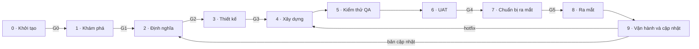

# Template: Quy trình sản phẩm từ ý tưởng đến ra mắt và cập nhật

> Template trung lập, không chứa thông tin của dự án nào. Dùng để dựng một **trang quy trình sản phẩm** cho một dự án cụ thể: 10 giai đoạn và phần quản trị xuyên suốt, mỗi giai đoạn có mục tiêu, đầu vào/đầu ra, bảng RACI, cổng duyệt và danh mục tài liệu chuẩn kèm trạng thái thật của dự án.
>
> Mọi chỗ `{{…}}` là chỗ phải điền bằng thông tin thật của dự án. Phần không có `{{…}}` là khung chuẩn: giữ nguyên, chỉ sửa khi đội thống nhất đổi quy trình.

---

## Phần 1 · Cách dùng template này

### 1.1 Thứ tự làm

1. **Tìm hiểu dự án trước khi điền.** Đọc README, tài liệu, lịch sử git (tag, nhánh, commit), cấu hình deploy, các trang UAT/kiểm thử đã có. Ghi lại: sản phẩm làm gì, ai dùng, đang có những môi trường nào, đã phát hành những phiên bản nào, tài liệu nào đang tồn tại và nằm ở đâu.
2. **Hỏi người dùng những gì không suy ra được**, trước khi viết (gom một lượt, mỗi câu có một lựa chọn được khuyến nghị):
   - Ai giữ từng vai trò ở mục 2.3 (một người có thể giữ nhiều vai trò).
   - Các phiên bản đã và sẽ phát hành, tên gọi, thứ tự ưu tiên.
   - Những cổng nào đã thực sự được duyệt, ai duyệt, ngày nào.
   - Thiết bị và trình duyệt bắt buộc hỗ trợ (dùng cho UAT và DoD).
3. **Điền phần 2** theo đúng thứ tự mục. Không bỏ mục; mục chưa áp dụng thì ghi rõ vì sao.
4. **Dựng trang** theo đặc tả ở phần 3 (một trang HTML, hoặc artifact nếu môi trường có).
5. **Rà soát** theo danh sách ở mục 1.3 rồi mới gửi.

### 1.2 Quy tắc điền

- **Mỗi việc có đúng một A.** A là người chịu trách nhiệm cuối và duyệt kết quả. R có thể nhiều. Ô `A·R` = cùng một vai trò vừa làm vừa chịu trách nhiệm.
- **Trợ lý AI chỉ được làm R**, không bao giờ là A. Trách nhiệm cuối luôn thuộc về một người.
- **Phiên bản và giai đoạn là hai trục khác nhau.** Phiên bản (v0.1.0, v0.2.0…) là một đợt phát hành; giai đoạn 0–9 là bước của quy trình. Không gọi đợt phát hành là “Giai đoạn N”. Hai phiên bản có thể ở hai giai đoạn khác nhau cùng lúc.
- **Trạng thái tài liệu** chỉ dùng 5 giá trị:

  | Mã | Nhãn | Nghĩa |
  | --- | --- | --- |
  | `done` | Đã có | Tài liệu tồn tại và dùng được (ghi rõ nằm ở đâu, có link) |
  | `part` | Một phần | Có nhưng thiếu nội dung hoặc nằm rải rác (ghi thiếu gì) |
  | `skip` | Chưa làm | Lẽ ra đã phải có nhưng bị bỏ qua (ghi lý do và rủi ro) |
  | `later` | Chưa tới lúc | Thuộc bước chưa đến (ghi khi nào cần) |
  | `na` | Không cần lúc này | Không cần ở quy mô hiện tại (ghi điều kiện để phải làm) |

- **Trạng thái trong bảng Bản đồ**: `Xong {{ngày}}`, `Đang làm`, `Chờ {{ai}}`, `Chưa`, `Chưa làm` (lẽ ra phải có), `Bỏ qua: {{lý do}}`. Mọi lần đi tắt quy trình (bỏ cổng, lên production trước UAT…) đều ghi một dòng, kèm lý do và người quyết định.
- **Chỉ ghi sự thật kiểm chứng được.** Không biết thì ghi câu hỏi mở, không đoán. Ngày ghi dạng tuyệt đối (`16/10/2026`), không ghi “hôm qua”.
- **Viết ngắn, chữ thường đầu câu, không emoji trong tiêu đề.** Câu dưới 25 từ. Mỗi ghi chú “Áp dụng cho dự án” 1–3 câu.

### 1.3 Rà soát trước khi gửi

- [ ] Mỗi dòng RACI có đúng một A; không ô nào giao A cho trợ lý AI.
- [ ] Mỗi giai đoạn có ghi chú “Áp dụng cho dự án” và bảng tài liệu đủ trạng thái.
- [ ] Bảng Bản đồ có mọi phiên bản đã phát hành và đang làm, mỗi dòng có cổng và trạng thái.
- [ ] Mọi lần đi tắt quy trình đã được ghi lại.
- [ ] Số đếm trạng thái tài liệu (mục 2.7) khớp với bảng ở từng giai đoạn.
- [ ] Không còn `{{…}}` nào trên trang.

---

## Phần 2 · Nội dung trang (điền theo thứ tự)

### 2.1 Đầu trang

- Dòng nhỏ phía trên: `{{Tên sản phẩm}} · Cẩm nang quy trình`
- Tiêu đề: **Quy trình sản phẩm từ ý tưởng đến ra mắt và cập nhật**
- Đoạn dẫn: “10 giai đoạn và phần quản trị xuyên suốt. Mỗi giai đoạn có mục tiêu, đầu vào và đầu ra, bảng RACI cho từng việc, danh mục tài liệu chuẩn kèm trạng thái thật của {{Tên sản phẩm}}, và một cổng duyệt (gate) phải qua trước khi sang giai đoạn sau. Chọn một vai trò ở thanh lọc để xem riêng việc của vai trò đó.”

### 2.2 RACI là gì

| Mã | Tên | Nghĩa |
| --- | --- | --- |
| R | Responsible · Thực hiện | Người trực tiếp làm việc. Một việc có thể có nhiều R. |
| A | Accountable · Chịu trách nhiệm cuối | Người duyệt và chịu trách nhiệm về kết quả. Mỗi việc có đúng một A. |
| C | Consulted · Tham vấn | Được hỏi ý kiến trước khi làm, trao đổi hai chiều. |
| I | Informed · Được thông báo | Được báo kết quả, một chiều. |

Ghi chú dưới bảng: “Ô ghi A·R nghĩa là cùng một vai trò vừa làm vừa chịu trách nhiệm. Trợ lý AI chỉ được làm R; trách nhiệm cuối (A) luôn thuộc về một người.”

### 2.3 Các vai trò (PIC)

Đội nhỏ thì một người giữ nhiều vai trò. Cột cuối là phân vai thật của dự án; vai trò chưa có người thì ghi “Chưa có” và ai đang kiêm tạm.

| Mã | Vai trò | Trách nhiệm | Người giữ vai trò |
| --- | --- | --- | --- |
| SP | Chủ dự án / Nhà tài trợ | Quyết định đầu tư, ngân sách, đi tiếp hay dừng ở mỗi cổng lớn. | {{điền tên hoặc “Chưa có, … kiêm”}} |
| PO | Product Owner | Sở hữu backlog và mức ưu tiên, viết và duyệt tiêu chí chấp nhận, ký duyệt UAT. | {{điền tên hoặc “Chưa có, … kiêm”}} |
| PM | Project Manager / Scrum Master | Kế hoạch, tiến độ, điều phối, rủi ro, tổ chức họp sprint và hậu kiểm. | {{điền tên hoặc “Chưa có, … kiêm”}} |
| UX | UX/UI Designer | Nghiên cứu người dùng, luồng, giao diện, design system, kiểm thử khả dụng. | {{điền tên hoặc “Chưa có, … kiêm”}} |
| TL | Tech Lead | Kiến trúc, chất lượng code, quyết định kỹ thuật, duyệt deploy. | {{điền tên hoặc “Chưa có, … kiêm”}} |
| DEV | Developer | Lập trình, test tự động, sửa lỗi, tài liệu kỹ thuật. | {{điền tên hoặc “Chưa có, … kiêm”}} |
| QA | QA / Tester | Kế hoạch và ca kiểm thử, kiểm thử chức năng, hồi quy, tương thích. | {{điền tên hoặc “Chưa có, … kiêm”}} |
| OPS | DevOps / Release | Môi trường, CI/CD, deploy, giám sát, sao lưu, rollback. | {{điền tên hoặc “Chưa có, … kiêm”}} |
| SEC | Bảo mật & Pháp lý | Quyền riêng tư, bảo mật, điều khoản, thủ tục xác minh với nền tảng bên thứ ba (vd OAuth, kho ứng dụng). | {{điền tên hoặc “Chưa có, … kiêm”}} |
| MKT | Marketing / Nội dung | Thông điệp, kênh ra mắt, hướng dẫn sử dụng, ghi chú phát hành. | {{điền tên hoặc “Chưa có, … kiêm”}} |
| CS | Hỗ trợ người dùng | Kênh nhận phản hồi, trả lời, gom lỗi gửi về đội. | {{điền tên hoặc “Chưa có, … kiêm”}} |
| USR | Người dùng / Beta tester | Tham gia phỏng vấn, dùng thử, phản hồi. | {{điền tên hoặc “Chưa có, … kiêm”}} |

### 2.4 Toàn cảnh

Sơ đồ (Mermaid), giữ nguyên:

Dưới sơ đồ: “Giai đoạn 4–6 chạy lặp theo sprint (1–2 tuần). Sau ra mắt, mỗi bản cập nhật quay lại từ Định nghĩa với quy trình thu gọn; lỗi khẩn cấp (hotfix) đi đường tắt từ Xây dựng.”

### 2.5 Bản đồ: {{Tên sản phẩm}} đang ở đâu

Đoạn dẫn: “Mỗi **phiên bản** là một đợt phát hành và đi qua các **giai đoạn 0–9** bên dưới. Hai phiên bản có thể ở hai giai đoạn khác nhau cùng lúc. Cập nhật ngày {{ngày}}.”

Bảng 4 cột, nhóm theo phiên bản (dòng nhóm in đậm). Nhóm đầu luôn là “Cả sản phẩm”. Mỗi việc thật đã làm hoặc sẽ làm là một dòng; tài liệu có link thì gắn link ngay trong cột đầu.

| Đã làm / sẽ làm | Giai đoạn quy trình | Cổng | Trạng thái |
| --- | --- | --- | --- |
| **Cả sản phẩm** | | | |
| {{vd: Sản phẩm được xây trước khi có quy trình}} | {{0 Khởi tạo · 1 Khám phá}} | {{G0 · G1}} | {{Chưa làm}} |
| {{vd: Dựng môi trường staging và production}} | {{3 Thiết kế: dựng môi trường}} | | {{Xong dd/mm}} |
| **{{vX.Y.Z}} · {{tên ngắn}}** | | | |
| {{Tài liệu user story và tiêu chí chấp nhận (link)}} | 2 Định nghĩa | G2 | {{trạng thái}} |
| {{Bản mẫu trên địa chỉ preview}} | 3 Thiết kế | G3 | {{trạng thái}} |
| {{Xây dựng và dev tự QC}} | 4 Xây dựng · 5 QA | | {{trạng thái}} |
| {{Checklist UAT (link), ai ký}} | 6 UAT | G4 | {{trạng thái}} |
| {{Kiểm tra trước phát hành, lên production, tag}} | 7 Chuẩn bị · 8 Ra mắt | G5 | {{trạng thái}} |

Mẫu dòng khi đi tắt quy trình: `{{việc}} | {{giai đoạn}} | {{cổng}} | Bỏ qua: {{lý do}}, {{ai quyết}} {{ngày}}`.

### 2.6 Các phiên bản

Đoạn dẫn: “Từ nay gọi các đợt phát hành bằng số phiên bản. Số phiên bản sau bản đang làm là dự kiến, PO có thể đổi thứ tự.”

| Phiên bản | Nội dung | Ghi chú (tên cũ, lý do đổi thứ tự…) | Trạng thái |
| --- | --- | --- | --- |
| {{v0.1.0}} | {{nội dung một dòng}} | {{…}} | {{Production dd/mm · Đang làm · Chưa bắt đầu}} |

Dưới bảng: một câu về cổng G0/G1 nếu sản phẩm chưa từng qua.

### 2.7 Rà soát quy trình và tài liệu

- Đoạn dẫn: “Rà soát ngày {{ngày}} theo chuẩn quản lý sản phẩm. Kết luận: {{tóm tắt một câu}}.”
- Dòng đếm: `Đã có N · Một phần N · Chưa làm N · Chưa tới lúc N · Không cần lúc này N` (đếm từ các bảng tài liệu ở 2.8).
- Chú giải 5 trạng thái (bảng ở mục 1.2).
- **Nên làm bù trước**: 5–8 tài liệu đang `skip`/`part` quan trọng nhất.

| Tài liệu | Vì sao | Khi nào |
| --- | --- | --- |
| {{tên tài liệu}} | {{rủi ro cụ thể của dự án nếu thiếu}} | {{Ngay · Trước khi xây vX · Trước khi mời người dùng}} |

### 2.8 Thanh lọc theo vai trò

Ngay trước phần giai đoạn: một hàng nút, mỗi nút một vai trò (`SP · Chủ dự án / Nhà tài trợ`…), và một hàng liên kết nhảy tới từng giai đoạn. Chi tiết ở đặc tả trang (phần 3).

### Giai đoạn 0 · Khởi tạo

- **Thời lượng:** 1–3 ngày
- **Mục tiêu:** Trả lời: có đáng làm không? Vấn đề gì, cho ai, đo thành công bằng gì, với nguồn lực nào.
- **Đầu vào:** Ý tưởng ban đầu, quan sát cá nhân; Nguồn lực sẵn có (thời gian, tiền, người)
- **Đầu ra:** Bản tóm tắt một trang: vấn đề, người dùng mục tiêu, mục tiêu, chỉ số thành công, giả định, rủi ro, ngân sách

**RACI**

| Việc | Ghi chú | SP | PO | PM | UX | TL | DEV | QA | OPS | SEC | MKT | CS | USR |
| --- | --- | --- | --- | --- | --- | --- | --- | --- | --- | --- | --- | --- | --- |
| Xác định vấn đề và cơ hội | Ai đang gặp vấn đề gì, họ đang giải quyết thế nào | A | R | C |  | C |  |  |  |  | C |  |  |
| Tầm nhìn, mục tiêu, chỉ số thành công | Vd North Star: một con số cho thấy người dùng nhận được giá trị cốt lõi | A | R | C |  | I |  |  |  |  | C |  |  |
| Ước lượng nguồn lực, ngân sách, rủi ro sơ bộ |  | A | C | R |  | C |  |  |  |  |  |  |  |
| Lập sổ rủi ro ban đầu | Rủi ro sản phẩm, kỹ thuật, pháp lý; mỗi rủi ro có người theo dõi |  | C | A·R |  | C |  |  |  | C |  |  |  |
| Trình bày và quyết định đi tiếp |  | A | R | C | I | C | I |  |  |  |  |  |  |

**Cổng G0 · Đáng làm** (người quyết định: Chủ dự án / Nhà tài trợ, SP)

- Vấn đề và người dùng mục tiêu được mô tả rõ
- Có chỉ số thành công đo được
- Có nguồn lực cho giai đoạn Khám phá

**Áp dụng cho {{Tên sản phẩm}}:** {{1–3 câu. Sản phẩm đã có trước khi áp quy trình thì ghi rõ G0 chưa từng xét và đề xuất làm bù gọn nhẹ.}}

**Danh mục tài liệu**

| Tài liệu | Dùng để | Lập → Duyệt | Trạng thái | Ghi chú cho dự án |
| --- | --- | --- | --- | --- |
| Bản tóm tắt dự án một trang (project charter) | Vấn đề, người dùng mục tiêu, mục tiêu, chỉ số thành công, phạm vi, ngân sách, rủi ro chính | PO → SP | {{done/part/skip/later/na}} | {{nằm ở đâu (link) / thiếu gì / lý do / điều kiện}} |
| Phân tích lợi ích và chi phí (business case) | Quyết định có đáng bỏ thời gian và tiền | PO → SP | {{done/part/skip/later/na}} | {{nằm ở đâu (link) / thiếu gì / lý do / điều kiện}} |
| Danh sách bên liên quan (stakeholder register) | Ai liên quan, quan tâm gì, cần báo gì | PM → SP | {{done/part/skip/later/na}} | {{nằm ở đâu (link) / thiếu gì / lý do / điều kiện}} |

### Giai đoạn 1 · Khám phá

- **Thời lượng:** 1–3 tuần
- **Mục tiêu:** Kiểm chứng vấn đề có thật và giải pháp có người cần, trước khi tốn công xây.
- **Đầu vào:** Bản tóm tắt một trang đã qua G0
- **Đầu ra:** Báo cáo phỏng vấn, chân dung người dùng (persona / JTBD); Phân tích đối thủ; Kết quả thử nghiệm kỹ thuật (POC); Danh sách rủi ro

**RACI**

| Việc | Ghi chú | SP | PO | PM | UX | TL | DEV | QA | OPS | SEC | MKT | CS | USR |
| --- | --- | --- | --- | --- | --- | --- | --- | --- | --- | --- | --- | --- | --- |
| Phỏng vấn 5–8 người dùng mục tiêu | Hỏi về hành vi thật, không hỏi “bạn có thích không” |  | A | I | R |  |  |  |  |  | C |  | C |
| Phân tích đối thủ và thị trường |  |  | A |  | C |  |  |  |  |  | R |  |  |
| Kiểm thử tính khả thi kỹ thuật (POC) | Phần kỹ thuật rủi ro nhất: tích hợp bên thứ ba, lưu trữ, hiệu năng trên thiết bị yếu |  | C |  |  | A | R |  |  | C |  |  |  |
| Prototype và thử giả định giá trị với người dùng |  |  | A |  | R | C |  |  |  |  |  |  | C |
| Rà soát sơ bộ quyền riêng tư và pháp lý | Dữ liệu nào là nhạy cảm (sức khỏe, tài chính, vị trí, lịch cá nhân…) | A | C |  |  | C |  |  |  | R |  |  |  |
| Tổng hợp và trình bày kết quả khám phá |  | A | R | C | R | C |  |  |  |  |  |  |  |

**Cổng G1 · Vấn đề đã được kiểm chứng** (người quyết định: Chủ dự án / Nhà tài trợ, SP)

- Ít nhất 5 người dùng xác nhận vấn đề
- POC cho thấy làm được về kỹ thuật
- Không có rủi ro pháp lý chặn

**Áp dụng cho {{Tên sản phẩm}}:** {{1–3 câu. Ghi đã phỏng vấn ai, bao nhiêu người; chưa có thì đề xuất 5 người cụ thể cần hỏi.}}

**Danh mục tài liệu**

| Tài liệu | Dùng để | Lập → Duyệt | Trạng thái | Ghi chú cho dự án |
| --- | --- | --- | --- | --- |
| Kế hoạch và ghi chép phỏng vấn người dùng | Bằng chứng vấn đề có thật | UX → PO | {{done/part/skip/later/na}} | {{nằm ở đâu (link) / thiếu gì / lý do / điều kiện}} |
| Chân dung người dùng (persona, JTBD) | Thống nhất đang làm cho ai | UX → PO | {{done/part/skip/later/na}} | {{nằm ở đâu (link) / thiếu gì / lý do / điều kiện}} |
| Phân tích đối thủ | Biết người dùng đang dùng gì thay thế | MKT → PO | {{done/part/skip/later/na}} | {{nằm ở đâu (link) / thiếu gì / lý do / điều kiện}} |
| Báo cáo thử nghiệm khả thi kỹ thuật (POC) | Chứng minh làm được trước khi cam kết | DEV → TL | {{done/part/skip/later/na}} | {{nằm ở đâu (link) / thiếu gì / lý do / điều kiện}} |
| Rà soát quyền riêng tư sơ bộ | Dữ liệu nhạy cảm nào, đi đâu | SEC → SP | {{done/part/skip/later/na}} | {{nằm ở đâu (link) / thiếu gì / lý do / điều kiện}} |
| Báo cáo tổng hợp khám phá | Căn cứ để qua cổng G1 | PO → SP | {{done/part/skip/later/na}} | {{nằm ở đâu (link) / thiếu gì / lý do / điều kiện}} |

### Giai đoạn 2 · Định nghĩa

- **Thời lượng:** 3–7 ngày
- **Mục tiêu:** Biến hiểu biết thành phạm vi rõ ràng: làm gì, không làm gì, thế nào là đạt.
- **Đầu vào:** Kết quả khám phá đã qua G1
- **Đầu ra:** Tài liệu yêu cầu sản phẩm (PRD); Backlog các user story có tiêu chí chấp nhận; Yêu cầu phi chức năng; Kế hoạch phát hành

**RACI**

| Việc | Ghi chú | SP | PO | PM | UX | TL | DEV | QA | OPS | SEC | MKT | CS | USR |
| --- | --- | --- | --- | --- | --- | --- | --- | --- | --- | --- | --- | --- | --- |
| Viết PRD và chốt phạm vi MVP (MoSCoW) | Must / Should / Could / Won’t | C | A·R | C | C | C |  |  |  |  |  |  |  |
| Viết user story và tiêu chí chấp nhận | Dạng Cho trước / Khi / Thì; đây là gốc của UAT |  | A·R |  | C | C | I | C |  |  |  |  |  |
| Yêu cầu phi chức năng | Hiệu năng, bảo mật, quyền riêng tư, khả năng truy cập, thiết bị hỗ trợ |  | A |  | C | R |  | C |  | C |  |  |  |
| Ước lượng và kế hoạch phát hành | Mốc, sprint, ngày dự kiến ra mắt | I | A | R |  | C | C |  |  |  |  |  |  |
| Thống nhất DoR, DoD, mức độ lỗi S1–S4 | Xem phần Tham chiếu |  | R | A |  | R | C | R |  |  |  |  |  |
| Lập backlog tập trung và sổ quyết định | Một nơi duy nhất cho mọi yêu cầu, thứ tự ưu tiên và quyết định |  | A·R | C |  | C |  |  |  |  |  |  |  |
| Chốt phạm vi |  | A | R | R |  | C | I | I |  |  |  |  |  |

**Cổng G2 · Phạm vi đã chốt** (người quyết định: Chủ dự án / Nhà tài trợ, SP)

- Mọi story Must có tiêu chí chấp nhận được PO duyệt
- Có ước lượng và ngày dự kiến
- Đội đồng ý DoR / DoD

**Áp dụng cho {{Tên sản phẩm}}:** {{1–3 câu. Ghi mỗi phiên bản có tài liệu user story ở đâu, ai duyệt G2, ngày nào.}}

**Danh mục tài liệu**

| Tài liệu | Dùng để | Lập → Duyệt | Trạng thái | Ghi chú cho dự án |
| --- | --- | --- | --- | --- |
| Tài liệu yêu cầu (PRD) kèm user story và tiêu chí chấp nhận | Thống nhất làm gì, thế nào là đạt | PO → SP | {{done/part/skip/later/na}} | {{nằm ở đâu (link) / thiếu gì / lý do / điều kiện}} |
| Yêu cầu phi chức năng | Bảo mật, hiệu năng, thiết bị, offline | TL → PO | {{done/part/skip/later/na}} | {{nằm ở đâu (link) / thiếu gì / lý do / điều kiện}} |
| Lộ trình sản phẩm (roadmap) | Thứ tự các phiên bản | PO → SP | {{done/part/skip/later/na}} | {{nằm ở đâu (link) / thiếu gì / lý do / điều kiện}} |
| Kế hoạch phát hành và ước lượng | Ngày dự kiến, khối lượng việc | PM → PO | {{done/part/skip/later/na}} | {{nằm ở đâu (link) / thiếu gì / lý do / điều kiện}} |
| Chỉ số thành công (KPI, North Star) | Biết sản phẩm có ích hay không | PO → SP | {{done/part/skip/later/na}} | {{nằm ở đâu (link) / thiếu gì / lý do / điều kiện}} |
| DoR, DoD, mức độ lỗi | Luật chung của đội | PM → PO | {{done/part/skip/later/na}} | {{nằm ở đâu (link) / thiếu gì / lý do / điều kiện}} |

### Giai đoạn 3 · Thiết kế

- **Thời lượng:** 1–2 tuần
- **Mục tiêu:** Thiết kế trải nghiệm và kỹ thuật đủ chi tiết để xây mà không phải đoán.
- **Đầu vào:** Backlog và PRD đã qua G2
- **Đầu ra:** Luồng người dùng, wireframe, giao diện, design system; Kết quả kiểm thử khả dụng; Tài liệu kiến trúc, mô hình dữ liệu; Đánh giá bảo mật; Môi trường local / staging / prod và CI/CD

**RACI**

| Việc | Ghi chú | SP | PO | PM | UX | TL | DEV | QA | OPS | SEC | MKT | CS | USR |
| --- | --- | --- | --- | --- | --- | --- | --- | --- | --- | --- | --- | --- | --- |
| Luồng người dùng và wireframe |  |  | A |  | R | C | C |  |  |  |  |  |  |
| Giao diện và design system | Màu, chữ, chế độ tối, độ tương phản, mobile |  | A |  | R |  | C |  |  |  |  |  |  |
| Kiểm thử khả dụng trên prototype (3–5 người) |  |  | A |  | R |  |  |  |  |  |  |  | C |
| Kiến trúc, mô hình dữ liệu, tích hợp | Nơi lưu dữ liệu, đồng bộ, các dịch vụ bên ngoài |  | I |  |  | A·R | C |  | C | C |  |  |  |
| Đánh giá bảo mật và quyền riêng tư | Quyền tối thiểu, cách lưu khóa và token, chính sách bảo mật nội dung (CSP) |  | C |  |  | A | C |  |  | R |  |  |  |
| Dựng repo, môi trường, CI/CD | Nhánh main → prod, staging → staging |  |  |  |  | A | C |  | R |  |  |  |  |
| Ghi quyết định kiến trúc (ADR) | Mỗi quyết định kỹ thuật lớn: bối cảnh, các lựa chọn, lý do chọn |  |  |  |  | A·R | C |  |  | C |  |  |  |
| Kế hoạch kiểm thử tổng thể | Mức nào test tự động, mức nào QA, UAT trên thiết bị nào |  | C |  |  | A | C | R |  |  |  |  |  |
| Đánh giá khả năng truy cập | Độ tương phản, dùng bằng bàn phím, trình đọc màn hình |  | A |  | R |  | C | C |  |  |  |  |  |
| Duyệt thiết kế |  | I | A |  | R | R |  | C |  |  |  |  |  |

**Cổng G3 · Thiết kế được duyệt** (người quyết định: Product Owner, PO)

- Giao diện các luồng Must đã duyệt
- Kiến trúc và rủi ro bảo mật đã duyệt
- Staging chạy được

**Áp dụng cho {{Tên sản phẩm}}:** {{1–3 câu. Ghi môi trường thật đang có (địa chỉ, nhánh, nhà cung cấp hosting) và việc thiết kế còn thiếu.}}

**Danh mục tài liệu**

| Tài liệu | Dùng để | Lập → Duyệt | Trạng thái | Ghi chú cho dự án |
| --- | --- | --- | --- | --- |
| Luồng người dùng và wireframe | Thống nhất màn hình trước khi code | UX → PO | {{done/part/skip/later/na}} | {{nằm ở đâu (link) / thiếu gì / lý do / điều kiện}} |
| Giao diện và design system | Màu, chữ, thành phần dùng chung | UX → PO | {{done/part/skip/later/na}} | {{nằm ở đâu (link) / thiếu gì / lý do / điều kiện}} |
| Bản mẫu bấm thử (prototype) | Duyệt trải nghiệm ở G3 | UX → PO | {{done/part/skip/later/na}} | {{nằm ở đâu (link) / thiếu gì / lý do / điều kiện}} |
| Báo cáo kiểm thử khả dụng | Người thật dùng có vướng không | UX → PO | {{done/part/skip/later/na}} | {{nằm ở đâu (link) / thiếu gì / lý do / điều kiện}} |
| Tài liệu kiến trúc và quyết định kỹ thuật (ADR) | Hệ thống gồm gì, vì sao chọn vậy | TL → TL | {{done/part/skip/later/na}} | {{nằm ở đâu (link) / thiếu gì / lý do / điều kiện}} |
| Tài liệu tích hợp với dịch vụ ngoài | Sản phẩm nói chuyện với từng dịch vụ bên ngoài ra sao: luồng, cấu hình, khóa bí mật, lỗi, kiểm thử | TL → TL | {{done/part/skip/later/na}} | {{nằm ở đâu (link) / thiếu gì / lý do / điều kiện}} |
| Đánh giá bảo mật và quyền riêng tư (DPIA) | Rủi ro khi lưu dữ liệu cá nhân | SEC → TL | {{done/part/skip/later/na}} | {{nằm ở đâu (link) / thiếu gì / lý do / điều kiện}} |
| Thiết lập môi trường và CI/CD | Local, staging, production; tự kiểm tra khi đẩy code | OPS → TL | {{done/part/skip/later/na}} | {{nằm ở đâu (link) / thiếu gì / lý do / điều kiện}} |
| Kế hoạch kiểm thử tổng thể (test strategy) | Mức nào test tự động, mức nào QA, UAT trên thiết bị nào | QA → TL | {{done/part/skip/later/na}} | {{nằm ở đâu (link) / thiếu gì / lý do / điều kiện}} |

### Giai đoạn 4 · Xây dựng

- **Thời lượng:** Theo sprint 1–2 tuần
- **Mục tiêu:** Biến story thành phần mềm chạy được, chất lượng ổn định từng sprint.
- **Đầu vào:** Story đạt DoR; Thiết kế đã duyệt
- **Đầu ra:** Code đã review và merge; Test tự động; Bản demo mỗi sprint; Tài liệu cập nhật

**RACI**

| Việc | Ghi chú | SP | PO | PM | UX | TL | DEV | QA | OPS | SEC | MKT | CS | USR |
| --- | --- | --- | --- | --- | --- | --- | --- | --- | --- | --- | --- | --- | --- |
| Lập kế hoạch sprint | Chọn story theo ưu tiên, chia việc |  | A | R |  | C | R | C |  |  |  |  |  |
| Lập trình theo story |  |  |  |  | C | A | R |  |  |  |  |  |  |
| Review code và quy chuẩn |  |  |  |  |  | A | R |  |  |  |  |  |  |
| Viết test tự động (unit / integration) | Ưu tiên phần logic dễ sai và khó thử bằng tay |  |  |  |  | A | R | C |  |  |  |  |  |
| Cập nhật tài liệu và README |  |  | C |  |  | A | R |  |  |  |  | I |  |
| Demo cuối sprint |  | I | A |  | C |  | R | C |  |  |  |  |  |
| Theo dõi tiến độ và rủi ro |  | I | C | A·R |  | C |  |  |  |  |  |  |  |

**Áp dụng cho {{Tên sản phẩm}}:** {{1–3 câu. Ghi quy ước commit, review, test tự động hiện có.}}

**Danh mục tài liệu**

| Tài liệu | Dùng để | Lập → Duyệt | Trạng thái | Ghi chú cho dự án |
| --- | --- | --- | --- | --- |
| Backlog tập trung và kế hoạch sprint | Một danh sách việc duy nhất, có thứ tự | PO → PO | {{done/part/skip/later/na}} | {{nằm ở đâu (link) / thiếu gì / lý do / điều kiện}} |
| Mã nguồn và lịch sử thay đổi | Truy lại ai đổi gì, vì sao | DEV → TL | {{done/part/skip/later/na}} | {{nằm ở đâu (link) / thiếu gì / lý do / điều kiện}} |
| Biên bản review code | Người thứ hai kiểm tra trước khi gộp | DEV → TL | {{done/part/skip/later/na}} | {{nằm ở đâu (link) / thiếu gì / lý do / điều kiện}} |
| Bộ test tự động | Chặn lỗi cũ quay lại | DEV → TL | {{done/part/skip/later/na}} | {{nằm ở đâu (link) / thiếu gì / lý do / điều kiện}} |
| Tài liệu kỹ thuật (README) | Người mới đọc là chạy được | DEV → TL | {{done/part/skip/later/na}} | {{nằm ở đâu (link) / thiếu gì / lý do / điều kiện}} |
| Biên bản demo cuối sprint | PO thấy tiến độ thật | DEV → PO | {{done/part/skip/later/na}} | {{nằm ở đâu (link) / thiếu gì / lý do / điều kiện}} |

### Giai đoạn 5 · Kiểm thử QA

- **Thời lượng:** Song song sprint + 2–5 ngày cuối
- **Mục tiêu:** Tìm lỗi trước khi người dùng thấy, đảm bảo đạt tiêu chí và không làm hỏng thứ đã chạy.
- **Đầu vào:** Bản build trên staging; Tiêu chí chấp nhận
- **Đầu ra:** Kế hoạch và ca kiểm thử; Báo cáo lỗi theo mức S1–S4; Xác nhận QA đạt

**RACI**

| Việc | Ghi chú | SP | PO | PM | UX | TL | DEV | QA | OPS | SEC | MKT | CS | USR |
| --- | --- | --- | --- | --- | --- | --- | --- | --- | --- | --- | --- | --- | --- |
| Kế hoạch và ca kiểm thử từ tiêu chí chấp nhận |  |  | C |  |  |  | I | A·R |  |  |  |  |  |
| Kiểm thử chức năng và hồi quy |  |  |  |  |  |  | C | A·R |  |  |  |  |  |
| Kiểm thử tương thích | Mọi thiết bị, trình duyệt, chế độ sáng/tối, bộ gõ… nêu trong yêu cầu phi chức năng |  |  |  | C |  | I | A·R |  |  |  |  |  |
| Kiểm thử bảo mật và quyền riêng tư |  |  |  |  |  | A |  | C |  | R |  |  |  |
| Kiểm thử hiệu năng và khả năng truy cập |  |  |  |  | C | A |  | R |  |  |  |  |  |
| Phân loại và ưu tiên lỗi (triage) |  |  | A | I |  | C | R | R |  |  |  |  |  |
| Ghi sổ lỗi tập trung | Mỗi lỗi: mức S1–S4, bước tái hiện, trạng thái, bản sửa |  | I |  |  |  | C | A·R |  |  |  |  |  |
| Xác nhận QA đạt | Không còn lỗi S1/S2 mở |  | I | I |  | I |  | A·R |  |  |  |  |  |

**Áp dụng cho {{Tên sản phẩm}}:** {{1–3 câu. Ghi ai đang QA, bằng cách nào, thiết bị nào còn chưa được thử.}}

**Danh mục tài liệu**

| Tài liệu | Dùng để | Lập → Duyệt | Trạng thái | Ghi chú cho dự án |
| --- | --- | --- | --- | --- |
| Kế hoạch và ca kiểm thử QA | Biết sẽ thử những gì | QA → QA | {{done/part/skip/later/na}} | {{nằm ở đâu (link) / thiếu gì / lý do / điều kiện}} |
| Báo cáo kết quả QA | Bằng chứng đã thử, trên thiết bị nào | QA → QA | {{done/part/skip/later/na}} | {{nằm ở đâu (link) / thiếu gì / lý do / điều kiện}} |
| Sổ lỗi tập trung (bug log) | Mỗi lỗi một dòng: mức S1–S4, trạng thái | QA → PO | {{done/part/skip/later/na}} | {{nằm ở đâu (link) / thiếu gì / lý do / điều kiện}} |
| Biên bản QA đạt | Điều kiện để sang UAT | QA → QA | {{done/part/skip/later/na}} | {{nằm ở đâu (link) / thiếu gì / lý do / điều kiện}} |

### Giai đoạn 6 · UAT

- **Thời lượng:** 2–5 ngày mỗi vòng
- **Mục tiêu:** Người đại diện người dùng xác nhận sản phẩm làm đúng điều đã thống nhất và dùng được thật.
- **Đầu vào:** Bản đã qua QA trên staging; Kịch bản UAT được PO duyệt
- **Đầu ra:** Kết quả UAT từng bước; Danh sách lỗi và yêu cầu mới; Biên bản ký duyệt

**RACI**

| Việc | Ghi chú | SP | PO | PM | UX | TL | DEV | QA | OPS | SEC | MKT | CS | USR |
| --- | --- | --- | --- | --- | --- | --- | --- | --- | --- | --- | --- | --- | --- |
| Viết kịch bản UAT từ tiêu chí chấp nhận |  |  | A |  | C |  |  | R |  |  |  |  |  |
| PO duyệt kết quả mong đợi trước khi test | Tránh lẫn lỗi với yêu cầu mới |  | A·R |  |  |  |  | C |  |  |  |  |  |
| Đưa bản UAT lên staging |  |  | I |  |  | A |  | I | R |  |  |  |  |
| Thực hiện UAT trên staging, đủ thiết bị hỗ trợ | Đủ mọi thiết bị hỗ trợ ngay từ vòng đầu, không để thiết bị nào sang bước kiểm tra trước phát hành |  | A·R |  |  |  | I | C |  |  |  |  | R |
| Phân loại Lỗi và Yêu cầu mới |  |  | A·R | I |  | C |  | C |  |  |  |  |  |
| Sửa lỗi UAT và test lại |  |  | C |  |  | A | R | R |  |  |  |  |  |
| Ký duyệt UAT |  | I | A·R | I |  |  |  | C |  |  |  |  |  |

**Cổng G4 · UAT được ký duyệt** (người quyết định: Product Owner, PO)

- Mọi bước trong phạm vi đạt trên tất cả thiết bị hỗ trợ
- Không còn lỗi S1/S2; lỗi S3/S4 còn lại được PO chấp nhận và ghi vào backlog
- PO ký duyệt có ngày và tên

**Áp dụng cho {{Tên sản phẩm}}:** {{1–3 câu. Ghi UAT chạy ở môi trường nào, trên thiết bị nào, ai ký, lần gần nhất ngày nào.}}

**Danh mục tài liệu**

| Tài liệu | Dùng để | Lập → Duyệt | Trạng thái | Ghi chú cho dự án |
| --- | --- | --- | --- | --- |
| Kịch bản UAT | PO biết thử gì, mong đợi gì | QA → PO | {{done/part/skip/later/na}} | {{nằm ở đâu (link) / thiếu gì / lý do / điều kiện}} |
| Kết quả UAT từng bước | Bằng chứng nghiệm thu | PO → PO | {{done/part/skip/later/na}} | {{nằm ở đâu (link) / thiếu gì / lý do / điều kiện}} |
| Biên bản ký duyệt UAT (G4) | Quyết định nghiệm thu | PO → PO | {{done/part/skip/later/na}} | {{nằm ở đâu (link) / thiếu gì / lý do / điều kiện}} |

### Giai đoạn 7 · Chuẩn bị ra mắt

- **Thời lượng:** 3–7 ngày
- **Mục tiêu:** Mọi thứ ngoài code đã sẵn sàng: hạ tầng, pháp lý, hỗ trợ, truyền thông, phương án lùi.
- **Đầu vào:** Bản đã qua G4
- **Đầu ra:** Production sẵn sàng; Chính sách quyền riêng tư, điều khoản; Ghi chú phát hành, hướng dẫn, FAQ; Kênh hỗ trợ; Kế hoạch rollback; Kế hoạch truyền thông

**RACI**

| Việc | Ghi chú | SP | PO | PM | UX | TL | DEV | QA | OPS | SEC | MKT | CS | USR |
| --- | --- | --- | --- | --- | --- | --- | --- | --- | --- | --- | --- | --- | --- |
| Kiểm tra trước phát hành (smoke test) trên staging | Danh sách ngắn ~10 phút trên đúng bản sẽ lên production: luồng chính và cấu hình môi trường (địa chỉ, đăng nhập, quyền truy cập), không test lại từng tính năng. Sửa code sau bước này thì chạy lại |  | R |  |  | A |  | R | C |  |  |  |  |
| Production: tên miền, HTTPS, deploy từ main |  |  |  |  |  | A |  |  | R |  |  |  |  |
| Cấu hình đăng nhập và tích hợp cho production (khóa, địa chỉ được phép, màn hình xin quyền) | Kiểm tra hạn mức và thủ tục xác minh của nhà cung cấp khi số người dùng tăng | I |  |  |  | A |  |  | R | C |  |  |  |
| Chính sách quyền riêng tư và điều khoản | Bắt buộc khi thu thập dữ liệu cá nhân hoặc dùng dịch vụ bên thứ ba | A | C |  |  |  |  |  |  | R |  |  |  |
| Giám sát lỗi, phân tích sử dụng (tôn trọng quyền riêng tư) |  |  | C |  |  | A |  |  | R | C |  |  |  |
| Kế hoạch sao lưu và rollback |  |  | I |  |  | A |  |  | R |  |  |  |  |
| Viết runbook: deploy, quay lại bản trước, xử lý sự cố |  |  |  |  |  | A | C |  | R |  |  |  |  |
| Ghi chú phát hành, hướng dẫn, FAQ |  |  | A |  |  |  | C |  |  |  | R | R |  |
| Kênh hỗ trợ và quy trình xử lý phản hồi |  |  | A | C |  |  |  |  |  |  |  | R |  |
| Kế hoạch truyền thông ra mắt |  | A | C |  |  |  |  |  |  |  | R |  |  |
| Họp Go / No-go |  | A | R |  |  | R |  | C | C |  | I | I |  |

**Cổng G5 · Go / No-go** (người quyết định: Chủ dự án / Nhà tài trợ, SP)

- UAT đã ký duyệt
- Kiểm tra trước phát hành trên staging đạt, đúng bản sẽ lên production
- Production, cấu hình đăng nhập/tích hợp, chính sách quyền riêng tư sẵn sàng
- Có phương án rollback và người trực sau ra mắt

**Áp dụng cho {{Tên sản phẩm}}:** {{1–3 câu. Ghi những gì ngoài code còn thiếu trước khi mời người dùng (chính sách, kênh hỗ trợ, rollback…).}}

**Danh mục tài liệu**

| Tài liệu | Dùng để | Lập → Duyệt | Trạng thái | Ghi chú cho dự án |
| --- | --- | --- | --- | --- |
| Checklist kiểm tra trước phát hành (G5) | Môi trường thật có chạy không | QA → SP | {{done/part/skip/later/na}} | {{nằm ở đâu (link) / thiếu gì / lý do / điều kiện}} |
| Ghi chú phát hành (release notes) | Người dùng biết có gì mới | PO → PO | {{done/part/skip/later/na}} | {{nằm ở đâu (link) / thiếu gì / lý do / điều kiện}} |
| Chính sách quyền riêng tư | Bắt buộc khi thu thập dữ liệu cá nhân hoặc lưu dữ liệu lên máy chủ | SEC → SP | {{done/part/skip/later/na}} | {{nằm ở đâu (link) / thiếu gì / lý do / điều kiện}} |
| Điều khoản sử dụng | Giới hạn trách nhiệm | SEC → SP | {{done/part/skip/later/na}} | {{nằm ở đâu (link) / thiếu gì / lý do / điều kiện}} |
| Hướng dẫn sử dụng và FAQ | Người mới tự dùng được | MKT → PO | {{done/part/skip/later/na}} | {{nằm ở đâu (link) / thiếu gì / lý do / điều kiện}} |
| Runbook: deploy, rollback, xử lý sự cố | Ai trực cũng làm được | OPS → TL | {{done/part/skip/later/na}} | {{nằm ở đâu (link) / thiếu gì / lý do / điều kiện}} |
| Theo dõi lỗi và số liệu sử dụng | Biết lỗi trước khi người dùng báo | OPS → TL | {{done/part/skip/later/na}} | {{nằm ở đâu (link) / thiếu gì / lý do / điều kiện}} |
| Kế hoạch truyền thông và tin nhắn mời | Ra mắt mềm có chủ đích | MKT → SP | {{done/part/skip/later/na}} | {{nằm ở đâu (link) / thiếu gì / lý do / điều kiện}} |
| Biên bản Go / No-go | Quyết định ra mắt | SP → SP | {{done/part/skip/later/na}} | {{nằm ở đâu (link) / thiếu gì / lý do / điều kiện}} |

### Giai đoạn 8 · Ra mắt

- **Thời lượng:** 1 ngày + 1–2 tuần theo dõi sát
- **Mục tiêu:** Đưa lên chính thức an toàn và xử lý nhanh sự cố trong những ngày đầu.
- **Đầu vào:** Quyết định Go ở G5
- **Đầu ra:** Phiên bản đã phát hành (tag v1.0.0); Thông báo ra mắt; Nhật ký sự cố tuần đầu

**RACI**

| Việc | Ghi chú | SP | PO | PM | UX | TL | DEV | QA | OPS | SEC | MKT | CS | USR |
| --- | --- | --- | --- | --- | --- | --- | --- | --- | --- | --- | --- | --- | --- |
| Deploy production, gắn tag phiên bản |  |  |  | I |  | A | C |  | R |  |  |  |  |
| Smoke test trên production | Các luồng chính trong 15 phút sau deploy |  | C |  |  | A |  | R |  |  |  |  |  |
| Lưu bản ghi phát hành | Tag, commit, ngày, ai duyệt, kết quả smoke test |  | I |  |  | A |  |  | R |  |  |  |  |
| Thông báo ra mắt |  | A | C |  |  |  |  |  |  |  | R | I | I |
| Trực xử lý sự cố (hypercare) | Phản hồi lỗi S1 trong vài giờ |  |  | I |  | A | R |  | R |  |  | R |  |
| Theo dõi chỉ số những ngày đầu |  | I | A·R |  |  |  |  |  | C |  | C |  |  |
| Đánh giá sau ra mắt | Sau 2–4 tuần: so chỉ số với mục tiêu, quyết định bước tiếp | C | A·R | C |  | C |  |  |  |  |  |  |  |

**Áp dụng cho {{Tên sản phẩm}}:** {{1–3 câu. Ghi cách ra mắt (ra mắt mềm cho nhóm nhỏ hay công khai) và ai trực sau ra mắt.}}

**Danh mục tài liệu**

| Tài liệu | Dùng để | Lập → Duyệt | Trạng thái | Ghi chú cho dự án |
| --- | --- | --- | --- | --- |
| Bản ghi phát hành | Bản nào, lúc nào, ai duyệt | OPS → TL | {{done/part/skip/later/na}} | {{nằm ở đâu (link) / thiếu gì / lý do / điều kiện}} |
| Kết quả smoke test sau deploy | Bằng chứng production chạy đúng | QA → TL | {{done/part/skip/later/na}} | {{nằm ở đâu (link) / thiếu gì / lý do / điều kiện}} |
| Thông báo ra mắt | Người dùng biết và dùng | MKT → SP | {{done/part/skip/later/na}} | {{nằm ở đâu (link) / thiếu gì / lý do / điều kiện}} |
| Đánh giá sau ra mắt | Chỉ số có đạt mục tiêu không | PO → SP | {{done/part/skip/later/na}} | {{nằm ở đâu (link) / thiếu gì / lý do / điều kiện}} |

### Giai đoạn 9 · Vận hành và cập nhật

- **Thời lượng:** Liên tục
- **Mục tiêu:** Giữ sản phẩm ổn định, học từ người dùng và cải tiến theo nhịp đều.
- **Đầu vào:** Phản hồi, số liệu sử dụng, báo lỗi
- **Đầu ra:** Báo cáo chỉ số định kỳ; Backlog được ưu tiên lại; Các bản cập nhật (minor, patch); Biên bản hậu kiểm

**RACI**

| Việc | Ghi chú | SP | PO | PM | UX | TL | DEV | QA | OPS | SEC | MKT | CS | USR |
| --- | --- | --- | --- | --- | --- | --- | --- | --- | --- | --- | --- | --- | --- |
| Thu thập phản hồi và yêu cầu |  |  | A |  |  |  |  |  |  |  | C | R | C |
| Theo dõi chỉ số, báo cáo hằng tháng |  | I | A·R |  |  | C |  |  |  |  |  |  |  |
| Ưu tiên backlog cho bản kế tiếp |  | C | A·R | C |  | C |  |  |  |  |  |  |  |
| Hotfix lỗi S1/S2 | Sửa → test trên staging → deploy → hậu kiểm |  | I |  |  | A | R | R | R |  |  | I |  |
| Bản cập nhật minor / major | Lặp lại giai đoạn 2 → 8 ở dạng thu gọn | I | A | R |  | R | R | R |  |  |  |  |  |
| Bảo trì: thư viện, bảo mật, chuyển đổi dữ liệu |  |  |  |  |  | A | R |  | R | C |  |  |  |
| Hậu kiểm sau sự cố và retro mỗi bản |  |  | C | A·R |  | C | C | C |  |  |  |  |  |
| Cập nhật changelog, hướng dẫn và ghi chú phát hành sau mỗi bản |  |  | A |  |  |  | R |  |  |  | C | I |  |
| Ngừng một tính năng hoặc sản phẩm | Báo trước, cho xuất dữ liệu | A | R |  |  | C |  |  |  |  | R | R | I |

**Áp dụng cho {{Tên sản phẩm}}:** {{1–3 câu. Ghi nhịp phát hành, cách xử lý hotfix và sự cố đã từng xảy ra.}}

**Danh mục tài liệu**

| Tài liệu | Dùng để | Lập → Duyệt | Trạng thái | Ghi chú cho dự án |
| --- | --- | --- | --- | --- |
| Biên bản hậu kiểm sự cố (postmortem) | Không lặp lại lỗi | PM → TL | {{done/part/skip/later/na}} | {{nằm ở đâu (link) / thiếu gì / lý do / điều kiện}} |
| Sổ phản hồi người dùng | Không bỏ sót góp ý | CS → PO | {{done/part/skip/later/na}} | {{nằm ở đâu (link) / thiếu gì / lý do / điều kiện}} |
| Báo cáo chỉ số định kỳ | Theo dõi sức khỏe sản phẩm | PO → SP | {{done/part/skip/later/na}} | {{nằm ở đâu (link) / thiếu gì / lý do / điều kiện}} |
| Nhật ký thay đổi (changelog) | Lịch sử các bản cho người dùng | DEV → PO | {{done/part/skip/later/na}} | {{nằm ở đâu (link) / thiếu gì / lý do / điều kiện}} |
| Biên bản retro mỗi bản | Đội làm tốt hơn lần sau | PM → PM | {{done/part/skip/later/na}} | {{nằm ở đâu (link) / thiếu gì / lý do / điều kiện}} |

### ★ · Quản trị xuyên suốt

- **Thời lượng:** Suốt dự án, cập nhật mỗi tuần hoặc mỗi mốc
- **Mục tiêu:** Giữ cho mọi người cùng biết điều gì đã quyết, rủi ro nào đang mở, thay đổi nào được nhận, và rút kinh nghiệm sau mỗi bản.
- **Đầu vào:** Mọi giai đoạn
- **Đầu ra:** Sổ quyết định; Sổ rủi ro và vấn đề; Sổ yêu cầu thay đổi; Báo cáo tiến độ; Bài học rút ra; Mục lục tài liệu

**RACI**

| Việc | Ghi chú | SP | PO | PM | UX | TL | DEV | QA | OPS | SEC | MKT | CS | USR |
| --- | --- | --- | --- | --- | --- | --- | --- | --- | --- | --- | --- | --- | --- |
| Ghi sổ quyết định | Mỗi quyết định: ngày, ai quyết, các lựa chọn, lý do | I | A | R |  | R |  |  |  |  |  |  |  |
| Theo dõi rủi ro và vấn đề | Khả năng xảy ra, mức ảnh hưởng, cách giảm, người theo dõi | I | C | A·R |  | C |  |  |  | C |  |  |  |
| Kiểm soát thay đổi phạm vi | Yêu cầu mới trong lúc làm: nhận, đánh giá, quyết định đưa vào bản nào | I | A·R | C |  | C |  |  |  |  |  |  |  |
| Báo cáo tiến độ | Ngắn gọn, mỗi tuần hoặc mỗi mốc | I | I | A·R |  |  |  |  |  |  |  |  |  |
| Quản lý tài liệu và mục lục | Mỗi tài liệu có một chỗ, một người giữ |  | C | A·R |  |  |  |  |  |  |  |  |  |
| Rút bài học sau mỗi phiên bản |  |  | R | A |  | R | C | C |  |  |  |  |  |

**Áp dụng cho {{Tên sản phẩm}}:** {{1–3 câu. Ghi quyết định, rủi ro, yêu cầu mới đang nằm ở đâu (chat, ticket, tài liệu rời).}}

**Danh mục tài liệu**

| Tài liệu | Dùng để | Lập → Duyệt | Trạng thái | Ghi chú cho dự án |
| --- | --- | --- | --- | --- |
| Sổ quyết định (decision log) | Biết điều gì đã chốt, ai chốt, vì sao | PM → PO | {{done/part/skip/later/na}} | {{nằm ở đâu (link) / thiếu gì / lý do / điều kiện}} |
| Sổ rủi ro và vấn đề (risk and issue register) | Thấy trước điều có thể hỏng | PM → SP | {{done/part/skip/later/na}} | {{nằm ở đâu (link) / thiếu gì / lý do / điều kiện}} |
| Sổ yêu cầu thay đổi | Kiểm soát phạm vi | PO → PO | {{done/part/skip/later/na}} | {{nằm ở đâu (link) / thiếu gì / lý do / điều kiện}} |
| Báo cáo tiến độ | Ai cũng biết đang ở đâu | PM → SP | {{done/part/skip/later/na}} | {{nằm ở đâu (link) / thiếu gì / lý do / điều kiện}} |
| Bài học rút ra (lessons learned) | Không lặp lại sai lầm | PM → SP | {{done/part/skip/later/na}} | {{nằm ở đâu (link) / thiếu gì / lý do / điều kiện}} |
| Mục lục tài liệu | Tìm được mọi tài liệu ở một chỗ | PM → PM | {{done/part/skip/later/na}} | {{nằm ở đâu (link) / thiếu gì / lý do / điều kiện}} |

### 2.9 Tham chiếu dùng chung

**Mức độ lỗi**

| Mức | Định nghĩa | Xử lý |
| --- | --- | --- |
| S1 | Mất hoặc hỏng dữ liệu, sản phẩm không mở được, lộ dữ liệu | Sửa ngay bằng hotfix, chặn phát hành |
| S2 | Tính năng chính sai, không có cách vòng ({{vd cụ thể của dự án}}) | Chặn phát hành |
| S3 | Sai nhưng có cách vòng, hoặc chỉ ảnh hưởng ít người | Sửa trong bản kế tiếp |
| S4 | Lỗi hiển thị, chữ, góp ý nhỏ | Đưa vào backlog |

**Definition of Ready (DoR)**: một user story chỉ vào sprint khi:
- Có mô tả “Là… tôi muốn… để…”.
- Có tiêu chí chấp nhận dạng Cho trước / Khi / Thì, PO đã duyệt.
- Có thiết kế (nếu có giao diện) và đã ước lượng.
- Không còn câu hỏi mở chặn việc làm.

**Definition of Done (DoD)**
- Code đã review, đã merge, có test tự động cho phần logic.
- Đạt tiêu chí chấp nhận khi chạy trên staging.
- Không có lỗi S1/S2 mở.
- Tài liệu và ghi chú phát hành đã cập nhật.
- Chạy được trên {{danh sách thiết bị, trình duyệt, chế độ hiển thị bắt buộc}}.

**Đánh số phiên bản**

| Dạng | Khi nào | Quy trình |
| --- | --- | --- |
| X.0.0 · Major | Thay đổi lớn hoặc đổi cấu trúc dữ liệu | Đi đủ quy trình từ giai đoạn 2, UAT đầy đủ |
| 1.Y.0 · Minor | Thêm hoặc sửa tính năng | Chu kỳ 2–4 tuần, UAT các phần bị ảnh hưởng |
| 1.0.Z · Patch / hotfix | Sửa lỗi S1–S2 | Trong ngày, smoke test và hậu kiểm |

**Ba môi trường**

| Môi trường | Nghĩa | Của dự án |
| --- | --- | --- |
| Local | Máy của dev. Sửa và thử nhanh. | {{cách chạy}} |
| Staging | Địa chỉ HTTPS riêng, lấy code từ nhánh {{staging}}. Nơi chạy QA, UAT và kiểm tra trước phát hành. | {{địa chỉ cố định}} |
| Production | Địa chỉ chính thức, lấy code từ nhánh {{main}}. Chỉ deploy sau khi qua cổng G5. | {{địa chỉ}} |

**UAT và kiểm tra trước phát hành**
- **UAT (G4):** app có làm đúng điều PO cần không? Kiểm tra từng tính năng trong phạm vi, trên staging, đủ thiết bị hỗ trợ. Vài ngày mỗi vòng.
- **Smoke (G5):** đúng bản đó có chạy được ở môi trường thật không? Chỉ luồng chính và cấu hình (địa chỉ, đăng nhập, quyền truy cập), khoảng 10 phút, ngay trước khi lên production. Bắt các lỗi môi trường mà máy local không lộ ra (vd địa chỉ chưa được khai báo ở nhà cung cấp đăng nhập).

**Phân loại phản hồi UAT**
- **Lỗi:** app làm khác với kết quả mong đợi đã được PO duyệt. Phải sửa trước khi ký duyệt, theo mức S1–S4.
- **Yêu cầu mới:** app làm đúng như đã duyệt, nhưng PO muốn khác. Đưa vào backlog, không chặn phát hành.

---

## Phần 3 · Đặc tả trang đầu ra

Dựng thành **một trang duy nhất** (HTML tự chứa, hoặc artifact nếu môi trường hỗ trợ), tiếng Việt, đọc tốt trên điện thoại.

**Bố cục** (một cột rộng tối đa ~980px, lề 16px trên điện thoại, không cuộn ngang trang; bảng rộng thì cuộn ngang trong khung riêng):
1. Đầu trang (2.1).
2. RACI là gì: 4 thẻ chú giải R, A, C, I có màu riêng (R xanh dương, A đỏ hồng, C vàng nâu, I xám) + ghi chú A·R.
3. Các vai trò: lưới thẻ, mỗi thẻ có mã (font mono), tên, trách nhiệm, và một dòng nền xám ghi người giữ vai trò.
4. Toàn cảnh: sơ đồ Mermaid (tải Mermaid từ CDN có ghim phiên bản; không tải được thì hiện mã sơ đồ dạng chữ).
5. Bản đồ: bảng có dòng nhóm theo phiên bản; trạng thái là nhãn tròn màu (Xong = xanh, Đang/Chờ = hồng đậm, Chưa làm/Bỏ qua = vàng nâu, Chưa = xám).
6. Các phiên bản: bảng.
7. Rà soát: dòng đếm 5 trạng thái (nhãn màu + số), chú giải, bảng “Nên làm bù trước”.
8. **Thanh lọc dính** ở mép trên khi cuộn: hàng nút vai trò (bấm lần nữa để bỏ lọc) + hàng liên kết tới từng giai đoạn.
9. 10 giai đoạn + ★, mỗi giai đoạn: số giai đoạn lớn (font mono, màu nhấn) + tên + mục tiêu; 3 ô Thời lượng / Đầu vào / Đầu ra; bảng RACI (ô là nhãn màu R/A/C/I/A·R, tiêu đề cột là mã vai trò, rê chuột hiện tên vai trò); khung cổng duyệt (viền màu nhấn, nhãn G0…G5, người quyết định, tiêu chí); hộp “Áp dụng cho dự án” (viền trái vàng nâu); bảng danh mục tài liệu (cột Lập → Duyệt font mono; trạng thái là nhãn màu theo 5 mã).
10. Tham chiếu dùng chung: lưới thẻ (Mức độ lỗi, DoR, DoD, Đánh số phiên bản, Ba môi trường, UAT và smoke, Phân loại phản hồi).

**Lọc theo vai trò**: chọn một vai trò thì trong mọi bảng RACI làm mờ các ô của vai trò khác, tô nền cột của vai trò đó, ẩn dòng mà vai trò đó không tham gia; trong bảng tài liệu ẩn dòng mà vai trò đó không lập cũng không duyệt.

**Dữ liệu**: giữ vai trò, giai đoạn và tài liệu ở dạng mảng dữ liệu trong script (vai trò: mã, tên, trách nhiệm, người giữ; giai đoạn: số, id, tên, thời lượng, mục tiêu, đầu vào, đầu ra, các dòng `[việc, ghi chú, "SP:A PO:R …"]`, cổng, ghi chú dự án; tài liệu: theo id giai đoạn, mỗi dòng `[tên, dùng để, "Lập → Duyệt", trạng thái, ghi chú]`), rồi dựng bảng từ dữ liệu. Nhờ vậy lần sau chỉ cần sửa dữ liệu khi trạng thái đổi.

**Giao diện**: biến màu khai báo ở `:root`, có bản tối theo `prefers-color-scheme`; font chữ không chân, số và mã dùng font mono; tương phản chữ đạt WCAG AA; nút lọc có viền focus khi dùng bàn phím; tôn trọng giảm chuyển động.

---

## Phần 4 · Giữ trang luôn đúng

Cập nhật trang (ít nhất bảng Bản đồ, Các phiên bản và trạng thái tài liệu) mỗi khi: một cổng được duyệt hoặc bị bỏ qua; một phiên bản lên production; một tài liệu được tạo, đổi chỗ hoặc đổi trạng thái; đổi số hoặc thứ tự phiên bản; có sự cố S1/S2. Ghi ngày cập nhật ở đoạn dẫn của bảng Bản đồ.
